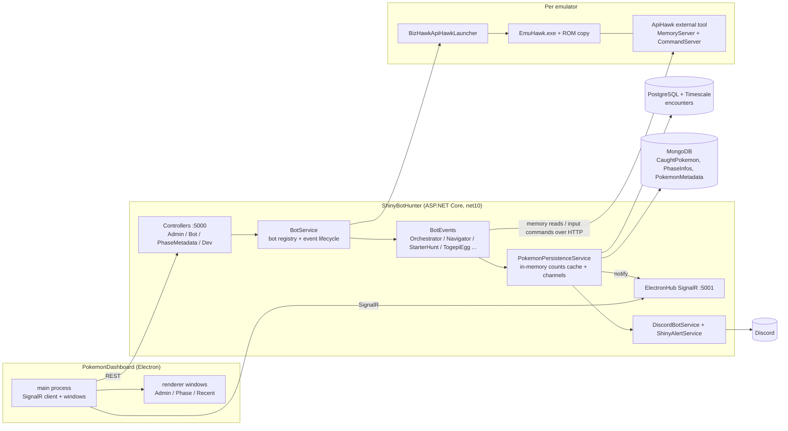
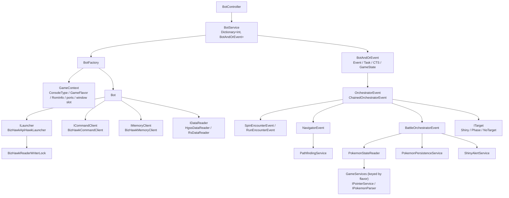

# System Architecture Overview

Status: Draft
Last updated: 2026-10-17
Related: [Engineering principles](../engineering-principles.md), [Code review 2026-10](../reviews/2026-10-code-review.md), [Improvement plan](../plans/2026-10-cleanup-and-hardening.md)

## 1. What the system does

ShinyBotHunter launches one or more BizHawk emulator instances running Pokemon ROMs, drives them with scripted inputs, reads game memory to detect encounters and shiny Pokemon, records every encounter, and shows live counts on a local Electron dashboard and in Discord. One operator, one Windows machine.

Supported games today, keyed by `GameFlavor`:

| Flavor | Console | Games | Memory/parsing |
|---|---|---|---|
| `HGSS` | DS | HeartGold, SoulSilver | `HgssPointerService`, `HgssPokemonParser` (Gen 4 encryption) |
| `RS` | GBA | Ruby, Sapphire | `RsPointerService`, `Gen3PokemonParser` |

## 2. Topology

Ports: REST on 5000 and SignalR on 5001, enforced per endpoint by `RouteExtensions.AsRequiredPort` (`Startup.cs:446`). Each emulator gets its own pair of ApiHawk ports chosen by the launcher.

## 3. Projects

| Project | Target | Role |
|---|---|---|
| `ShinyBotHunter/` | net10.0 web app | Everything server-side: API, bot engine, persistence, Discord. Single process. |
| `ShinyBotHunter.Tests/` | net10.0 xUnit | ~109 hermetic unit tests. |
| `ApiHawk/` | net48 | BizHawk external tool loaded into EmuHawk. Exposes memory reads and input commands over local HTTP. Builds against the custom BizHawk fork below, so it is outside the solution and CI; deployed by `Scripts/deploy-apihawk.ps1`. |
| BizHawk fork (external) | C# | `ppicinic/BizHawk`, branch `fix/4535-sticky-analog`, built as 2.11.2 with `Dist/BuildRelease.sh`. Not in this repo; see section 8. |
| `PokemonDashboard/` | Electron + React + TS | Operator UI. Multi-window (admin, phase cards, recent encounters). |
| `Lua Scripts/` | Lua | Legacy BizHawk integration, replaced by ApiHawk. Scheduled for deletion (plan 1.3). |

## 4. Backend startup and composition

`Startup.MainAsync` (`Startup.cs:38`) builds the host, registers everything in `CreateServices` (`:360`), then:

1. Starts Discord, the Lua loader (legacy), and the encounter DAO's background writer.
2. Loads metadata caches: Pokemon metadata (Mongo), phase definitions (`Phases/**/*.json` merged into Mongo), ROM inventory (hashes every file under `ROMBaseDirectory`).
3. Starts the persistence service's two channel consumers and the bot service.
4. Branches on CLI args: `--parsepokeapi`, `--parsepokemoveapi`, `--migrateinfluxv1tov2`, `--migrateinfluxtopostgresql`, `--generatemapdatahgss`, else runs the web host and blocks on `Console.ReadLine` until `end`.

Composition is plain `IServiceCollection` with almost everything a singleton. The one deliberate extension point is **keyed DI by `GameFlavor`** for `IPointerService`, `IPokemonParser` and `IBattlePokemonParser` (`Startup.cs:414-421`), resolved through `GameServices`. Adding a game flavor means adding those registrations plus macros and phase JSON.

Configuration is `appsettings.json` bound to `ApplicationSettings` plus user secrets for tokens and the connection string. Paths to ROMs, BizHawk and sprites are absolute `D:/` paths on the dev machine.

## 5. HTTP API surface

All under `/api` (`ApiControllerBase`). Consumers: the dashboard only.

| Controller | Endpoints | Backing service |
|---|---|---|
| `AdminController` | subscribe/unsubscribe a game phase for live updates; recent-encounter count; `metadata` (all phases per flavor + feature flags); `getAllGames`, `refreshGames` (ROM inventory) | `AdminService`, `PhaseInfoService`, `RomInfoService` |
| `BotController` | `getTopLevelActions` (from `Configs/SpecialEvents/SpecialEvents.json`), `startTopLevelAction` (launch a bot or a multi-emulator hunt), `bot/getDashboardState`, `bot/getBotActions/{pos}`, `bot/getParty/{pos}`, `bot/startAction/{pos}`, `bot/cancelAction` | `BotService` |
| `PhaseMetadataController` | `phaseinfo/{game}/{phase}[/{gameFileName}]` (phase definition + all counts), `updatePhaseInfo`, `phaseinfo/encounterRate/...` | `PhaseInfoService`, `PokemonPersistenceService`, `IEncounterDao` |
| `DevController` | location readout and macro recording; every route 404s unless `EnableMacroRecording` | `LocationService`, `MacroRecordingService` |

The action model is data-driven: `EventArgumentOptions` describes an action's required, optional and conditional parameters, and the dashboard renders forms from it (`BotService.cs:490-513`). This is a good pattern and worth keeping: new bot actions are a new entry in `actionMap` plus a branch in `ExecuteEvent`, with no dashboard code change.

**SignalR** (`ElectronHub`, `IElectronClient`): server pushes `ReceiveDashboardConfig`, `ReceiveDashboardState` (bot positions and states) and `RecieveEncounters` (counts for a subscribed `{game}_{phase}` group). Clients call `SubscribeToGamePhase`.

## 6. Data and persistence

### Stores

| Store | Data | Access |
|---|---|---|
| PostgreSQL + TimescaleDB | `encounters` hypertable, one row per encounter (species, PID, IVs, shiny flag, milestone, game file name, timestamp). Two EF migrations. | `PostgreSQLEncounterDao` via `IDbContextFactory<PokemonDbContext>` |
| MongoDB | `CaughtPokemon` (shinies actually caught), `PhaseInfos` (milestone definitions seeded from `Phases/*.json`), `PokemonMetadata` (species/forms scraped from PokeAPI) | Three DAOs/services with the raw driver |
| InfluxDB 3 | legacy encounter store, migration source only | `InfluxDbEncounterDao` (unregistered) |
| Files | ROMs and save copies under `ROMBaseDirectory`; macro YAML under `Macro/Configs/{flavor}/`; event configs under `Configs/Events/`; starter-hunt state JSON via `StarterHuntStateStore` | |

### Write path
Bot event detects an encounter and calls `PokemonPersistenceService.AddEncounterAsync`. That posts to an unbounded `Channel`; a single consumer loop updates the in-memory counts cache, forwards to the DAO's own channel (which batches into EF `SaveChanges`), then notifies SignalR groups and Discord. Catches follow the same shape through `MongoCaughtPokemonDao`.

This single-consumer channel design is the right one for this project and should be kept. Its weaknesses are supervision (a faulted loop is silent) and the cold-load path described next.

### Read path
Dashboard reads never hit the database directly; they read the counts cache. The cache is lazily filled per game, per phase, per form, per game file, each leaf by its own count query, serialised on one static semaphore. With no secondary indexes on `encounters`, this is the slow first load the owner sees. Details and the fix are in the [review](../reviews/2026-10-code-review.md#1-query-performance-slow-first-load-of-counts).

## 7. Bot execution engine

### Bot
`IBot` is `ILauncher + ICommandClient + IMemoryClient + IDataReader + GameFlavor`; `Bot` is pure delegation to those four parts. `BotFactory.BuildGameContext` identifies the ROM from its header (`RomInfoService`), derives the ApiHawk ports (`20000/20001 + 2 × position`) and window geometry, and `CreateBot` picks the launcher by `BizHawkMode` and the data reader by flavor.

`Bot.LaunchAsync`: start EmuHawk under a reader slot of `BizHawkReaderWriterLock`, wait for its window, fixed 5 s delay, connect both clients, verify the running game code. `DisposeAsync` takes the writer lock so a shutdown never overlaps a launch.

### Events
`IBotEvent.ExecuteAsync(GameState, CancellationToken)` is the whole contract. Two families:

- **Bot-driven events** are handed an existing bot. `OrchestratorEvent` is the top-level overworld state machine (`DecideOverworldAction → Encountering → BattleStart`), delegating to `SpinEncounterEvent`/`RunEncounterEvent` for finding encounters, `BattleOrchestratorEvent` for the fight (read foe, parse, persist, check target, fight/flee, level-up and evolution handling), and `NavigatorEvent` + `PathfindingService` for walking to a Pokemon Center. `ChainedOrchestratorEvent` runs a list of `EventLeg`s over one shared `GameState`. `HgssTogepiEggEvent` is a self-contained egg loop.
- **Self-managing hunts** launch and own their own emulators: `MultiStarterHuntEvent`/`StarterHuntEvent` for RS soft-reset starter hunting (wave-based, with persisted parked shinies in `StarterHuntStateStore`), `MultiShinyHunterEvent`/`HgssShinyStarterEvent` for HGSS (channel-based). They are two unrelated orchestrations behind one dashboard action.

`GameState` is the shared bag the events pass around: flavor, bot, milestone, target, train settings, tile penalties, and `State`, a `Stack<EventState>` (`Init`, `Running`, `Waiting`, `Resume`, `Complete` ...) that both the event loop and the dashboard read. `ITarget` decides whether an encounter parks the run (`Waiting`) for the operator to catch it; `Resume` re-enters and `CheckForCatchAsync` records the catch and flushes the save.

### Macros and memory
Inputs are macro strings authored as YAML under `Macro/Configs/{flavor}/`, expanded by `CommandPreprocessor` and cached by `MacroRegistry` (a static singleton loaded from the working directory). Memory reads go through `IMemoryClient`; the frame-coherent primitives (`ReadBytesViaPointerAsync`, `ReadValidatedPartyAsync`) push multi-hop reads and validation into ApiHawk so a party read is consistent within one frame. `PokemonStateReader` turns raw bytes into `PokemonState` via the flavor's `IPointerService` and `IPokemonParser`.

### Patterns worth keeping
- Keyed-by-flavor services and the late `GameServices` lookup with a test that every playable flavor has its parts.
- Frame-coherent reads and the typed `PartyReadUnavailableException` for "not yet" versus transport failure.
- `BattleReadiness` as the single definition of the flee threshold.
- `EventLeg` validated up front in `BotService.ValidateAndBuildLeg`, and event configs (`StarterHuntConfig`, `EggHuntConfig`) validated at construction so bad input fails the HTTP request with a 400.
- `MultiStarterHuntEvent`'s lock discipline and cleanup-on-any-exception.
- `EmulatorGrid` extracted as pure, tested arithmetic.

### Known weaknesses
Detailed in the [review](../reviews/2026-10-code-review.md): no synchronisation around `BotService.botEvents`; three god classes (`BattleOrchestratorEvent`, `StarterHuntEvent`, `BotService`); HGSS memory addresses defined in five places; dead duplicate events; a `IDataReader` that RS cannot implement.

## 8. ApiHawk and the emulator boundary

ApiHawk is a BizHawk "external tool" DLL (`BotServer`) loaded into each EmuHawk with `--open-ext-tool-dll=BotServer` (`BizHawkApiHawkLauncher.cs:84`). It replaces the older Lua scripts and gives the backend two loopback HTTP listeners per emulator, ports passed by environment variable (`BotServerTool.cs:102-103`):

| Server | Transport | Operations |
|---|---|---|
| `CommandServer` (even port) | plain-text POST | `/command` (`\|`-joined lines: hold/release buttons, push a macro string, clear), `/wait-macro` (10 s long-poll, "done"/"pending"), `/flush` (save SRAM), `/record/start\|stop\|status`, `/ping` |
| `MemoryServer` (odd port) | binary POST, 9-byte header `[cmd:1][addr:4][aux:4]` | `0x01` read range, `0x02` write byte, `0x03` pointer-chain read, `0x04` validated one-frame party read |

**Threading.** An accept thread hands each request to the thread pool, which enqueues it on a `ConcurrentQueue`; the BizHawk **frame thread** drains commands in `PreFrame` and memory requests in `PostFrame` (`BotServerTool.cs:65-78`). All emulator API calls happen on the frame thread; the handler blocks on a `ManualResetEventSlim` with a 5 s timeout. This is the right design for BizHawk and should be kept.

**Macro language.** A macro is `;`-separated frames, each `:`-separated ops with `.`-separated fields: `W.n` wait, `H.btn.n` hold, `R.btn` release, `S.x.y.f` touch, `M.btn.dest.addr[...]` move until a memory coordinate matches with a warp guard, `BTN.n`. Authored as YAML under `Macro/Configs/{flavor}/`, expanded by `CommandPreprocessor` and `MacroRegistry` on the backend, parsed again by `CommandServer.ParseFrameCommands` on the emulator side.

Backend clients: `BizHawkClientBase` (shared `HttpClient`, 10 linear-backoff retries), `BizHawkCommandClient` (60 s timeout), `BizHawkMemoryClient` (15 s). Launch and shutdown are serialised through `BizHawkReaderWriterLock`.

### The BizHawk fork
The emulator is not stock BizHawk. It is `ppicinic/BizHawk`, branch `fix/4535-sticky-analog`, built with `Dist/BuildRelease.sh` so the assemblies are stamped 2.11.2.0 (a bare `dotnet build` stamps 1.0.0.0 and `BotServer.dll` then fails to bind at runtime). The fork carries:

- the fix for `TASEmulators/BizHawk#4535`: sticky analog input was XOR-cancelled to neutral by mouse-bound axes, which broke NDS touch input through `joypad.setanalog`. Without it, every HGSS touch macro fails;
- SaveRAM named after the ROM file rather than a save slot, which is what lets the starter hunt run many ROM copies side by side (`BizHawkApiHawkLauncher.cs:92`).

Consequences: `ApiHawk/lib/` must hold the fork's `BizHawk.Client.Common.dll`, `BizHawk.Common.dll`, `BizHawk.Emulation.Common.dll` and `EmuHawk.exe` (gitignored; `ApiHawk/lib/.gitkeep` has the instructions); `ApplicationSettings.BizHawkBaseDirectory` must point at an install of that build; and the fork is kept to the minimum upstream lacks for the bot to work. It gets no QA or capture features; QA captures from outside the emulator (decided 2026-10-17).

> **OPEN:** is the fork's branch rebased on a tagged upstream release, and is there a written list of its commits beyond the two above? A short `FORK.md` in the fork, linked from here, would stop this knowledge living in one `.gitkeep`.

Risks found are in the [review](../reviews/2026-10-code-review.md#5-architecture-and-patterns).

## 9. Dashboard

Electron, one `BrowserWindow` per card (admin, recent encounters, one per subscribed game+phase), as laid out in `PokemonDashboard/docs/MULTI_WINDOW_EXECUTION_PLAN.md` (whose "no implementation yet" header is stale; it is implemented). Bounds persist to `window-layout.json` so windows can be placed for OBS capture.

- **SignalR** lives only in the main process (`src/main/signalRClient.ts`) and is fanned out to every window over IPC. Reconnect and resubscribe are handled with backoff.
- **REST** is called directly from each renderer with `fetch` against port 5000. That works only because windows run with `webSecurity: false` and `sandbox: false` (`windowManager.ts:135-136`), originally to load `file://` sprites; the backend has no CORS configuration.
- **State** is one `AppContext` per window holding config, connection state, subscriptions and recent encounters. `types/api.ts` hand-mirrors the C# response shapes.
- `AdminCard.tsx` (1802 lines) holds the dashboard config tab, the bot control tab, the phase editor and the shared schema-driven action form. The review proposes a split.

There is no backend-for-frontend layer and, per [principle 2.3](../engineering-principles.md), there should not be one. The only indirection worth adding is routing REST through the main process (one `window.api.fetch`), which would let `webSecurity` be turned back on. That is a security tidy-up, not a tier.

## 10. Cross-cutting

- **Logging:** `Console.WriteLine` throughout; no `ILogger`. Fine for a console-hosted tool, but faults in background loops are easy to miss.
- **Error handling:** controllers mostly let exceptions become 500s; `PhaseMetadataController` turns any exception into 404.
- **Config:** one `ApplicationSettings` class; several keys are legacy (Influx, Lua).
- **Testing:** hermetic unit tests, no emulator in the loop; see review section 3.

## 11. Extension axes

The project grows in two known directions. Each gets one seam; nothing else is generalised (principle 2.2).

### Axis 1: game flavors
`GameFlavor` is the key. Today the per-flavor parts are three keyed registrations (`IPointerService`, `IPokemonParser`, `IBattlePokemonParser`) resolved through `GameServices`. That is the right shape; the plan grows it into a **game profile**, one object per flavor that is the only place game knowledge lives:

| Part | Varies by | Today | Target |
|---|---|---|---|
| Memory addresses and pointer chains | game and ROM revision | `*PointerService`, plus copies in five other files; one address set regardless of revision | profile only, keyed by `(flavor, revision)` where a revision differs. Today's hunts run 1.1/1.2; other revisions are added when a hunt needs them |
| Party/box/foe parsing and shiny check | generation | `Gen3PokemonParser`, `HgssPokemonParser` | one parser per generation, registered for every flavor of that generation |
| Battle-state constants (`0x41/0x97/0xC0`, `GetBattleState() == 14`) | game | inline in five files | profile |
| Macro set | game | `Macro/Configs/{flavor}/` | unchanged |
| Phases | game | `Phases/{flavor}/` | unchanged |
| Capabilities (overworld pathfinding, soft-reset hunt, eggs, boxes readable) | game | implicit; `RsDataReader` throws `NotSupported` | declared flags on the profile; events check them before starting |
| Map and graph data | game | `Data/HGSS`, loaded by two singletons | per-flavor instances keyed like the rest |
| Console (window size, emulator budget, ROM extension, core) | console | `GameContext` + `ApplicationSettings` per `ConsoleType` | unchanged |

Different flavors supporting different things is expected and fine. The rule is that the difference is declared, not discovered by exception.

### Axis 2: event types
Today each event is a branch in `BotService.ExecuteEvent` or `ExecuteNewBotOrSpecialEvent`, plus an entry in a static action map, plus a name in `SpecialEvents.json`. The target is an **event registry**: each event type declares its name, its parameter schema (`EventArgumentOptions`, already data-driven), which flavors or capabilities it needs, whether it owns its own emulators, and a factory. `BotService` looks the event up, checks the flavor's capabilities, builds it and runs it. The dashboard's action list is the registry filtered by the selected bot's flavor.

The two hunt orchestrations (`MultiStarterHuntEvent` for RS, `MultiShinyHunterEvent` for HGSS) stay separate implementations behind one registry entry until a third game shows what they share.

## Changelog
- 2026-10-17: first draft; extension axes added after review discussion.
