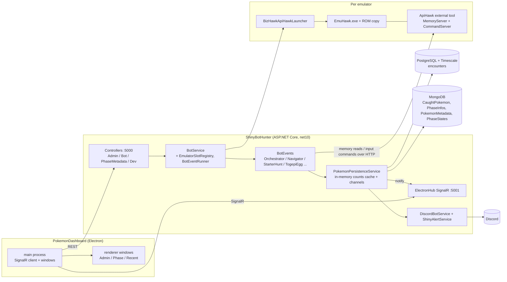
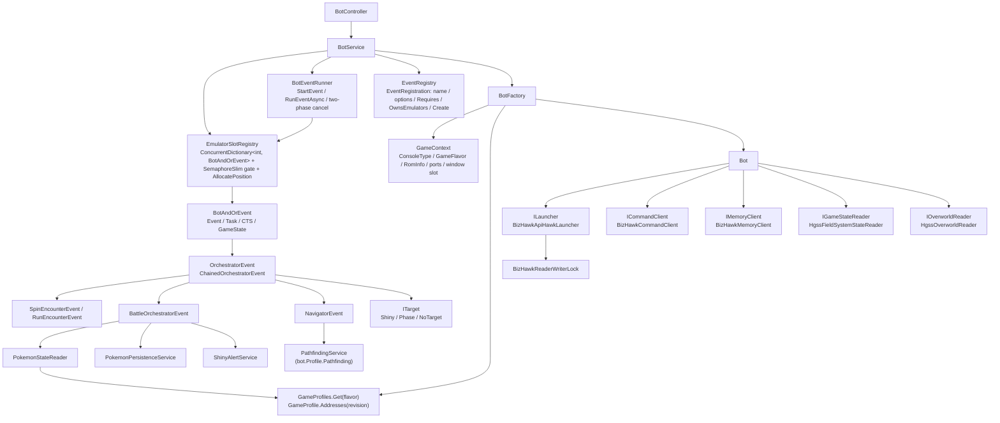

# System Architecture Overview

Status: Draft
Last updated: 2026-10-17
Related: [Engineering principles](../engineering-principles.md), [Code review 2026-10](../reviews/2026-10-code-review.md), [Improvement plan](../plans/2026-10-cleanup-and-hardening.md)

## 1. What the system does

ShinyBotHunter launches one or more BizHawk emulator instances running Pokemon ROMs, drives them with scripted inputs, reads game memory to detect encounters and shiny Pokemon, records every encounter, and shows live counts on a local Electron dashboard and in Discord. One operator, one Windows machine.

Supported games today, keyed by `GameFlavor`:

| Flavor | Console | Games | Memory/parsing |
|---|---|---|---|
| `HGSS` | DS | HeartGold, SoulSilver | `HgssPointerService`, `HgssPokemonParser` (Gen 4 encryption) |
| `RS` | GBA | Ruby, Sapphire | `RsPointerService`, `Gen3PokemonParser` |

## 2. Topology

Ports: REST on 5000 and SignalR on 5001, enforced per endpoint by `RouteExtensions.AsRequiredPort` (`Startup.cs:446`). Each emulator gets its own pair of ApiHawk ports chosen by the launcher.

## 3. Projects

| Project | Target | Role |
|---|---|---|
| `ShinyBotHunter/` | net10.0 web app | Everything server-side: API, bot engine, persistence, Discord. Single process. |
| `ShinyBotHunter.Tests/` | net10.0 xUnit | ~109 hermetic unit tests. |
| `ApiHawk/` | net48 | BizHawk external tool loaded into EmuHawk. Exposes memory reads and input commands over local HTTP. Builds against the custom BizHawk fork below, so it is outside the solution and CI; deployed by `Scripts/deploy-apihawk.ps1`. |
| BizHawk fork (external) | C# | `ppicinic/BizHawk`, branch `fix/4535-sticky-analog`, built as 2.11.2 with `Dist/BuildRelease.sh`. Not in this repo; see section 8. |
| `PokemonDashboard/` | Electron + React + TS | Operator UI. Multi-window (admin, phase cards, recent encounters). |

## 4. Backend startup and composition

`Startup.MainAsync` builds the host, registers everything in `CreateServices`, then:

1. Starts Discord and the encounter DAO's background writer.
2. Loads metadata caches: Pokemon metadata (Mongo), phase definitions (`Phases/**/*.json` merged into Mongo), ROM inventory (hashes every file under `ROMBaseDirectory`).
3. Starts the persistence service's two channel consumers and the bot service.
4. Setup commands (`--parsepokeapi`, `--generatemapdatahgss <romDataDir> <decompDir> <headerCsv> <outputDir>`) run from `Tools/SetupCommands.cs` before the host is built; otherwise runs the web host and blocks on `Console.ReadLine` until `end`.

Composition is plain `IServiceCollection` with almost everything a singleton. The one deliberate extension point is the **game profile**: `Startup` registers one `GameProfiles` singleton built from `HgssProfile.Create` and `RsProfile.Create`, and every per-flavor part (address table, parsers, capabilities, map data, readers) is reached through `bot.Profile`. The HGSS profile loads `Data/HGSS` when `GameProfiles` is first resolved. Adding a game flavor means one `Create` method composing its parts, plus macros and phase JSON (section 11).

Configuration is `appsettings.json` bound to `ApplicationSettings` plus user secrets for tokens and the connection string. Paths to ROMs, BizHawk and sprites are absolute `D:/` paths on the dev machine.

## 5. HTTP API surface

All under `/api` (`ApiControllerBase`). Consumers: the dashboard only.

| Controller | Endpoints | Backing service |
|---|---|---|
| `AdminController` | subscribe/unsubscribe a game phase for live updates; recent-encounter count; `metadata` (all phases per flavor + feature flags); `getAllGames`, `refreshGames` (ROM inventory) | `AdminService`, `PhaseInfoService`, `RomInfoService` |
| `BotController` | `getTopLevelActions` (the `OwnsEmulators` entries of `EventRegistry`, minus the by-name-only HGSS hunt), `startTopLevelAction` (launch a bot or a multi-emulator hunt), `bot/getDashboardState`, `bot/getBotActions/{pos}`, `bot/getParty/{pos}`, `bot/startAction/{pos}`, `bot/cancelAction` | `BotService` |
| `PhaseMetadataController` | `phaseinfo/{game}/{phase}[/{gameFileName}]` (phase definition + all counts), `updatePhaseInfo`, `phaseinfo/encounterRate/...` | `PhaseInfoService`, `PokemonPersistenceService`, `IEncounterDao` |
| `DevController` | location readout and macro recording; every route 404s unless `EnableMacroRecording` | `LocationService`, `MacroRecordingService` |

The action model is data-driven: `EventArgumentOptions` describes an action's required, optional and conditional parameters, and the dashboard renders forms from it. Every action is one `EventRegistration` in `Games/EventRegistry.cs` (name, options, required capability, owns-emulators flag, and the `BotService` method that starts it), so a new bot action is one registry entry plus one method, with no dashboard code change. Both start routes map `ArgumentException`, `InvalidOperationException` and `FileNotFoundException` to a plain-text 400.

**SignalR** (`ElectronHub`, `IElectronClient`): server pushes `ReceiveDashboardConfig`, `ReceiveDashboardState` (bot positions and states) and `RecieveEncounters` (counts for a subscribed `{game}_{phase}` group). Clients call `SubscribeToGamePhase`.

## 6. Data and persistence

### Stores

| Store | Data | Access |
|---|---|---|
| PostgreSQL + TimescaleDB | `encounters` hypertable, one row per encounter (species, PID, IVs, shiny flag, milestone, game file name, timestamp). Three EF migrations. | `PostgreSQLEncounterDao` via `IDbContextFactory<PokemonDbContext>` |
| MongoDB | `CaughtPokemon` (shinies actually caught), `PhaseInfos` (milestone definitions seeded from `Phases/*.json`), `PokemonMetadata` (species/forms scraped from PokeAPI), `PhaseStates` (HGSS and RS hunt state, incl. `StarterHuntStateStore`) | Three DAOs/services with the raw driver, `StarterHuntStateStore`, and `MultiShinyHunterEvent` reading `PhaseStates` directly |
| Files | ROMs and save copies under `ROMBaseDirectory`; macro YAML under `Macro/Configs/{flavor}/`; event configs under `Configs/Events/` | |

### Write path
Bot event detects an encounter and calls `PokemonPersistenceService.AddEncounterAsync`. That posts to an unbounded `Channel`; a single consumer loop updates the in-memory counts cache, forwards to the DAO's own channel (which batches into EF `SaveChanges`), then notifies SignalR groups and Discord. Catches follow the same shape through `MongoCaughtPokemonDao`.

This single-consumer channel design is the right one for this project and should be kept. The three loops are supervised by `BackgroundLoop.RunSupervisedAsync` (a fault is logged and the loop restarts), and the cold load is the grouped build described next.

### Read path
Dashboard reads never hit the database directly; they read the counts cache. A game's cache is loaded whole on first use, under that game's own lock: three Postgres queries (grouped counts, since-last-shiny progress, latest 20) and the caught list from Mongo, from which `PokemonPersistenceService.BuildGameCache` builds the tree in memory. A requested key with no rows gets a zero node for increments to land on. Design in the [count queries spec](../specs/count-queries.md); background in the [review](../reviews/2026-10-code-review.md#1-query-performance-slow-first-load-of-counts).

## 7. Bot execution engine

### Bot
`IBot` is `ILauncher + ICommandClient + IMemoryClient` plus the bot's game: `Profile` (its `GameProfile`), `Addresses` (the launched revision's `IPointerService`), `State` (`IGameStateReader`, which says where the game is) and `Overworld` (`IOverworldReader`: map id, position, facing). `Bot` is pure delegation. `BotFactory.BuildGameContext` identifies the ROM from its header (`RomInfoService`), derives the ApiHawk ports (`20000/20001 + 2 × position`) and window geometry; `CreateBot` resolves the profile from `GameProfiles` and the address table from the ROM revision (a revision with no table refuses the launch, FR-3 of the profile spec), then builds the ApiHawk launcher, the clients and the two readers from the profile's factory delegates. A flavor without a reader has none; `State` and `Overworld` throw `InvalidOperationException` naming the flavor, and the capability flags keep such a bot off the events that would ask.

`BizHawkApiHawkLauncher.LaunchAsync` (through `Bot.LaunchAsync`): start EmuHawk under a reader slot of `BizHawkReaderWriterLock`, wait for its window, fixed 5 s delay, connect both clients, verify the running game code. `DisposeAsync` takes the writer lock so a shutdown never overlaps a launch.

### Events
`IBotEvent.ExecuteAsync(GameState, CancellationToken)` is the whole contract. Two families:

- **Bot-driven events** are handed an existing bot. `OrchestratorEvent` is the top-level overworld state machine (`DecideOverworldAction → Encountering → BattleStart`), delegating to `SpinEncounterEvent`/`RunEncounterEvent` for finding encounters, `BattleOrchestratorEvent` for the fight (read foe, parse, persist, check target, fight/flee) with `LevelUpFlow` for level-up, move learning and evolution, and `NavigatorEvent` + `PathfindingService` for walking to a Pokemon Center. `ChainedOrchestratorEvent` runs a list of `EventLeg`s over one shared `GameState`. `HgssTogepiEggEvent` is a self-contained egg loop.
- **Self-managing hunts** launch and own their own emulators: `MultiStarterHuntEvent`/`StarterHuntEvent` for RS soft-reset starter hunting (wave-based; progress, created saves and retired copies kept in Mongo via `StarterHuntStateStore`; parked shinies are dropped on restart), `MultiShinyHunterEvent`/`HgssShinyStarterEvent` for HGSS (channel-based). They are two unrelated orchestrations behind one dashboard action.

`GameState` is the shared bag the events pass around: the profile (set where `BotService` constructs the state; `GameFlavor` derives from it, with no default), bot, milestone, target, train settings, tile penalties, and `State`, a `Stack<EventState>` (`Init`, `Running`, `Waiting`, `Resume`, `Complete` ...) that both the event loop and the dashboard read. `ITarget` decides whether an encounter parks the run (`Waiting`) for the operator to catch it; `Resume` re-enters and `CheckForCatchAsync` records the catch and flushes the save.

### Macros and memory
Inputs are macro strings authored as YAML under `Macro/Configs/{flavor}/`, expanded by `CommandPreprocessor` and cached by `MacroRegistry` (a static singleton loaded from the working directory). Memory reads go through `IMemoryClient`; the frame-coherent primitives (`ReadBytesViaPointerAsync`, `ReadValidatedPartyAsync`, `ReadChainBlocksAsync`) push multi-hop reads and validation into ApiHawk so a party read or a game-state snapshot is consistent within one frame. `PokemonStateReader` turns raw bytes into `PokemonState` via the bot's `Addresses` and its profile's `Parser` and `BattleParser`; the box read checks `CanReadBoxes` first. Every HGSS address and struct offset is a commented member of `HgssPointerService` (decomp symbol where known, root or offset, the QA scenario that exercises it); the three battle magic values live only in `HgssLegacyStateReader`. The rule for any new read: add the member with that comment and read it through `bot.Addresses`; `grep -rnE "0x0?2[0-9A-F]{6}\b" ShinyBotHunter --include=*.cs` must match only the two pointer services, `RomInfoService` and `Gen3SaveFile`.

### Patterns worth keeping
- The game profile as the one composition point per flavor, with `GameProfileTests` asserting both real profiles are consistent and `ServiceRegistrationTests` that every playable flavor has one.
- Frame-coherent reads and the typed `PartyReadUnavailableException` for "not yet" versus transport failure.
- `BattleReadiness` as the single definition of the flee threshold.
- `EventLeg` validated up front in `BotService.ValidateAndBuildLeg`, and event configs (`StarterHuntConfig`, `EggHuntConfig`) validated at construction so bad input fails the HTTP request with a 400.
- `MultiStarterHuntEvent`'s lock discipline and cleanup-on-any-exception.
- `EmulatorGrid` extracted as pure, tested arithmetic.

### Known weaknesses
Detailed in the [review](../reviews/2026-10-code-review.md): the three god classes were split in October 2026 (`BotService` into `EmulatorSlotRegistry`, `BotEventRunner` and `BotDtos.cs`; `LevelUpFlow` out of `BattleOrchestratorEvent`; `StarterSaveFiles` out of `StarterHuntEvent`), and the game profile epic (#118) replaced the if/else dispatch with `EventRegistry`, moved every HGSS address into `HgssPointerService` and deleted `IDataReader`. The [HGSS state reader spec](../specs/hgss-state-reader.md) then replaced the three heap-coincidence battle bytes with `HgssFieldSystemStateReader`, which walks the verified `sFieldSysPtr` chain in one frame through ApiHawk opcode `0x05` (rows S0 to S2a, merged 2026-10-23); its remaining rows (S2b to S4) bound every wait loop and replace the heal and poison macros with the script-chain press loop. The dead duplicate events and the unsynchronised registry were removed in the October 2026 cleanup.

## 8. ApiHawk and the emulator boundary

ApiHawk is a BizHawk "external tool" DLL (`BotServer`) loaded into each EmuHawk with `--open-ext-tool-dll=BotServer` (`BizHawkApiHawkLauncher.cs`). It gives the backend two loopback HTTP listeners per emulator, ports passed by environment variable (`BotServerTool.cs:102-103`):

| Server | Transport | Operations |
|---|---|---|
| `CommandServer` (even port) | plain-text POST | `/command` (`\|`-joined lines: hold/release buttons, push a macro string, clear), `/wait-macro` (10 s long-poll, "done"/"pending"), `/flush` (save SRAM), `/record/start\|stop\|status`, `/ping` |
| `MemoryServer` (odd port) | binary POST, 9-byte header `[cmd:1][addr:4][aux:4]` | `0x01` read range, `0x02` write byte, `0x03` pointer-chain read, `0x04` validated one-frame party read, `0x05` multi-block chain read (up to 16 pointer chains, every block from the same frame, a status per block instead of a 502, optional per-frame retry) |

**Threading.** An accept thread hands each request to the thread pool, which enqueues it on a `ConcurrentQueue`; the BizHawk **frame thread** drains commands in `PreFrame` and memory requests in `PostFrame` (`BotServerTool.cs:65-78`). All emulator API calls happen on the frame thread; the handler blocks on a `ManualResetEventSlim` with a 5 s timeout. This is the right design for BizHawk and should be kept.

**Macro language.** A macro is `;`-separated frames, each `:`-separated ops with `.`-separated fields: `W.n` wait, `H.btn.n` hold, `R.btn` release, `S.x.y.f` touch, `M.btn.dest.addr[...]` move until a memory coordinate matches with a warp guard, `BTN.n`. Authored as YAML under `Macro/Configs/{flavor}/`, expanded by `CommandPreprocessor` and `MacroRegistry` on the backend, parsed again by `CommandServer.ParseFrameCommands` on the emulator side.

Backend clients: `BizHawkClientBase` (shared `HttpClient`, 10 linear-backoff retries), `BizHawkCommandClient` (60 s timeout), `BizHawkMemoryClient` (15 s). Launches run concurrently under reader slots of `BizHawkReaderWriterLock`; a shutdown takes the writer lock so it never overlaps a launch.

### The BizHawk fork
The emulator is not stock BizHawk. It is `ppicinic/BizHawk`, branch `fix/4535-sticky-analog`, built with `Dist/BuildRelease.sh` so the assemblies are stamped 2.11.2.0 (a bare `dotnet build` stamps 1.0.0.0 and `BotServer.dll` then fails to bind at runtime). The fork carries:

- the fix for `TASEmulators/BizHawk#4535`: sticky analog input was XOR-cancelled to neutral by mouse-bound axes, which broke NDS touch input through `joypad.setanalog`. Without it, every HGSS touch macro fails;
- SaveRAM named after the ROM file rather than a save slot, which is what lets the starter hunt run many ROM copies side by side (`BizHawkApiHawkLauncher.cs:92`).

Consequences: `ApiHawk/lib/` must hold the fork's `BizHawk.Client.Common.dll`, `BizHawk.Common.dll`, `BizHawk.Emulation.Common.dll` and `EmuHawk.exe` (gitignored; `ApiHawk/lib/.gitkeep` has the instructions); `ApplicationSettings.BizHawkBaseDirectory` must point at an install of that build; and the fork is kept to the minimum upstream lacks for the bot to work. It gets no QA or capture features; QA captures from outside the emulator (decided 2026-10-17).

> **OPEN:** is the fork's branch rebased on a tagged upstream release, and is there a written list of its commits beyond the two above? A short `FORK.md` in the fork, linked from here, would stop this knowledge living in one `.gitkeep`.

Risks found are in the [review](../reviews/2026-10-code-review.md#5-architecture-and-patterns).

## 9. Dashboard

Electron, one `BrowserWindow` per card (admin, recent encounters, one per subscribed game+phase), as laid out in `PokemonDashboard/docs/MULTI_WINDOW_EXECUTION_PLAN.md`. Bounds persist to `window-layout.json` so windows can be placed for OBS capture.

- **SignalR** lives only in the main process (`src/main/signalRClient.ts`) and is fanned out to every window over IPC. Reconnect and resubscribe are handled with backoff.
- **REST** goes through the main process. Every renderer request is a function in `services/apiClient.ts`, which calls `window.api.request` (the `api-request` IPC channel); main forwards it with `net.fetch` only when the URL's origin is the configured `apiUrl` and returns the status and body. Windows run with the Electron defaults (`webSecurity` and `sandbox` on); sprites come from the `sprite://` scheme served by main. The backend has no CORS configuration and needs none.
- **State** is one `AppContext` per window holding config, connection state, subscriptions and recent encounters. `types/api.ts` hand-mirrors the C# response shapes.
- `AdminCard.tsx` (1802 lines) holds the dashboard config tab, the bot control tab, the phase editor and the shared schema-driven action form. The review proposes a split.

There is no backend-for-frontend layer and, per [principle 2.3](../engineering-principles.md), there should not be one. Routing REST through the main process (one `window.api.request`) is the only indirection, and it exists so `webSecurity` and `sandbox` can stay on. That is a security measure, not a tier.

## 10. Cross-cutting

- **Logging:** `Console.WriteLine` for most output, `ILogger` for the three supervised background loops (`BackgroundLoop.RunSupervisedAsync`), which log a fault with the full exception and restart. Fine for a console-hosted tool.
- **Error handling:** controllers mostly let exceptions become 500s; `PhaseMetadataController` turns any exception into 404.
- **Config:** one `ApplicationSettings` class.
- **Testing:** hermetic unit tests, no emulator in the loop; see review section 3.

## 11. Extension axes

The project grows in two known directions. Each gets one seam; nothing else is generalised (principle 2.2).

### Axis 1: game flavors
`GameFlavor` is the key. Each flavor has one **game profile** (`Games/GameProfile.cs`, designed in the [game profile spec](../specs/game-profile.md) and implemented under epic #118): a sealed record that names the flavor's parts and does no work beyond one constructor assertion that every declared capability has its part present. `GameProfiles.Get(flavor)` hands it out; `HgssProfile.Create` and `RsProfile.Create` (`Games/Hgss/`, `Games/Rs/`) are the two composition methods. The parts keep one job each:

| Part | Varies by | Type | Where |
|---|---|---|---|
| Memory addresses and struct offsets | game and ROM revision | `IPointerService` (shared party, box and battle-mirror members, `BoxLayout?`), with the flavor-only members on `HgssPointerService` / `RsPointerService` | `profile.Addresses(revision)`: HGSS has revision 0, RS revisions 1 and 2; any other revision refuses the launch. Every member carries its decomp symbol, root-or-offset kind and QA scenario |
| Party/box/foe parsing and shiny check | generation | `IPokemonParser`, `IBattlePokemonParser` | `profile.Parser`, `profile.BattleParser` (null for RS) |
| Where the game is (field free, field task, the battle screens, evolution) | game | `IGameStateReader`; `HgssFieldSystemStateReader` walks the `sFieldSysPtr` chain in one opcode `0x05` request ([state reader spec](../specs/hgss-state-reader.md)) | `profile.CreateStateReader`, exposed as `bot.State`; RS has none |
| Map id, position, facing | game | `IOverworldReader`; `HgssOverworldReader` | `profile.CreateOverworldReader`, exposed as `bot.Overworld`; RS has none |
| Capabilities | game | `GameCapabilities`: `HasOverworldNavigation`, `HasWildEncounters`, `HasEggs`, `CanReadBoxes`, `HasSoftResetStarterHunt`, `HasShinyStarterHunt` | `profile.Capabilities`; HGSS declares all but the soft-reset hunt, RS only the soft-reset hunt. `BotService` refuses an action the bot's flavor lacks with a 400 and the dashboard never lists it |
| Map and graph data | game | `MapService`, `GraphService`, `PathfindingService` instances | `profile.Maps`, `.Graph`, `.Pathfinding`, loaded from `HgssProfile.DataDirectory`; null for RS |
| Macro set | game | YAML | `Macro/Configs/{flavor}/`, unchanged |
| Phases | game | JSON | `Phases/{flavor}/`, unchanged |
| Console (window size, emulator budget, ROM extension, core) | console | `GameContext` + `ApplicationSettings` per `ConsoleType` | unchanged |

Different flavors supporting different things is expected and fine. The rule is that the difference is declared in `GameCapabilities`, not discovered by exception: no reader stub throws `NotSupportedException` any more.

### Axis 2: event types
Each event type is one `EventRegistration` in the static list `EventRegistry.All` (`Games/EventRegistry.cs`): its name, its parameter schema (`EventArgumentOptions`, which the dashboard renders), the capability it requires (with the name, so the refusal can say which), whether it owns its own emulators, and `Create`, a delegate onto the internal `BotService` method that starts it. The eight entries are `Launch Bot`, `Launch Bot + Continue`, `Shiny Starter Hunt` (RS; its `Mode` also routes to the HGSS hunt), `HGSS Shiny Starter Hunt` (by name only), `Wild Encounter`, `Chained Encounter`, `HGSS Togepi Egg` and `Resume`. `BotService` looks the entry up (an unknown name is a 400), checks `Requires` against the bot's profile, checks the bot's state as before, and calls `Create`; `GetAvailableActions` is the list filtered by state and then by `Requires`, and `GetTopLevelOptions` is the owns-emulators entries the dashboard shows. `SpecialEvents.json` and the action map are gone. The registry names `BotService` because the start methods do slot, state and runner wiring that only `BotService` owns; the spec's sketch of a factory returning an event did not fit three of the eight entries, which build no event (decided 2026-10-22, see the plan's implementation notes).

The two hunt orchestrations (`MultiStarterHuntEvent` for RS, `MultiShinyHunterEvent` for HGSS) stay separate implementations behind one registry entry until a third game shows what they share.

## Changelog
- 2026-10-17: first draft; extension axes added after review discussion.
- 2026-10-21: section 7 updated for the BotService split (row 5.1).
- 2026-10-22: sections 4, 5, 7 and 11 updated for the game profile, the readers and the event registry (epic #118).
