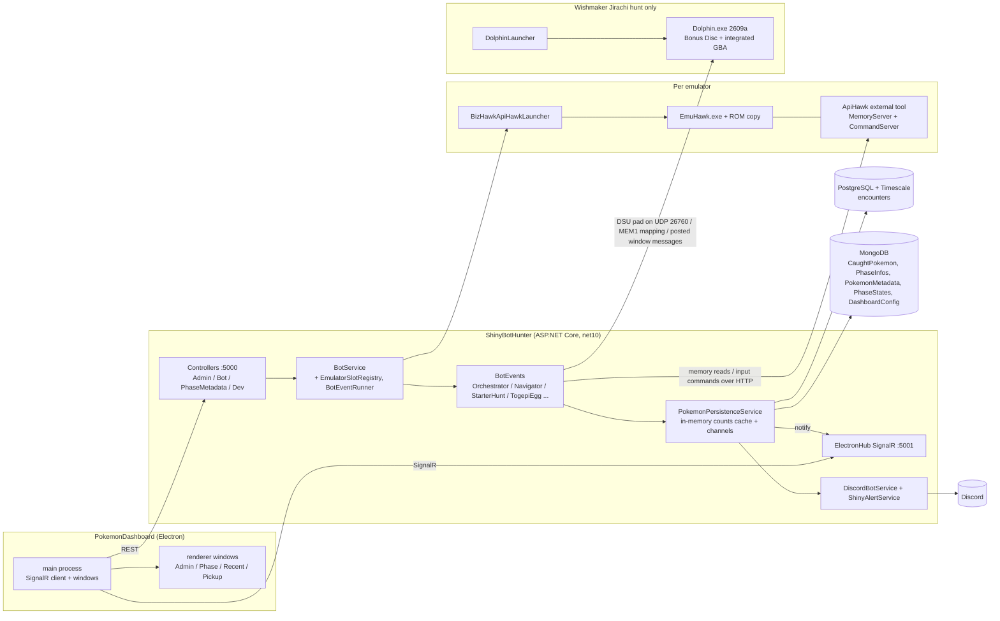
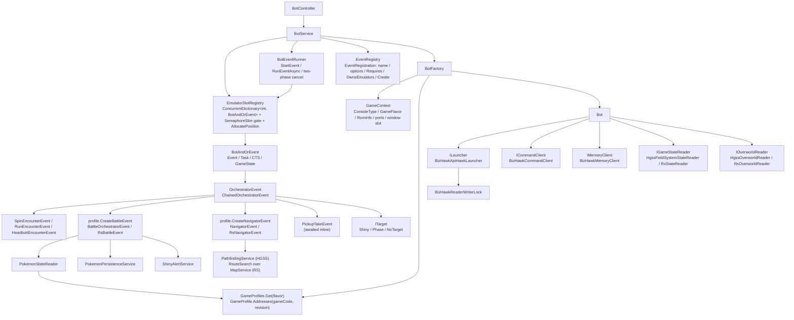

# System Architecture Overview

Status: Draft
Last updated: 2026-11-17
Related: [Engineering principles](../engineering-principles.md), [Code review 2026-10](../reviews/2026-10-code-review.md), [Improvement plan](../plans/2026-10-cleanup-and-hardening.md)

## 1. What the system does

ShinyBotHunter launches one or more BizHawk emulator instances running Pokemon ROMs, drives them with scripted inputs, reads game memory to detect encounters and shiny Pokemon, records every encounter, and shows live counts on a local Electron dashboard and in Discord. One operator, one Windows machine.

Supported games today, keyed by `GameFlavor`:

| Flavor | Console | Games | Memory/parsing |
|---|---|---|---|
| `HGSS` | DS | HeartGold, SoulSilver | `HgssPointerService`, `HgssPokemonParser` (Gen 4 encryption) |
| `RS` | GBA | Ruby, Sapphire | `RsPointerService`, `Gen3PokemonParser` |

## 2. Topology

Ports: REST on 5000 and SignalR on 5001, enforced per endpoint by `RouteExtensions.AsRequiredPort` (`Startup.cs:446`). Each emulator gets its own pair of ApiHawk ports chosen by the launcher; the Jirachi hunt's virtual pad listens on UDP 26760 (`DsuPort`).

## 3. Projects

| Project | Target | Role |
|---|---|---|
| `ShinyBotHunter/` | net10.0 web app | Everything server-side: API, bot engine, persistence, Discord. Single process. |
| `ShinyBotHunter.Tests/` | net10.0 xUnit | ~109 hermetic unit tests. |
| `ApiHawk/` | net48 | BizHawk external tool loaded into EmuHawk. Exposes memory reads and input commands over local HTTP. Builds against the custom BizHawk fork below, so it is outside the solution and CI; deployed by `Scripts/deploy-apihawk.ps1`. |
| BizHawk fork (external) | C# | `ppicinic/BizHawk`, branch `fix/4535-sticky-analog`, built as 2.11.2 with `Dist/BuildRelease.sh`. Not in this repo; see section 8. |
| `Dolphin/`, `Scripts/deploy-dolphin.ps1` | ini files | Dolphin config as files, installed by the script into `{DolphinBaseDirectory}\User-ShinyBotHunter`, the user folder the bot launches Dolphin with (`-u`). |
| Dolphin 2609a (external) | C++ | Mainline Dolphin, no fork, used only by the Wishmaker Jirachi hunt; see section 8. |
| `PokemonDashboard/` | Electron + React + TS | Operator UI. Multi-window (admin, phase cards, recent encounters, and one Pickup items window per game while its switch is on). |

## 4. Backend startup and composition

`Startup.MainAsync` builds the host, registers everything in `CreateServices`, then:

1. Starts Discord and the encounter DAO's background writer.
2. Loads metadata caches: Pokemon metadata (Mongo), phase definitions (`Phases/**/*.json` merged into Mongo), ROM inventory (hashes every file under `ROMBaseDirectory`).
3. Starts the persistence service's two channel consumers and the bot service.
4. Setup commands (`--parsepokeapi`, which also fetches the animated sprites (the `Animated` folder; `ffmpeg` on the PATH is optional, for 11 forms) and the item sprites, `--parseitemsprites` for the item sprites alone, `--generatemapdatahgss <romDataDir> <decompDir> <headerCsv> <outputDir>`, `--generatemapdatars <pokerubyDir> <outputDir>`, which writes `Data/RS` from a `pret/pokeruby` checkout) run from `Tools/SetupCommands.cs` before the host is built; otherwise runs the web host and blocks on `Console.ReadLine` until `end`.

Composition is plain `IServiceCollection` with almost everything a singleton. The one deliberate extension point is the **game profile**: `Startup` registers one `GameProfiles` singleton built from `HgssProfile.Create` and `RsProfile.Create`, and every per-flavor part (address table, parsers, capabilities, map data, readers) is reached through `bot.Profile`. The HGSS profile loads `Data/HGSS` when `GameProfiles` is first resolved. Adding a game flavor means one `Create` method composing its parts, plus macros and phase JSON (section 11).

Configuration is `appsettings.json` bound to `ApplicationSettings` plus user secrets for tokens and the connection string. Paths to ROMs, BizHawk and sprites are absolute `D:/` paths on the dev machine.

## 5. HTTP API surface

All under `/api` (`ApiControllerBase`). Consumers: the dashboard only.

| Controller | Endpoints | Backing service |
|---|---|---|
| `AdminController` | subscribe/unsubscribe a game phase for live updates; recent-encounter count; `admin/appearance` (the whole theme choice, pushed to every dashboard); `metadata` (all phases per flavor + feature flags); `getAllGames`, `refreshGames` (ROM inventory) | `AdminService`, `PhaseInfoService`, `RomInfoService` |
| `BotController` | `getTopLevelActions` (the `OwnsEmulators` entries of `EventRegistry`, minus the by-name-only HGSS hunt), `startTopLevelAction` (launch a bot or a multi-emulator hunt), `bot/getDashboardState`, `bot/getBotActions/{pos}`, `bot/getParty/{pos}`, `bot/startAction/{pos}`, `bot/cancelAction`, `bot/getPickupItems` (the in-memory Pickup tally, `PickupTally`) | `BotService`, `PickupTally` |
| `PhaseMetadataController` | `phaseinfo/{game}/{phase}[/{gameFileName}]` (phase definition + all counts), `updatePhaseInfo`, `phaseinfo/encounterRate/...` | `PhaseInfoService`, `PokemonPersistenceService`, `IEncounterDao` |
| `DevController` | location readout and macro recording; every route 404s unless `EnableMacroRecording` | `LocationService`, `MacroRecordingService` |

The action model is data-driven: `EventArgumentOptions` describes an action's required, optional and conditional parameters, and the dashboard renders forms from it. Every action is one `EventRegistration` in `Games/EventRegistry.cs` (name, options, required capability, owns-emulators flag, and the `BotService` method that starts it), so a new bot action is one registry entry plus one method, with no dashboard code change. Both start routes map `ArgumentException`, `InvalidOperationException` and `FileNotFoundException` to a plain-text 400.

**SignalR** (`ElectronHub`, `IElectronClient`): server pushes `ReceiveDashboardConfig` (subscriptions, recent count and `appearance`; `AdminService` saves the whole of it as one MongoDB document on every change and loads it at start, so it survives a backend restart; each dashboard window picks its own theme from it), `ReceiveDashboardState` (bot positions, states and a wild hunt's speed lines, `EmulatorState.SpeedLines`) `RecieveEncounters` (counts for a subscribed `{game}_{phase}` group) and `ReceivePickupItems` (one game's Pickup tally after each take, from `PickupTally`; memory only, gone on a backend restart). Clients call `SubscribeToGamePhase`.

## 6. Data and persistence

### Stores

| Store | Data | Access |
|---|---|---|
| PostgreSQL + TimescaleDB | `encounters` hypertable, one row per encounter (species, PID, IVs, shiny flag, milestone, game file name, timestamp). Three EF migrations. | `PostgreSQLEncounterDao` via `IDbContextFactory<PokemonDbContext>` |
| MongoDB | `CaughtPokemon` (shinies actually caught), `PhaseInfos` (milestone definitions seeded from `Phases/*.json`), `PokemonMetadata` (species/forms scraped from PokeAPI), `PhaseStates` (HGSS and RS hunt state, incl. `StarterHuntStateStore`), `DashboardConfig` (one document, `_id` `dashboard`: the saved dashboard config) | Three DAOs/services with the raw driver, `StarterHuntStateStore`, and `MultiShinyHunterEvent` reading `PhaseStates` directly |
| Files | ROMs and save copies under `ROMBaseDirectory`; macro YAML under `Macro/Configs/{flavor}/`; event configs under `Configs/Events/` | |

### Write path
Bot event detects an encounter and calls `PokemonPersistenceService.AddEncounterAsync`. That posts to an unbounded `Channel`; a single consumer loop updates the in-memory counts cache, forwards to the DAO's own channel (which batches into EF `SaveChanges`), then notifies SignalR groups and Discord. Catches follow the same shape through `MongoCaughtPokemonDao`.

This single-consumer channel design is the right one for this project and should be kept. The three loops are supervised by `BackgroundLoop.RunSupervisedAsync` (a fault is logged and the loop restarts), and the cold load is the grouped build described next.

### Read path
Dashboard reads never hit the database directly; they read the counts cache. A game's cache is loaded whole on first use, under that game's own lock: two Postgres queries (grouped counts, since-last-shiny progress) and the caught list from Mongo, from which `PokemonPersistenceService.BuildGameCache` builds the tree in memory. The recent-encounters list starts empty and fills only from encounters this bot records, capped at 20. A requested key with no rows gets a zero node for increments to land on. Design in the [count queries spec](../specs/count-queries.md); background in the [review](../reviews/2026-10-code-review.md#1-query-performance-slow-first-load-of-counts).

## 7. Bot execution engine

### Bot
`IBot` is `ILauncher + ICommandClient + IMemoryClient` plus the bot's game: `Profile` (its `GameProfile`), `Addresses` (the launched ROM's `IPointerService`), `State` (`IGameStateReader`, which says where the game is) and `Overworld` (`IOverworldReader`: map id, position, facing). `Bot` is pure delegation. `BotFactory.BuildGameContext` identifies the ROM from its header (`RomInfoService`), derives the ApiHawk ports (`20000/20001 + 2 × position`) and window geometry; `CreateBot` resolves the profile from `GameProfiles` and the address table from the ROM's game code and revision (a revision with no table refuses the launch, FR-3 of the profile spec), then builds the ApiHawk launcher, the clients and the two readers from the profile's factory delegates. A flavor without a reader has none; `State` and `Overworld` throw `InvalidOperationException` naming the flavor, and the capability flags keep such a bot off the events that would ask.

`BizHawkApiHawkLauncher.LaunchAsync` (through `Bot.LaunchAsync`): start EmuHawk under a reader slot of `BizHawkReaderWriterLock`, wait for its window, fixed 5 s delay, connect both clients, verify the running game code. `DisposeAsync` takes the writer lock so a shutdown never overlaps a launch.

### Events
`IBotEvent.ExecuteAsync(GameState, CancellationToken)` is the whole contract. Two families:

- **Bot-driven events** are handed an existing bot. `OrchestratorEvent` is the top-level overworld state machine (`DecideOverworldAction → Encountering → BattleStart`), delegating to `SpinEncounterEvent`/`RunEncounterEvent`/`HeadbuttEncounterEvent` (turn on the spot, pace a line, or headbutt the tree the player faces; `OrchestratorEvent.BuildEncounter` picks one by `EncounterType`) for finding encounters, the profile's battle event for the fight (`profile.CreateBattleEvent`, made once per orchestrator), and the profile's navigator part for walking to a Pokemon Center (`NavigatorEvent` + `PathfindingService` on HGSS, `RsNavigatorEvent` over `RouteSearch` on RS; `DecideOverworldAction` logs why it sends a hunt there), and, with Pickup on, `PickupTakeEvent`, which `DecideOverworldAction` awaits inline when the Pickup members' held items are due, to take them into the bag through the party menu ([spec](../specs/pickup-mode.md), epic #273). On HGSS the battle event is `BattleOrchestratorEvent` (read foe, parse, persist, check target, fight/flee) with `LevelUpFlow` for level-up, move learning and evolution. On RS it is `RsBattleEvent`, which in a train mode fights with the move HGSS's damage picker chooses from the party records, answers the level-up box, the new-move prompt (the Discord question is `DiscordBotService.SendNewMoveDecisionAndWaitAsync`, as `LevelUpFlow` asks it), the forget-a-move screen and the evolution scene by the game's own state, with no `LevelUpFlow`, and in Switch training switches to the battler at the first action menu ([RS navigation spec](../specs/rs-navigation-and-training.md), FR-13 to FR-17); each of those presses is sent on the snapshot its rule needs and confirmed by the value it changes, and a press whose snapshot is still unchanged a second later is sent once more, never a third time (`PressConfirmedAsync`). Otherwise it flees: it presses A at a battle message, confirmed by the battle window's state leaving its value, reads the wild Pokémon at the first action menu, moves the cursor to RUN, confirmed by the cursor reading 3, and presses A, confirmed by the screen leaving the menu. Both battle events log the encounter and ask the target through `OrchestratorEvent.LogEncounterAndAskTargetAsync`. Spin and Run serve both games: they are built from the flavor's registry macros (`SpinUp` to `SpinRight`, and the optional `RunHold`) and the address table's `RunWatchX`/`RunWatchY`; each checks the player's tile before its seek (Spin the start tile, Run the line), and each stops when the field is not free for 15 s with no battle (`SpinEncounterEvent.SeekAsync`). With the profile's `SeekLockHandOff` (4 s on RS, none on HGSS) a locked field is instead handed to the battle event after that long; `RsBattleEvent` reads in one request whether an unbeaten trainer locked it (FR-10 of the [RS navigation spec](../specs/rs-navigation-and-training.md)), stops with the trainer's sentence and a Discord message, and sets `GameState.StoppedForTrainer`, so the next Resume waits for the free field before the hunt carries on; any other lock still stops about 15 s after it began. `RsNavigatorEvent` plans each walk afresh from where the player stands with `RouteSearch`, a tile-level search across maps over the profile's `MapService` (its elevation plane and its events side file: connections, warps, flagged objects and script triggers, with the flags and variables read once per plan), so RS has no graph and no `PathfindingService`; it sends one `M` macro per straight run, ends the walk on a battle bit or on a lock that lasts `SeekLockHandOff` by pushing `BattleStart` (the battle event then reads the trainer, as for a seek), and talks to the nurse by rule with `FieldAdvance`. The orchestrator's other seams are chosen by the profile: the save after a catch is `profile.SaveGame`, and `FinishAsync` completes in place without `HasOverworldNavigation`. The catch check reads the party and the PC boxes on both games, each through its profile's `BoxLayout`. `ChainedOrchestratorEvent` runs a list of `EventLeg`s over one shared `GameState`. `HgssTogepiEggEvent` is a self-contained egg loop. It paces and hatches through `HgssEggHatch`, the shared hatch step: the pacing macro runs until field script 2021 starts, the nickname question is answered No from the hatch app's cursor, and the party is read once the script has ended and the field is free. `HgssPrimoEggEvent` ([spec](../specs/primo-egg-hunt.md), epic #240) is the second egg loop: it enters Primo's password, computed from the trainer ID by `PrimoPassword`, through `HgssEasyChatInput`, each press sent only while the app takes input and confirmed by the byte it writes, walks to the Togepi line through the navigator's return walk, hatches through the same `HgssEggHatch`, and soft resets to Primo's tile.
- **Self-managing hunts** launch and own their own emulators: `MultiStarterHuntEvent`/`StarterHuntEvent` for RS soft-reset starter hunting (wave-based; progress, created saves and retired copies kept in Mongo via `StarterHuntStateStore`; parked shinies are dropped on restart), `MultiShinyHunterEvent`/`HgssShinyStarterEvent` for HGSS (channel-based). They are two unrelated orchestrations behind one dashboard action. A third, `WishmakerJirachiEvent` ([spec](../specs/wishmaker-jirachi.md), epic #163), drives one BizHawk and one Dolphin per cycle: it is the only event that touches a second emulator (section 8). Start refuses with a 400 a ROM outside the entry's `GameFilter`, a missing or incomplete save, no Pokédex, a full party, or a missing `Dolphin.exe`, BIOS or ISO, and takes a one-time `{GameName}.SaveRAM.wishmaker.bak`. Each cycle continues the operator's save in EmuHawk, confirms the field through the start menu, plays a random stretch, saves in-game once or twice until the first block advances, flushes and closes EmuHawk, and predicts the PID from that block's checksum. Dolphin then gets a copy as `{rom}-2.sav`; the event drives the disc to the power prompt, resets the GBA, waits for the transfer, copies the result to `{GameName}-WISHMKR.SaveRAM`, and launches EmuHawk on `{GameName}-WISHMKR.gba`, where it shows the Jirachi at its summary screen and only then reads the party slot from RAM, requires the predicted PID and logs one encounter. A non-shiny closes that EmuHawk; a shiny records the catch, alerts Discord and parks in `Waiting` with the summary on view.

`GameState` is the shared bag the events pass around: the profile (set where `BotService` constructs the state; `GameFlavor` derives from it, with no default), bot, milestone, target, train settings, tile penalties, `SpeedLines` (what slows a wild hunt's battles, FR-15 of the [RS wild encounter spec](../specs/rs-wild-encounter.md); replaced, never mutated), which `EmulatorState` carries to the emulator card, and `State`, a `Stack<EventState>` (`Init`, `Running`, `Waiting`, `Resume`, `Complete` ...) that both the event loop and the dashboard read. `ITarget` decides whether an encounter parks the run (`Waiting`) for the operator to catch it; `Resume` re-enters and `CheckForCatchAsync` records the catch and flushes the save.

### Macros and memory
Inputs are macro strings authored as YAML under `Macro/Configs/{flavor}/`, expanded by `CommandPreprocessor` and cached by `MacroRegistry` (a static singleton loaded from the working directory). Shared events ask the registry by flavor and name (`GetMacro`, or `TryGetMacro` for an optional one): `SpinUp`, `SpinLeft`, `SpinDown` and `SpinRight` exist for both flavors; `RunHold`, `BattleAdvance`, `BattleCursorToRun`, `BattleConfirm` and `FieldAdvance` are RS only. Memory reads go through `IMemoryClient`; the frame-coherent primitives (`ReadBytesViaPointerAsync`, `ReadValidatedPartyAsync`, `ReadChainBlocksAsync`) push multi-hop reads and validation into ApiHawk so a party read or a game-state snapshot is consistent within one frame. `PokemonStateReader` turns raw bytes into `PokemonState` via the bot's `Addresses` and its profile's `Parser` and `BattleParser`; the box read checks `CanReadBoxes` first. Every HGSS address and struct offset is a commented member of `HgssPointerService` (decomp symbol where known, root or offset, the QA scenario that exercises it); the three battle magic values live only in `HgssLegacyStateReader`. The rule for any new read: add the member with that comment and read it through `bot.Addresses`; `grep -rnE "0x0?2[0-9A-F]{6}\b" ShinyBotHunter --include=*.cs` must match only the two pointer services, `RomInfoService` and `Gen3SaveFile`.

### Patterns worth keeping
- The game profile as the one composition point per flavor, with `GameProfileTests` asserting both real profiles are consistent and `ServiceRegistrationTests` that every playable flavor has one.
- Frame-coherent reads and the typed `PartyReadUnavailableException` for "not yet" versus transport failure.
- `BattleReadiness` as the single definition of the flee threshold.
- `EventLeg` validated up front in `BotService.ValidateAndBuildLeg`, and event configs (`StarterHuntConfig`, `EggHuntConfig`) validated at construction so bad input fails the HTTP request with a 400.
- `MultiStarterHuntEvent`'s lock discipline and cleanup-on-any-exception.
- `EmulatorGrid` extracted as pure, tested arithmetic.

### Known weaknesses
Detailed in the [review](../reviews/2026-10-code-review.md): the three god classes were split in October 2026 (`BotService` into `EmulatorSlotRegistry`, `BotEventRunner` and `BotDtos.cs`; `LevelUpFlow` out of `BattleOrchestratorEvent`; `StarterSaveFiles` out of `StarterHuntEvent`), and the game profile epic (#118) replaced the if/else dispatch with `EventRegistry`, moved every HGSS address into `HgssPointerService` and deleted `IDataReader`. The [HGSS state reader spec](../specs/hgss-state-reader.md) then replaced the three heap-coincidence battle bytes with `HgssFieldSystemStateReader`, which walks the verified `sFieldSysPtr` chain in one frame through ApiHawk opcode `0x05` (rows S0 to S4, merged 2026-10-23 and 2026-10-24): every HGSS wait ends in the awaited state, cancellation or a stale-timeout, every press that expects a state change is confirmed and retried, the level-up, move-learn and evolution prompts are driven by the getter and evolution-scene states, and the Pokémon Center heal and the field poison message are driven by the script chain instead of blind macros; S2d and S2e (replacing a move after an evolution and in battle, and learning into a free slot) landed on 2026-10-24, so no blind level-up, move-learn or evolution macro remains. The dead duplicate events and the unsynchronised registry were removed in the October 2026 cleanup.

## 8. ApiHawk and the emulator boundary

ApiHawk is a BizHawk "external tool" DLL (`BotServer`) loaded into each EmuHawk with `--open-ext-tool-dll=BotServer` (`BizHawkApiHawkLauncher.cs`). It gives the backend two loopback HTTP listeners per emulator, ports passed by environment variable (`BotServerTool.cs:102-103`):

| Server | Transport | Operations |
|---|---|---|
| `CommandServer` (even port) | plain-text POST | `/command` (`\|`-joined lines: hold/release buttons, push a macro string, clear), `/wait-macro` (10 s long-poll, "done"/"pending"), `/flush` (save SRAM), `/record/start\|stop\|status`, `/ping` |
| `MemoryServer` (odd port) | binary POST, 9-byte header `[cmd:1][addr:4][aux:4]` | `0x01` read range, `0x02` write byte, `0x03` pointer-chain read, `0x04` validated one-frame party read, `0x05` multi-block chain read (up to 16 pointer chains, every block from the same frame, a status per block instead of a 502, optional per-frame retry) |

**Threading.** An accept thread hands each request to the thread pool, which enqueues it on a `ConcurrentQueue`; the BizHawk **frame thread** drains commands in `PreFrame` and memory requests in `PostFrame` (`BotServerTool.cs:65-78`). All emulator API calls happen on the frame thread; the handler blocks on a `ManualResetEventSlim` with a 5 s timeout. This is the right design for BizHawk and should be kept.

**Macro language.** A macro is `;`-separated frames, each `:`-separated ops with `.`-separated fields: `W.n` wait, `H.btn.n` hold, `R.btn` release, `S.x.y.f` touch, `M.btn.dest.addr[...]` move until a memory coordinate matches with a warp guard, `BTN.n`. Authored as YAML under `Macro/Configs/{flavor}/`, expanded by `CommandPreprocessor` and `MacroRegistry` on the backend, parsed again by `CommandServer.ParseFrameCommands` on the emulator side.

Backend clients: `BizHawkClientBase` (shared `HttpClient`, 10 linear-backoff retries), `BizHawkCommandClient` (60 s timeout), `BizHawkMemoryClient` (15 s). Launches run concurrently under reader slots of `BizHawkReaderWriterLock`; a shutdown takes the writer lock so it never overlaps a launch.

### The BizHawk fork
The emulator is not stock BizHawk. It is `ppicinic/BizHawk`, branch `fix/4535-sticky-analog`, built with `Dist/BuildRelease.sh` so the assemblies are stamped 2.11.2.0 (a bare `dotnet build` stamps 1.0.0.0 and `BotServer.dll` then fails to bind at runtime). The fork carries:

- the fix for `TASEmulators/BizHawk#4535`: sticky analog input was XOR-cancelled to neutral by mouse-bound axes, which broke NDS touch input through `joypad.setanalog`. Without it, every HGSS touch macro fails;
- SaveRAM named after the ROM file rather than a save slot, which is what lets the starter hunt run many ROM copies side by side (`BizHawkApiHawkLauncher.cs:92`).

Consequences: `ApiHawk/lib/` must hold the fork's `BizHawk.Client.Common.dll`, `BizHawk.Common.dll`, `BizHawk.Emulation.Common.dll` and `EmuHawk.exe` (gitignored; `ApiHawk/lib/.gitkeep` has the instructions); `ApplicationSettings.BizHawkBaseDirectory` must point at an install of that build; and the fork is kept to the minimum upstream lacks for the bot to work. It gets no QA or capture features; QA captures from outside the emulator (decided 2026-10-17).

> **OPEN:** is the fork's branch rebased on a tagged upstream release, and is there a written list of its commits beyond the two above? A short `FORK.md` in the fork, linked from here, would stop this knowledge living in one `.gitkeep`.

### Dolphin
The Wishmaker Jirachi hunt also drives mainline Dolphin 2609a, unforked, with no ApiHawk equivalent: everything goes through what Dolphin already exposes, from four classes and a table under `Emulators/Dolphin/`. Dolphin always runs on the bot-owned user folder `User-ShinyBotHunter` that `Scripts/deploy-dolphin.ps1` installs, so the operator's own Dolphin settings are never touched.

- `DolphinLauncher` (a plain class the event owns, not an `ILauncher`): copies the hunt save to `{user folder}\GBA\Saves\{rom}-2.sav`, starts `Dolphin.exe -u <folder> -e <iso> -C Dolphin.GBA.Rom2=<rom> -C Dolphin.GBA.SavesPath=<saves>`, waits for the `dolphin-emu.<pid>` mapping and the game id `PC6E01`, and stops Dolphin by killing the process tree (twice if the first kill has not ended it in 10 s).
- `DolphinMemory`: a read-only view of MEM1 through that mapping, 24 MiB big-endian with `0x80000000` at offset 0; no process handle or injection.
- `DolphinPad`: a cemuhook (DSU) server that Dolphin's DSU client subscribes to as GCPad1 (this build's `DSUClient.ini` key is `Entries`). It sends the 84-byte pad frame every 4 ms to every requester seen in the last 5 s. The requester map is a concurrent dictionary written by the receive loop and pruned by the send loop; the pressed buttons have one writer (the event) and one reader (the send loop), both through `Volatile`.
- `DolphinGbaWindow`: resets the integrated GBA by posting `WM_CONTEXTMENU` to the `GBA2` window and Down four times and a Return key-down to the Qt popup; the caller observes success (the wait-for-power byte clears, the `.sav` changes). UI Automation by item name is the recorded fallback.
- `BonusDisc`: the four commented MEM1 bytes (menu cursor, gift active, gift phase, waiting for power) and `DriveGiftAsync`, the press-and-check loop over them.

None of it calls `SendInput`, reads the screen or takes focus (NFR-3). Design in the [spec](../specs/wishmaker-jirachi.md), choices in the [decisions](../decisions/wishmaker-jirachi.md), evidence in the [research doc](../research/wishmaker-jirachi.md).

Risks found are in the [review](../reviews/2026-10-code-review.md#5-architecture-and-patterns).

## 9. Dashboard

Electron, one `BrowserWindow` per card (admin, recent encounters, one per subscribed game+phase), as laid out in `PokemonDashboard/docs/MULTI_WINDOW_EXECUTION_PLAN.md`. Bounds persist to `window-layout.json` so windows can be placed for OBS capture.

- **SignalR** lives only in the main process (`src/main/signalRClient.ts`) and is fanned out to every window over IPC. Reconnect and resubscribe are handled with backoff.
- **REST** goes through the main process. Every renderer request is a function in `services/apiClient.ts`, which calls `window.api.request` (the `api-request` IPC channel); main forwards it with `net.fetch` only when the URL's origin is the configured `apiUrl` and returns the status and body. Windows run with the Electron defaults (`webSecurity` and `sandbox` on); sprites come from the `sprite://` scheme served by main. The backend has no CORS configuration and needs none.
- **State** is one `AppContext` per window holding config, connection state, subscriptions and recent encounters. `types/api.ts` hand-mirrors the C# response shapes.
- `AdminCard.tsx` (1802 lines) holds the dashboard config tab, the bot control tab, the phase editor and the shared schema-driven action form. The review proposes a split.

There is no backend-for-frontend layer and, per [principle 2.3](../engineering-principles.md), there should not be one. Routing REST through the main process (one `window.api.request`) is the only indirection, and it exists so `webSecurity` and `sandbox` can stay on. That is a security measure, not a tier.

## 10. Cross-cutting

- **Logging:** `Console.WriteLine` for most output, `ILogger` for the three supervised background loops (`BackgroundLoop.RunSupervisedAsync`), which log a fault with the full exception and restart. Fine for a console-hosted tool.
- **Error handling:** controllers mostly let exceptions become 500s; `PhaseMetadataController` turns any exception into 404.
- **Config:** one `ApplicationSettings` class.
- **Testing:** hermetic unit tests, no emulator in the loop; see review section 3.

## 11. Extension axes

The project grows in two known directions. Each gets one seam; nothing else is generalised (principle 2.2).

### Axis 1: game flavors
`GameFlavor` is the key. Each flavor has one **game profile** (`Games/GameProfile.cs`, designed in the [game profile spec](../specs/game-profile.md) and implemented under epic #118): a sealed record that names the flavor's parts and does no work beyond one constructor assertion that every declared capability has its part present. `GameProfiles.Get(flavor)` hands it out; `HgssProfile.Create` and `RsProfile.Create` (`Games/Hgss/`, `Games/Rs/`) are the two composition methods. The parts keep one job each:

| Part | Varies by | Type | Where |
|---|---|---|---|
| Memory addresses and struct offsets | game and ROM revision | `IPointerService` (shared party, box and battle-mirror members, `BoxLayout?`), with the flavor-only members on `HgssPointerService` / `RsPointerService` | `profile.Addresses(gameCode, revision)`: HGSS has revision 0, RS revisions 1 and 2; any other revision refuses the launch. RS adds a per-game part by game code (`RsPointerService.For`: `WaitForAorBPress`, `DeleteMoveYesNo`, `StopLearningYesNo`, `UseNextPokemonYesNo` and `PartyMenuMainCallback2`, which differ between Sapphire and Ruby; any other code gets the shared table with that part null). Every member carries its decomp symbol, root-or-offset kind and QA scenario |
| Party/box/foe parsing and shiny check | generation | `IPokemonParser`, `IBattlePokemonParser` | `profile.Parser`, `profile.BattleParser` (null for RS) |
| Where the game is (field free, field task, the battle screens, evolution) | game | `IGameStateReader`; `HgssFieldSystemStateReader` walks the `sFieldSysPtr` chain in one opcode `0x05` request ([state reader spec](../specs/hgss-state-reader.md)); `RsStateReader` makes seven direct reads in one request ([RS wild encounter spec](../specs/rs-wild-encounter.md), FR-7), or, built with `trainingReads` for a battle that trains (`RsBattleEvent` builds one per such battle), fifteen in one request, plus one more request on the party screen (the cursor sprite's `data[0]` and the palette fade) and on the forget-a-move screen (the palette fade) ([RS navigation and training spec](../specs/rs-navigation-and-training.md)) | `profile.CreateStateReader`, exposed as `bot.State` |
| Map id, position, facing | game | `IOverworldReader`; `HgssOverworldReader`, `RsOverworldReader` (which also reads the player's object id, off the interface) | `profile.CreateOverworldReader`, exposed as `bot.Overworld` |
| Capabilities | game | `GameCapabilities`: `HasOverworldNavigation`, `HasWildEncounters`, `HasTraining`, `HasEggs`, `CanReadBoxes`, `HasSoftResetStarterHunt`, `HasShinyStarterHunt`, `HasWishmakerJirachi`, and, defaulting to false, `HasChainedEncounter`, `HasStaticEncounter`, `HasHeadbuttTrees`, `HasPickup`, `HasWildRunChecks` | `profile.Capabilities`; HGSS declares all but the soft-reset hunt, the Wishmaker hunt and the run checks, RS `HasOverworldNavigation`, `HasWildEncounters`, `HasTraining`, `CanReadBoxes`, `HasSoftResetStarterHunt`, `HasWishmakerJirachi` and `HasWildRunChecks`. Wild Encounter requires `HasWildEncounters`, Chained Encounter `HasChainedEncounter`, HGSS Static Encounter `HasStaticEncounter`. The profile constructor checks `HasOverworldNavigation` ⇒ overworld reader, maps and navigator event; `HasStaticEncounter` ⇒ graph and pathfinding; `HasWildEncounters` ⇒ state reader, overworld reader, battle event and save; `HasTraining` ⇒ `HasOverworldNavigation` (no battle parser: training reads the party record); and `HasChainedEncounter` ⇒ `HasTraining` (a chained leg may train). `BotService` refuses an action the bot's flavor lacks with a 400 and the dashboard never lists it |
| The battle a wild encounter hands to | game | `IBotEvent<GameState>`: `BattleOrchestratorEvent`, `RsBattleEvent` | `profile.CreateBattleEvent` |
| The walk to a Pokémon Center, the heal and the walk back | game | `IBotEvent<GameState>`: `NavigatorEvent`, `RsNavigatorEvent` | `profile.CreateNavigatorEvent`, made at the orchestrator's first navigation state; null without `HasOverworldNavigation` |
| Whether a ROM can train | game and ROM | delegate over the address table | `profile.TrainingRefusal`: null for HGSS; RS refuses a table without the per-game part (US Ruby and Sapphire only) |
| Saving after a catch | game | delegate | `profile.SaveGame`: HGSS the `SaveGame` macro, RS `RsStartMenuService.SaveViaStartMenuAsync` |
| Map and graph data | game | `MapService`, `GraphService`, `PathfindingService` instances | `profile.Maps`, `.Graph`, `.Pathfinding`; HGSS all three from `HgssProfile.DataDirectory`; RS only `Maps`, from `RsProfile.DataDirectory` (`data/RS`) with elevation and events, which `RsNavigatorEvent` plans over with `RouteSearch` |
| Macro set | game | YAML | `Macro/Configs/{flavor}/`, with the same macro name per flavor for the shared events |
| Phases | game | JSON | `Phases/{flavor}/`, unchanged |
| Console (window size, emulator budget, ROM extension, core) | console | `GameContext` + `ApplicationSettings` per `ConsoleType` | unchanged |

Different flavors supporting different things is expected and fine. The rule is that the difference is declared in `GameCapabilities`, not discovered by exception: no reader stub throws `NotSupportedException` any more.

### Axis 2: event types
Each event type is one `EventRegistration` in the static list `EventRegistry.All` (`Games/EventRegistry.cs`): its name, its parameter schema (`EventArgumentOptions`, which the dashboard renders), the capability it requires (with the name, so the refusal can say which), whether it owns its own emulators, and `Create`, a delegate onto the internal `BotService` method that starts it. The eleven entries are `Launch Bot`, `Launch Bot + Continue`, `Shiny Starter Hunt` (RS; its `Mode` also routes to the HGSS hunt), `HGSS Shiny Starter Hunt` (by name only), `Wishmaker Jirachi Hunt`, `Wild Encounter`, `Chained Encounter`, `HGSS Togepi Egg`, `HGSS Primo Egg`, `HGSS Static Encounter` and `Resume`. `BotService` looks the entry up (an unknown name is a 400), checks `Requires` against the bot's profile, checks the bot's state as before, and calls `Create`; `GetAvailableActions` is the list filtered by state and then by `Requires`, and `GetTopLevelOptions` is the owns-emulators entries the dashboard shows. An entry can restrict its `GameName` choices with `EventArgumentOptions.GameFilter` (a flavor, and tested revisions only), and the dashboard filters the dropdown by it. An entry can give a parameter a list of allowed values in `EventArgumentOptions.Choices` (set on the per-request copy in `GetBotActionsAsync`; `HGSS Static Encounter` fills `StaticEncounter` from `Configs/Events/StaticEncounter.json`), and the dashboard renders any such parameter as a dropdown. `getBotActions` is `BotService.GetBotActionsAsync`. When the list holds Wild Encounter or Chained Encounter, it reads the party once per idle period, as `BotAndOrEvent.PartyRead` (one cached `Task<PokemonState?>` serving both the Headbutt and the Pickup answers), written under the gate and cleared when an event starts or ends and by `getParty`; a failed or empty read is not kept. When no member knows Headbutt, or none has the Pickup ability, those two options come back as copies with `EventArgumentOptions.DisabledChoices` (`EncounterType` `Headbutt`, `Pickup` `true`), which the dashboard shows greyed. Choices are also disabled from capabilities (`BotService.DisabledByCapabilities`): without `HasHeadbuttTrees`, `EncounterType` `Headbutt`; without `HasPickup`, `Pickup` `true`; each comes with its sentence. A capability reason wins over the party's for the same choice, and the dashboard greys Target Type and Train Type too. Start refuses a greyed choice with its reason, and refuses a train mode with the profile's `TrainingRefusal` sentence when that gives one for the bot's address table (RS: a ROM other than US Ruby or Sapphire). Start reads the party again and refuses with a 400, and it also refuses Pickup without a train mode. For a profile with `HasWildRunChecks` it also refuses from fresh reads: the field not free, the player not object 0, the party unreadable, and the first Pokémon fainted. `SpecialEvents.json` and the action map are gone. The registry names `BotService` because the start methods do slot, state and runner wiring that only `BotService` owns; the spec's sketch of a factory returning an event did not fit three of the eight entries, which build no event (decided 2026-10-22, see the plan's implementation notes).

The two hunt orchestrations (`MultiStarterHuntEvent` for RS, `MultiShinyHunterEvent` for HGSS) stay separate implementations behind one registry entry until a third game shows what they share.

## Changelog
- 2026-10-17: first draft; extension axes added after review discussion.
- 2026-10-21: section 7 updated for the BotService split (row 5.1).
- 2026-10-22: sections 4, 5, 7 and 11 updated for the game profile, the readers and the event registry (epic #118).
- 2026-10-25: sections 2, 3, 7, 8 and 11 updated for Dolphin and the Wishmaker Jirachi hunt (epic #163).
- 2026-10-28: sections 7 and 11 updated for the Headbutt encounter type and DisabledChoices (epic #224).
- 2026-11-02: section 7 and axis 2 updated for the Primo egg hunt and the shared hatch step (epic #240).
- 2026-11-08: section 7 and axis 2 updated for Pickup mode (PickupTakeEvent, PartyRead; epic #273).
- 2026-11-10: the Pickup items windows, `bot/getPickupItems` and the `ReceivePickupItems` push (epic #292).
- 2026-11-10: section 4 lists `--parseitemsprites`, the item sprites for the Pickup items windows (epic #292).
- 2026-11-12: `HGSS Static Encounter` in the registry list and `EventArgumentOptions.Choices` (epic #346).
- 2026-11-10: the saved dashboard config (`DashboardConfig` collection, `appearance`, `admin/appearance`) and the animated sprites in `--parsepokeapi` (epic #308).
- 2026-11-15: sections 5, 7 and 11 updated for Ruby and Sapphire wild encounters (epic #380).
- 2026-11-17: Ruby and Sapphire train, heal and walk home: RS declares navigation and training, the training refusal at Start, the heal trip's log line (#451).
- 2026-11-17: section 7 and axis 1 made true for the merged RS feature (#434): `RsNavigatorEvent` over `RouteSearch` and the walk's hand-off, `RsBattleEvent`'s training and its one re-press, `FieldAdvance`, the four per-game members, and which reader carries the training reads.
