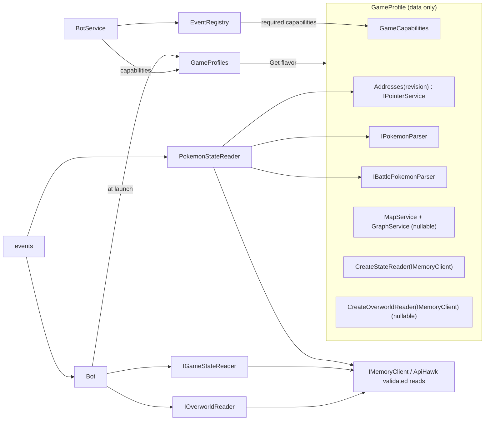

# Spec: game profile

Status: Implemented (epic #118, 2026-10-22); divergences are recorded in the [plan's implementation notes](../plans/2026-10-cleanup-and-hardening.md#implementation-notes-game-profile-2026-10-22) and marked below
Last updated: 2026-10-22
Owner: Phil
Related: [plan rows 5.3 to 5.3e](../plans/2026-10-cleanup-and-hardening.md#phase-5-structural-splits-after-1-3-one-file-per-pr), [architecture, extension axes](../architecture/system-overview.md#axis-1-game-flavors), [pointer discovery](../research/pointer-discovery.md), [HGSS state reader spec](hgss-state-reader.md) (the follow-up), [QA automation](qa-automation.md), [decisions](../decisions/game-profile.md)

## Summary

Game knowledge is spread over the backend: HGSS addresses are written out in eight files, the "in battle" byte and its three magic values are compared in five, `RsDataReader` throws for six of its seven members, map data lives in two static singletons that only know HGSS, and `BotService` dispatches events by comparing name strings in two if/else chains. This spec replaces that with one **game profile per flavor**: a small composition record that names, for one game, the address table, the parsers, the capabilities, the map data and the reader that says where the game is. The profile holds no logic. Each part keeps one job: addresses say *where* bytes are, parsers say *what* bytes mean, the state reader says *where the game is*, capabilities say *what the bot may try*.

Everything here is a restructure: no memory read changes, no wait changes, no new pointers. The events keep reading the same bytes they read today, through one interface instead of scattered constants. Replacing those bytes with the pointer chain verified in the spike is the [HGSS state reader spec](hgss-state-reader.md), a follow-up with its own QA gate, because it is the one change that alters what the bot does in the game. This spec's job is to leave the code in a shape where that follow-up is one new class and one changed line.

Ruby and Sapphire are not part of this spec beyond keeping them working: the RS profile is composed from the parts that exist today and declares what it cannot do. RS addresses, symbols and a state reader wait for the pokeruby work (plan row 6.1).

Line references are to `main` at the merge of the phases 3 to 5 feature (PR #106, 2026-10-22), which contains the `BotService` and `BattleOrchestratorEvent` splits from rows 5.1, 5.4 and 5.5.

## Goals

- G1: every game-specific address, offset, magic value and struct size is defined once, in a type whose only job is to hold it, and is looked up by `(flavor, ROM revision)`.
- G2: pointers, parsing, state reading, capabilities and map data are separate types with one responsibility each; the profile only composes them. No type in this spec has more than one reason to change.
- G3: a flavor says what it supports with declared flags. `BotService` refuses an unsupported action with a 400 before any event starts; the dashboard never offers it.
- G4: each event type is one registry entry (name, parameters, required capabilities, factory). Adding an event type adds an entry, not a branch.
- G5: HGSS events ask one reader "where is the game" through one interface, so the follow-up can change the answer's source without touching the events.
- G6: a new memory read, for any future feature, has exactly one place to go, and a reviewer can see it there.

## Non-goals

- Changing which bytes the bot reads or how it waits on them. That is the [state reader spec](hgss-state-reader.md). The legacy classification (three observed bytes) is kept byte for byte.
- RS addresses, symbols, revision tables beyond what exists today, or an RS state reader. The RS profile is a wrapper around today's parts.
- Moving Pokémon-structure parsing or the validated party read out of ApiHawk. They stay there for speed and for the per-frame retry; see [What stays in ApiHawk](#what-stays-in-apihawk).
- New games, generations or consoles. The shape must admit them; nothing is pre-built for them.
- Fixing the suspected issues listed in the pointer spike. None is confirmed.
- Changing macros, the touch-coordinate table in `CommandPreprocessor`, or the phase files.
- The Slowpoke Well navigation epic (#28). Map data stays as generated today.

## Requirements

| ID | Requirement | Priority | Acceptance |
|---|---|---|---|
| FR-1 | A `GameProfile` exists per flavor and is the only way code reaches a flavor's addresses, parsers, capabilities, map data or state reader. `GameServices` and the keyed `IPointerService` / `IPokemonParser` / `IBattlePokemonParser` registrations are deleted. | Must | `grep -rn "FromKeyedServices\|GetKeyedService" ShinyBotHunter/` is empty; `GameServices.cs` is gone. |
| FR-2 | No literal memory address or battle magic value exists outside the address tables and the state readers. | Must | `grep -rnE "0x0?2[0-9A-F]{6}\b" ShinyBotHunter --include=*.cs` matches only `Service/Pointers/`, `Games/Hgss/`, `RomInfoService.cs` (console header addresses) and `Gen3SaveFile.cs` (save format). |
| FR-3 | Addresses are looked up by `(flavor, revision)`. Launching a ROM whose revision has no table fails at launch with a message naming the flavor and revision. | Must | Unit test: `HgssProfile.Addresses(1)` throws `NotSupportedException` with "HGSS revision 1"; `Addresses(0)` returns the table. |
| FR-4 | `GameCapabilities` is a record of booleans declared by each profile. `GetAvailableActions` returns only actions whose required capabilities the bot's profile has; `ExecuteEvent` returns 400 for any other. | Must | Unit test: an RS bot's action list is empty of `Wild Encounter`, `Chained Encounter`, `HGSS Togepi Egg`; starting one returns 400 with the missing capability named. |
| FR-5 | `RsDataReader` and `HgssDataReader` are deleted. `IDataReader` is replaced by `IOverworldReader` (map, position, facing) and `IGameStateReader` (where the game is). A profile without overworld support has no overworld reader and declares `HasOverworldNavigation = false`. | Must | No reader stub throws `NotSupportedException` in `Bot/` or `Games/`; the FR-3 revision throw is the one that remains. |
| FR-6 | Map and graph data are instances owned by the HGSS profile, loaded from `Data/HGSS`. `MapService.Instance` and `GraphService.Instance` are deleted. `PathfindingService` is built per profile. | Must | A test constructs an `HgssProfile` with the internal test constructor and no files on disk. |
| FR-7 | Each event type is an `EventRegistration` in one static list. `BotService.ExecuteEvent`, `ExecuteNewBotOrSpecialEvent`, the `actionMap` dictionary and `SpecialEvents.json` are replaced by lookups in that list. | Must | Unit test: registry names are unique; every entry's required capabilities are members of `GameCapabilities`; the dashboard list for an idle HGSS bot equals today's. |
| FR-8 | `IGameStateReader.ReadAsync` returns a `GameSnapshot` whose `Screen` is a value of the `GameScreen` enum. The one implementation in this spec, `HgssLegacyStateReader`, reproduces today's classification from today's three bytes and returns only the four values the bot distinguishes today. | Must | Table-driven test over the three bytes; every event's `IsBattle`, `GetBattleMenuState() == 1` and `GetBattleState() == 14` comparison is replaced by a `Screen` comparison and nothing else in the event changes. |
| FR-9 | Every address the HGSS profile's table holds carries a comment naming its decomp symbol where the research doc has one, whether it is a static root (revision-dependent) or a struct offset (revision-independent), and which QA scenario exercises it. | Must | Reviewer checklist item; `HgssPointerService` has no uncommented member. |
| NFR-1 | Each PR is one row of the [migration](#migration-order) and changes no behaviour except the one marked. | Must | PR description states the row; the two HGSS QA scenarios that exist (`hgss-route33` and `hgss-route33-train` under `ShinyBotHunter.Qa/dashboard/`) pass before and after, run folders linked. |

## Design

### Shape



Responsibilities, one per type:

| Type | One job | Knows about | Does not know about |
|---|---|---|---|
| `GameProfile` | name the parts a flavor uses | the other types in this table | memory, bots, events |
| `GameProfiles` | hand out the profile for a flavor | the profiles built in `Startup` | anything else |
| `IPointerService` (unchanged interface, one per flavor and revision) | where bytes are: anchors, offsets, sizes | nothing; it is data | what the bytes mean, who reads them |
| `IPokemonParser`, `IBattlePokemonParser` (unchanged) | what a Pokémon byte block means | the structure layout | addresses, memory clients |
| `GameCapabilities` | what the bot may try on this flavor | nothing; it is data | how a capability is implemented |
| `IOverworldReader` | map id, position, facing | its address table, `IMemoryClient` | battles, parsing |
| `IGameStateReader` | where the game is right now | its address table, `IMemoryClient` | parsing, events, macros |
| `MapService`, `GraphService` (unchanged, no longer static) | map tiles and the route graph | `Data/<flavor>` files | memory, bots |
| `PathfindingService` (unchanged, per profile) | routes over a map and graph | the two above, the flavor's coordinate addresses via `IPointerService` | events |
| `PokemonStateReader` (unchanged) | party, boxes and battle Pokémon as `PokemonData` | the profile's addresses and parsers, `IMemoryClient` | game state, events |
| `EventRegistration` | one event type's name, parameters, needs and factory | `GameCapabilities` | `BotService` |

The profile is the only new composition point. It is a `sealed record` with one constructor assertion (a capability that is declared true has its part present). No method on it does work; the two `Create*` members are delegates stored at construction so a reader can be built per bot without the profile holding a memory client. As built: the members are get-only and set by the constructor (an `init` member cannot be checked by the constructor), and the constructor takes an unstored `revisions` list for the box-layout clause.

### `GameProfile`

```csharp
namespace ShinyBotHunter.Games;

public sealed record GameProfile
{
    public required GameFlavor Flavor { get; init; }
    public required GameCapabilities Capabilities { get; init; }

    /// Address table for a ROM revision. Throws NotSupportedException for a revision without one.
    public required Func<int, IPointerService> Addresses { get; init; }

    public required IPokemonParser Parser { get; init; }
    public IBattlePokemonParser? BattleParser { get; init; }          // null when the flavor has no battle reads

    public MapService? Maps { get; init; }                            // null when !Capabilities.HasOverworldNavigation
    public GraphService? Graph { get; init; }
    public PathfindingService? Pathfinding { get; init; }

    public Func<IMemoryClient, IPointerService, IGameStateReader>? CreateStateReader { get; init; }
    public Func<IMemoryClient, IPointerService, IOverworldReader>? CreateOverworldReader { get; init; }
}
```

`GameProfiles` is a class with a dictionary built in `Startup` and one method, `Get(GameFlavor)`, which throws `InvalidOperationException` naming the flavor when nothing is registered (this is the one message `GameServices.Resolve` gives today, kept). It is a singleton in DI. `GameServices` is deleted; its three callers in `PokemonStateReader` and the one in `StarterHuntEvent` take the profile instead.

The `Bot` resolves its profile and address table once in `LaunchAsync` from `context.GameFlavor` and `context.Revision`, and constructs its readers then. `IBot` loses `IDataReader` and gains:

```csharp
GameProfile Profile { get; }
IPointerService Addresses { get; }           // the revision's table
IGameStateReader State { get; }              // throws InvalidOperationException if the profile has none
IOverworldReader Overworld { get; }          // same
```

`Bot.GameFlavor`'s fallback to HGSS (`Bot.cs:64`) and `GameState.GameFlavor`'s default (`GameState.cs:32`) go: a bot always has a context by the time anything reads them, and `GameState` carries the profile itself (`GameState.Profile`, set where `BotService` constructs it) in P1. Row 5.6 (events receive clients plus profile rather than `IBot`) is compatible with this and is not pulled in.

### Address tables keyed by revision

`IPointerService` keeps its name and members. It already has one job (the memory map); `HgssPointerService` and `RsPointerService` already hold it. What changes:

- `HgssPointerService` gains the members that today live elsewhere, so the inline copies can be deleted. As built, the names below that duplicate an existing member keep the existing name (`FieldSystem` is `Anchor`, `EnemySetupOffset` is `EnemyAnchor`, `EnemyCountOffset` is `EnemyCount`, `EnemyOffset` is `Enemy`, `BattleMenuStateOffset` is `BattleMenuState`); the flavor-only members are on the concrete table class, not on `IPointerService`, and an event specific to one flavor casts `bot.Addresses` once. Each member is one of two kinds, stated in its comment (FR-9):
  - **static roots**, which depend on the ROM revision: `FieldSystem` (`0x021D4158`, `sFieldSysPtr`, the bot's "anchor"), `TrainerX` and `TrainerY` (`0x021DA6F4`, `0x021DA6FC`), `BattleIndicator` (`0x021E76D2`; overlay code, legacy reader only).
  - **offsets from a dereferenced root**, which depend on the struct layout and not the revision: `MapIdOffset` (`-0x22DA4`), `FacingOffset` (`0x1DC4`), `BattleMenuStateOffset` (`0x230EC`, legacy), `BattleStateOffset` (`0x692C`, legacy), `EnemySetupOffset` (`0x6930`, legacy; the real pointer is `app.setup`, see the follow-up), `EnemyCountOffset` (`0xC14`), `EnemyOffset` (`0xC18`), `StarterPreviewOffset` (`0x1BC00`), and the party, box and battle-mirror offsets already there.
  The members marked legacy are the ones the [state reader spec](hgss-state-reader.md) deletes; keeping them in the table now is what makes that deletion a table edit. Deleted on 2026-10-23 by that spec's S2a-0 (#145) and S2a (#138): `EnemyAnchor` from all three tables, `BattleMenuState` from `IPointerService` and RS, and `BattleIndicator`, `BattleStateOffset` and `BattleMenuState` from `HgssPointerService`; the foe reads now walk `app.setup` (`AppSlotsOffset`, `SubAppOffset`, `AppSetupOffset`) through opcode `0x05`.
- `HgssDataReader.cs:9-24` (nine duplicates, one with the wrong sign) are deleted with the file.
- The HGSS table is selected by `HgssProfile.Addresses(revision)`: revision 0 returns the instance; any other throws `NotSupportedException("HGSS revision {n}: no address table. Hunts run on revision 0.")`. `RomInfo.Revision` is already read from the header at launch.
- The RS table is selected the same way for revisions 1 and 2 (today's hunts) and returns the one existing instance for both; 0 throws. This matches today's `TestedRevisions` (`RomInfoService.cs:80-84`), which stays as the "known to work" list for the ROM scan.
- `RsDataReader.cs:22`, `StarterHuntEvent.cs:48-49` and `RsStartMenuService.cs:21-23` move into `RsPointerService` unchanged, with the same root/offset comment.

A second HGSS revision is the moment to split roots from offsets into two types, not before; the comment kind is what makes that split mechanical when it comes.

#### Rule for every future read

Any PR that adds a memory read, for any feature, adds the address to the flavor's `IPointerService` with the FR-9 comment, and reads it through `bot.Addresses`. Events, services and macros never hold an address literal. The reviewer agent's checklist carries this as an item; FR-2's grep is the test.

### Capabilities

```csharp
public sealed record GameCapabilities(
    bool HasOverworldNavigation,   // map, position, facing, pathfinding
    bool HasWildEncounters,        // run/spin loops and the battle orchestrator
    bool HasEggs,                  // Togepi egg event
    bool CanReadBoxes,             // PokemonStateReader.GetPokemonState
    bool HasSoftResetStarterHunt,  // RS wave hunt
    bool HasShinyStarterHunt,      // HGSS starter hunt
    bool HasWishmakerJirachi);     // RS Wishmaker Jirachi hunt
```

HGSS declares everything but `HasSoftResetStarterHunt` and `HasWishmakerJirachi`; RS declares only `HasSoftResetStarterHunt` and `HasWishmakerJirachi` (added by the [Wishmaker Jirachi spec](wishmaker-jirachi.md), FR-3). The profile constructor asserts: `HasOverworldNavigation ⇒ Maps, Graph, Pathfinding, CreateOverworldReader present`; `HasWildEncounters ⇒ CreateStateReader, BattleParser present, HasOverworldNavigation`; `HasEggs ⇒ HasOverworldNavigation`; `CanReadBoxes ⇒ Addresses(r).BoxLayout` is not null. The RS pointer service's four throwing box members (`RsPointerService.cs:58-64`) are then unreachable and are deleted; the four interface members move to a `BoxLayout?` record on `IPointerService` (null for RS). That is the only interface change.

`PokemonStateReader.GetPokemonState` checks `CanReadBoxes` and throws `InvalidOperationException` otherwise, replacing today's `NotSupportedException` from the pointer service. `PokemonState`'s hard-coded 18x30 (`PokemonStateReader.cs:17-20`) reads `BoxLayout` instead.

### Overworld reader

```csharp
public interface IOverworldReader
{
    Task<ushort> GetMapIdAsync(CancellationToken ct);
    Task<(short X, short Y)> GetPositionAsync(CancellationToken ct);
    Task<Direction> GetFacingAsync(CancellationToken ct);
}
```

`HgssOverworldReader` is `HgssDataReader` minus the battle members: the same four reads through the address table, the `to_s16` decode kept. `Direction` is the existing enum in `PathfindingService.cs:102-108`, moved to `Games/Direction.cs`; the duplicate facing switch in `SpinEncounterEvent.cs:92-107` and `LocationService.cs:81-84` use it. `Overworld.WaitForReadyAsync` keeps its coordinate heuristic; it takes the reader instead of the bot. (Superseded 2026-10-23 by the state reader spec's S3, #140: it now waits for `FieldFree` on `IGameStateReader` with a 10 s stale.)

There is one implementation. The interface exists because RS has none and `Bot` needs a type for the member; it is the test seam for `NavigatorEvent` tests (plan row 4.7), named as such in the commit per principle 2's exception.

### Game-state reader, legacy implementation

```csharp
public enum GameScreen
{
    Transitioning,        // the legacy reader never returns this; reserved for the chain reader
    FieldFree,            // not in a battle (legacy: battle indicator not set)
    FieldTask, OtherApp, BattleStarting, BattleMoveList, BattleMessage, BattleScript,
    BattleExpPrompt, BattleMoveLearnPrompt, BattleOver,   // reserved for the chain reader; see hgss-state-reader.md
    BattleMenu,           // legacy: indicator set and menu byte == 1
    BattleTurn,           // legacy: indicator set and menu byte != 1
    Evolution,            // legacy: battle-state byte == 14
}

public readonly record struct GameSnapshot(
    GameScreen Screen,
    BattleOutcome? Outcome, int? Script, int? Prompt, uint? TaskFunction);   // all null from the legacy reader

public interface IGameStateReader
{
    Task<GameSnapshot> ReadAsync(CancellationToken ct);
}
```

`HgssLegacyStateReader` reads the three bytes the bot reads today (`BattleIndicator`, `FieldSystem` + `BattleMenuStateOffset`, `FieldSystem` + `BattleStateOffset`) and maps them to the four values marked legacy. Its class comment lists the ten values it never returns. The enum is declared in full now so the follow-up adds no public type, only a class; the reserved values are documented in the [state reader spec](hgss-state-reader.md#state-table) and not referenced by any event until that spec lands.

Every event's existing check becomes a comparison on `Screen` and nothing else about the loop moves: `IsBattle(GetBattleValue())` is `Screen is BattleMenu or BattleTurn or Evolution`; `GetBattleMenuState() == 1` is `Screen == BattleMenu`; `GetBattleState() == 14` is `Screen == Evolution`. The polls keep their intervals and their lack of timeouts; bounding them is the follow-up's work, so that a loop that starts throwing is attributable to a stated change.

This is an interface with one implementation in this spec. The second implementation is the whole of the follow-up spec, and the interface is also the test seam that lets `BattleOrchestratorEvent` and `LevelUpFlow` be tested without scripting raw bytes; both reasons go in the P7 commit.

### Map data per profile

`MapService` and `GraphService` keep their code and lose their static `Instance` members and private constructors. `HgssProfile.Create` constructs them from `Data/HGSS` (as built, the directory is `HgssProfile.DataDirectory` and the file names stay in the two services, which take the directory), then a `PathfindingService` over them. `Startup.cs:111-113` registers nothing for them; `NavigatorEvent`, `HgssTogepiEggEvent` and `LocationService` take `bot.Profile.Pathfinding` / `.Maps`. `PathfindingService.cs:256-261` reads the coordinate and map-guard addresses from the profile's revision-0 table, passed in at construction. The map generator under `Scripts/Maps/` is a setup command and keeps reading files directly.

### Event registry

```csharp
// As built (owner's decision 2026-10-22). The draft typed Create as a factory returning an IBotEvent,
// but Launch Bot, Launch Bot + Continue and Resume build no event, so Create is the BotService
// method that starts the action and returns the dashboard state; Requires carries the capability
// name so the refusal can say which one is missing.
public sealed record EventRegistration(
    string Name,
    EventArgumentOptions Options,                         // the dashboard's parameter schema, as today
    (string Capability, Func<GameCapabilities, bool> Has)? Requires,   // null when the action needs nothing
    bool OwnsEmulators,                                   // true for the launches and the hunts that own their emulators
    Func<BotService, NewEventArguments, int, Task<Dictionary<int, EmulatorState>>> Create);

public static class EventRegistry
{
    public static readonly IReadOnlyList<EventRegistration> All = [...];   // one entry per event type
    public static EventRegistration Get(string name);                      // throws ArgumentException → 400
}
```

Entries: `Launch Bot`, `Launch Bot + Continue`, `Shiny Starter Hunt` (RS, `OwnsEmulators`, requires `HasSoftResetStarterHunt`), `HGSS Shiny Starter Hunt` (`OwnsEmulators`, requires `HasShinyStarterHunt`; the `Mode == HGSS` alias in `BotService.cs` goes), `Wild Encounter`, `Chained Encounter` (both require `HasWildEncounters`), `HGSS Togepi Egg` (requires `HasEggs`), `Resume`. The `Create` delegates are the bodies of today's branches, moved verbatim; `ValidateAndBuildLeg` and `EnsurePartyHasRoomForEggAsync` stay as private helpers called from the delegates.

`BotService` keeps slot allocation, the gate and the runner. `ExecuteEventUnderGate` becomes: look up the entry (unknown name → 400), check `entry.Requires(bot.Profile.Capabilities)` (false → 400 naming the capability), check the bot's state as today, build, start. `ExecuteNewBotOrSpecialEventUnderGate` becomes the same over the `OwnsEmulators` entries, with the capability checked against the profile of the first ROM's flavor. `GetAvailableActions` filters `EventRegistry.All` by the bot's state as today and then by `Requires`. `GetTopLevelOptions` returns the three options the dashboard showed before (`Launch Bot`, `Launch Bot + Continue`, `Shiny Starter Hunt`); `HGSS Shiny Starter Hunt` is reachable by name only, as it was. `SpecialEvents.json` and `BotService.Init` are deleted; the `Shiny Starter Hunt` conditional parameters move into code as an `EventArgumentOptions` literal.

The dashboard reads the same `EventArgumentOptions` shape, so no dashboard change is needed. The pre-existing hole that an RS bot is offered HGSS actions closes with FR-4.

### What stays in ApiHawk

The owner's constraint, restated as a rule for this spec: parsing and retry that exist on the emulator side today stay there. Concretely:

- The validated party read (opcode `0x04`, `MemoryServer.TryReadValidatedParty`, `PokemonValidator`, `Gen3PokemonValidator`) is untouched. It is the only place a Pokémon block is checked for garbage, it retries one attempt per frame inside the emulator, and nothing in this spec reads a Pokémon block any other way. `PokemonStateReader` keeps calling it with the profile's addressing and scheme.
- The pointer-chain read (opcode `0x03`) is untouched and still used by `PokemonStateReader.GetPokemonBattleState` for the enemy block.
- The `M.` move command's coordinate decode and map guard in `CommandServer` are untouched.

The spike did not find a better way to retry on garbage memory than ApiHawk's per-frame attempt, so nothing moves. If a future spike does, that is a decision for `docs/decisions/game-profile.md`, not a side effect of a task here.

### Files

New folder `ShinyBotHunter/Games/` (reason: the profile and its parts are a new axis that `Service/` would bury; one folder per flavor underneath mirrors `Macro/Configs/`):

| File | Holds |
|---|---|
| `Games/GameProfile.cs` | the record and its constructor assertion |
| `Games/GameProfiles.cs` | the registry |
| `Games/GameCapabilities.cs` | the record |
| `Games/IOverworldReader.cs`, `Games/Direction.cs` | |
| `Games/IGameStateReader.cs`, `Games/GameSnapshot.cs`, `Games/GameScreen.cs`, `Games/BattleOutcome.cs` | |
| `Games/EventRegistry.cs`, `Games/EventRegistration.cs` | |
| `Games/Hgss/HgssProfile.cs` | `Create(PokemonMetadataService)` and the internal test constructor |
| `Games/Hgss/HgssOverworldReader.cs` | |
| `Games/Hgss/HgssLegacyStateReader.cs` | replaced by the follow-up spec |
| `Games/Rs/RsProfile.cs` | `Create(PokemonMetadataService)` |

Deleted: `Bot/IDataReader.cs`, `Bot/HgssDataReader.cs`, `Bot/RsDataReader.cs`, `Service/GameServices.cs`, `Configs/SpecialEvents/SpecialEvents.json`, the static `Instance` members, the `actionMap`, the inline address constants listed in the [inventory](#inventory-of-what-moves). `Service/Pointers/` and `Pokemon/*Parser.cs` stay where they are; moving them is churn with no reader.

### Inventory of what moves

From the survey of 2026-10-21 (`feature/cleanup-phases-3-5`, since merged as PR #106):

| Today | Becomes |
|---|---|
| `HgssDataReader.cs:9-24` constants | `HgssPointerService` members; the `+0x23F44` duplicate is deleted |
| `BattleOrchestratorEvent.cs:395-431` anchor, `0x6930`, `0xC14`, `0xC18`, `0xEC`, `0x230EC` | `bot.Addresses.*`; the menu poll compares `Screen == BattleMenu` |
| `BattleOrchestratorEvent.cs:58`, `HgssShinyStarterEventFactory.cs:14` keyed `IPokemonParser` | `bot.Profile.Parser` |
| `RunEncounterEvent.cs:11-12, 38-44`, `SpinEncounterEvent.cs:38-48` | coordinates from `bot.Addresses`; the battle poll compares `Screen` |
| `ShinyStarterEvent.cs:41-47` | the HGSS table's `Anchor`, `StarterPreviewOffset`, `PartyPokemonSize` |
| `HgssTogepiEggEvent.cs:52-53` | `bot.Addresses.TrainerX/Y` |
| `PathfindingService.cs:256-261` | constructor parameters from the profile |
| `NavigatorEvent.cs:695`, `BattleOrchestratorEvent.cs:137`, `Run/SpinEncounterEvent` `0x41/0x97/0xC0` | inside `HgssLegacyStateReader` only |
| `LevelUpFlow.cs:384` `== 14` | `Screen == Evolution` |
| `RsDataReader.cs:22`, `StarterHuntEvent.cs:48-49`, `RsStartMenuService.cs:21-23` | `RsPointerService` members |
| `StarterHuntEvent.cs:81` literal `GameFlavor.RS` | `bot.Addresses` |
| `MapService.cs:39-91`, `GraphService.cs:29-85` | instances in `HgssProfile.Create` |
| `Startup.cs:111-113, 124-128` | `GameProfiles` registration |
| `BotService` if/else chains, `actionMap`, `Init`, `SpecialEvents.json` | `EventRegistry` |
| `IBot : IDataReader`, `Bot.cs:238-270` | `Profile`, `Addresses`, `State`, `Overworld` |

Not moved, on purpose: species ids and phase names in `MultiShinyHunterEvent` and `ShinyStarterEvent` (they are hunt configuration, not game memory; a later task can lift them into the event's config), `EggHuntConfig` defaults, `CustomLoadZoneMappings` and `Constants.MAP_*` (map generator data), `CommandPreprocessor` touch coordinates (console-level), `Gen3SaveFile` (save format), the night hours in `LevelUpFlow.cs:341`.

## Migration order

One row per PR, each on its own task issue, in this order. Every row is "no behaviour change" except P5's closing of a hole, and each must pass the HGSS QA scenarios that exist at the time before and after.

| # | PR | Depends on | Behaviour change | Size |
|---|---|---|---|---|
| P1 | `GameProfile`, `GameProfiles`, `GameCapabilities`; HGSS and RS profiles composed from today's parts; `GameServices` and keyed registrations deleted; `PokemonStateReader` and `StarterHuntEvent` take the profile; `GameState.GameFlavor` becomes `GameState.Profile` (set in `BotService`, no default); revision lookup with FR-3's throw; `BoxLayout?` on `IPointerService` | — | none | M |
| P2 | Address inventory: every inline constant moves to `HgssPointerService` / `RsPointerService` with the FR-9 comment; `HgssDataReader` constants deleted; `IBot.Addresses` | P1 | none | M |
| P3 | `IOverworldReader` + `HgssOverworldReader`; `IDataReader`'s overworld members removed; `RsDataReader` deleted; `Direction` unified; `Overworld.WaitForReadyAsync` takes the reader | P2 | none | S |
| P4 | Maps per profile: `MapService`/`GraphService` instances, `PathfindingService` per profile, statics deleted | P1 | none | M |
| P5 | Capabilities enforced: `GetAvailableActions` filter, 400 on unsupported, `CanReadBoxes` check | P1 | RS bots no longer see HGSS actions (closes a hole; not a regression) | S |
| P6 | Event registry; `SpecialEvents.json` deleted; `BotService` dispatch by lookup | P5 | none | L |
| P7 | `IGameStateReader`, `GameSnapshot`, `GameScreen`, `HgssLegacyStateReader`; every `IsBattle` / menu / evolution comparison becomes a `Screen` comparison; `IDataReader` deleted | P3 | none | M |

P4 and P5 can run alongside P2/P3 (disjoint files). P6 must follow P5 and lands in the small `BotService`. After P7 the feature branch goes to `main`, and the [state reader spec](hgss-state-reader.md) starts from there.

## Test cases

| Test | Covers |
|---|---|
| `GameProfileTests.HgssProfileIsConsistent` / `RsProfileIsConsistent` | the constructor assertion for both real profiles, built with the internal constructor and no files |
| `GameProfileTests.UnknownRevisionThrows` | FR-3 for HGSS revision 1 and RS revision 0 |
| `GameProfilesTests.UnregisteredFlavorThrows` | the registry's message |
| `EventRegistryTests.NamesAreUnique`, `.IdleHgssBotSeesTodaysActions`, `.RsBotSeesNoHgssActions`, `.UnsupportedActionIs400` | FR-4, FR-7 |
| `HgssLegacyStateReaderTests` (table over the three bytes, including the never-returned values) | FR-8 |
| `HgssOverworldReaderTests` (the four reads over `FakeMemoryClient`) | FR-5 |
| Existing `PokemonStateReaderTests` updated to construct a profile | FR-1 |

All tests use `FakeMemoryClient` with a scripted address-to-bytes map, arrange/act/assert, no fixtures.

## Rollout

- All seven PRs are restructures; they ship on one feature branch as the orchestrator merges them, and the owner merges it to `main` once P7 is in.
- No data migration, no config keys, no dashboard change, no ApiHawk change.
- The follow-up spec starts from the merged `main`.

## Risks

| Risk | Mitigation |
|---|---|
| Line numbers in this spec drift as phases 3 to 5 land | the inventory is by member name as well as line; the task planner re-checks before each PR |
| Registry factories drag `IServiceProvider` into event construction | they receive the provider today; narrowing to explicit dependencies is row 5.6 |
| `IGameStateReader` sits with one implementation if the follow-up is delayed | the legacy reader is still the single home of the three battle bytes, which is the point of P7; the interface costs one file |
| The HGSS starter hunt (`MultiShinyHunterEvent`, `ShinyStarterEvent`) is not covered by a QA scenario during P1 to P7 | checked 2026-10-21: neither uses `IDataReader`; they read the starter preview block through the address table only, so P2 is the only PR that touches them and it changes a constant's home, not its value |

## Open questions

None. Resolved 2026-10-21 by the owner: the chain reader and every behaviour change are the follow-up spec; `GameState` takes the profile in P1.

## Changelog

- 2026-10-21: first draft from the plan rows, the pointer spike and a code survey; RS held to a wrapper profile; ApiHawk-side parsing and retry explicitly kept.
- 2026-10-21: open questions closed by the owner; the chain reader, bounded waits and confirm-and-retry presses split out into the HGSS state reader spec so this one is restructure only; FR-9 (root/offset/scenario comment on every address) and the rule for future reads added.
- 2026-10-22: references moved to `main` after PR #106; NFR-1 names the two QA scenarios that exist.
- 2026-10-22: implemented under epic #118 (PRs #126 to #132). "As built" notes mark where the code differs from the draft: get-only profile members, existing address names kept, flavor-only members on the concrete tables, the data directory in `HgssProfile`, the `EventRegistration` shape, the top-level options, and the FR-5 wording. The full list is in the plan's implementation notes.
