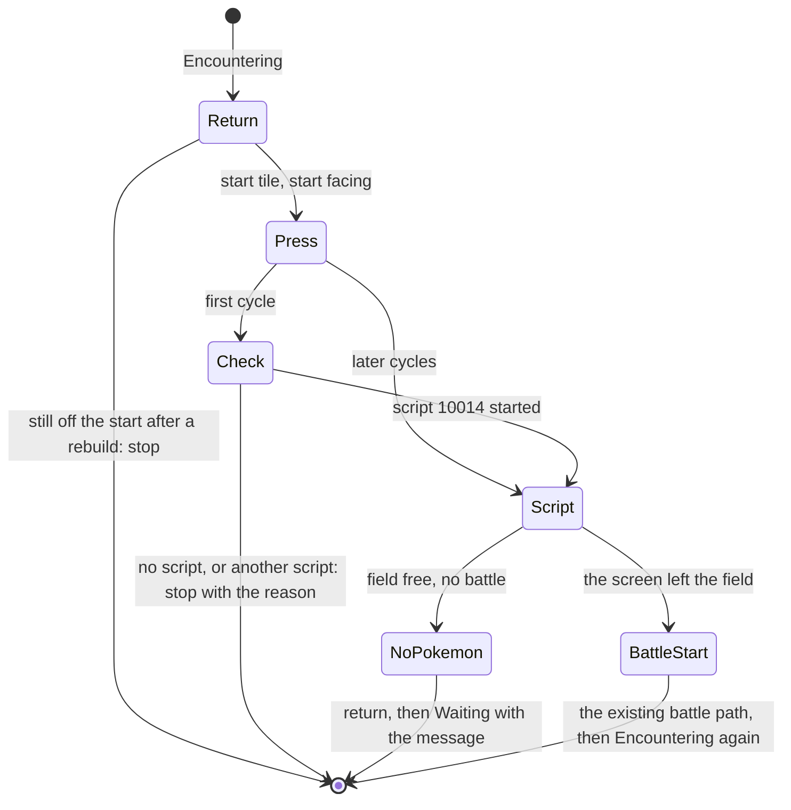

# Spec: Headbutt encounter mode (HGSS)

Status: Implemented (epic #224, 2026-10-28): FR-1 to FR-12 and NFR-1, NFR-2, PRs #230, #231, #232, #233, #234 on feature/headbutt-encounter. All six QA scenarios passed on 3e97461; run folders are in the plan's implementation notes and on the epic. Divergences are under [What diverged](#what-diverged).
Last updated: 2026-10-28
Owner: Phil
Related: [research: the spike](../research/headbutt.md) (the source for every value, timing and rule here), [HGSS state reader spec](hgss-state-reader.md) (the field script chain and its press loop), [QA automation](qa-automation.md), [feature workflow](feature-workflow.md), the guide page [Wild encounters](../guide/04-hunts/01-wild-encounter.md), plan [phase 9](../plans/2026-10-cleanup-and-hardening.md#phase-9-headbutt-encounter-mode)

## Summary

A third encounter type, **Headbutt**, beside Run and Spin, on the HGSS Wild Encounter and Chained Encounter actions. The player stands in front of a tree; the bot presses A, answers Yes, presses through the text, and the tree starts a wild battle. The battle is the existing one: read the foe, log it, target check, flee or fight, heal, Resume. After the battle the bot puts the player back on the start tile facing the tree and headbutts again.

The dashboard offers Headbutt only when a Pokémon in the bot's party knows the move. Otherwise the choice is shown greyed out with the reason, and the backend refuses it at Start with the same sentence, since the party can change between the list and the click.

The spike ran 36 headbutts on the owner's save with nothing but memory reads and macros: 33 battles on the tree in front, 3 clean "nothing happened" results on a tree with no Pokémon, about 30 s per cycle, and the follower swap landing on the same tile every cycle for a given setup.

## Goals

- G1: Headbutt is chosen like Run and Spin, in the same dropdown, with no new action.
- G2: the choice is greyed out, with the reason, when no party member knows Headbutt; Start refuses it with the same sentence.
- G3: every headbutt is driven from the field script chain and confirmed by state; no blind macro decides when the encounter starts.
- G4: after every battle and every heal the player is back on the start tile facing the tree before the next A, checked by reading the tile and facing.
- G5: a tree that gives nothing, a wrong thing in front, or a stuck script stops the hunt with a plain message instead of looping or throwing.

## Non-goals

- Choosing the tree, walking to it, or knowing which trees are "none" for a trainer ID. The operator stands in front of a tree; the first cycle proves it gives encounters.
- RS. Headbutt trees are a Gen 4 feature; the Wild Encounter action is already HGSS only.
- Headbutt while cycling or surfing. The decomp sends those to the same cut-in as a non-following Pokémon, so the event would work, but no QA covers them and the guide does not offer them.
- Repel handling. A Repel makes a good tree look like a "none" tree; the stop message names both.
- A faster cycle (keeping the text speed, skipping the cut-in). About 30 s is accepted.

## Requirements

| ID | Requirement | Priority | Acceptance |
|---|---|---|---|
| FR-1 | `EncounterType` gains `Headbutt` (appended after `Run`). `OrchestratorEvent`'s `Encountering` dispatch builds a `HeadbuttEncounterEvent` for it, as it builds `SpinEncounterEvent` and `RunEncounterEvent`. The Wild Encounter and Chained Encounter registry entries need no change: `xRange` and `yRange` stay conditional on `Run`. | Must | Unit test: the dispatch builds the headbutt event for `Headbutt`; `EventRegistry` schema unchanged. |
| FR-2 | `GameState` gains `StartFacing` (`Direction`, `None` until set), captured in `OrchestratorEvent`'s `Init` beside the start map and tile, through `IOverworldReader.GetFacingAsync`. | Must | Unit test with `FakeMemoryClient`: Init records the facing. |
| FR-3 | Availability: `GET /api/bot/getBotActions/{pos}` becomes async. For an idle HGSS bot, on the copies of the Wild Encounter and Chained Encounter options it returns, it sets `EventArgumentOptions.DisabledChoices`, a new `Dictionary<string, Dictionary<string, string>>?` from parameter name to choice to reason: `{"EncounterType": {"Headbutt": "No Pokémon in your party knows Headbutt."}}` when no party member has move 29 (`MOVE_HEADBUTT`, `include/constants/moves.h:33`) in any of its four slots. A party read that fails or returns an empty party (title screen, a fade, a corrupt read) sets the reason `"The party could not be read; try again once the game is in the field."`; that answer is not cached, so the next call reads again. The answer comes from one party read (`PokemonStateReader.GetPartyState`) cached on the bot's slot entry: the dashboard calls this endpoint for every idle bot on every SignalR state push, which during another bot's hunt is every encounter, so it must not read memory per call. The cache is filled by the first call after the bot becomes idle, and cleared when an event starts or ends on the slot and when `getParty` is called (the dashboard's Reload party button), and a read that failed or was empty is retried on the next call; the field says in a comment that it is guarded like the entry's other fields. The registry's option objects are never mutated; each request gets copies. Options with no disabled choices leave the field null. | Must | Unit tests: a fake party with Headbutt as slot 3's fourth move enables it; none disables it with the sentence; a throwing read gives the read sentence; two calls make one read; an event ending clears it; the registry instance is unchanged after the call. |
| FR-4 | Start refuses Headbutt the same way, from a fresh read, not the cache: `StartWildEncounter` and `StartChainedEncounter` read the party before building the legs when any leg asks for Headbutt, and no party member knowing it is a 400 with the FR-3 sentence (the controller's existing `ArgumentException` mapping). This is the guard; the greyed-out choice is a convenience that can be stale if the operator changes the party by hand while the bot is idle. | Must | Unit test on the leg validation; QA: `hgss-headbutt-greyed` posts a Start with Headbutt through the API and sees the 400 text. |
| FR-5 | Dashboard: `types/api.ts` adds `'Headbutt'` to `EncounterType` and `disabledChoices?: Record<string, Record<string, string>>` to `EventArgumentOptions`. `ActionParamFields.tsx` renders `ENCOUNTER_TYPE_OPTIONS` as `['Spin', 'Run', 'Headbutt']`; an option named in `disabledChoices.EncounterType` is rendered `disabled` with its reason appended to the label (`Headbutt (No Pokémon in your party knows Headbutt.)`), since a disabled option's tooltip does not show in Chromium. A leg's dropdown uses the leg schema's `disabledChoices`. A value already selected that becomes disabled on refresh is cleared. | Must | Vitest on the option rendering helper; QA: `hgss-headbutt-greyed` reads the disabled option and its text in the Electron UI. |
| FR-6 | First cycle checks the setup: at the start tile and facing, press A and wait for the field script chain. If no script starts within 3 s: stop, "Nothing in front of you starts a script; stand facing a headbutt tree." If a script starts and `env.script` is not 10014 (`std_field_headbutt`, `include/constants/std_script.h:646`): press B through it until the field is free, then stop, "The thing in front of you is not a headbutt tree (script N)." | Must | Unit test over scripted snapshots for both stops; QA: `hgss-headbutt` passes the check. |
| FR-7 | The headbutt: press through script 10014 with `NavigatorEvent.PressThroughScriptAsync`'s rules (one A at the menu native `0x020477C1`, A at a text arrow before the Yes and B after it, nothing at any other native), until the screen leaves the field for a battle (pop `Encountering`, push `BattleStart`) or the field is free again with no battle. `PressThroughScriptAsync` gains one optional parameter, the predicate that ends the loop (default: `FieldFree`), and returns the snapshot that ended it; its other callers are unchanged. Stale-timeout 20 s, as the heal. | Must | Unit test: the loop ends on the battle screen and on `FieldFree`; the heal and poison callers' tests unchanged. |
| FR-8 | Field free with no battle means the tree gives nothing: run the return step (FR-9), then park the event in `Waiting` with the log line `[Headbutt] The tree in front of you gave no Pokémon. It may give none for your trainer ID, or a Repel is active.`, as `SpinEncounterEvent` parks on a stale-timeout. Not an exception. | Must | Unit test; QA: `hgss-headbutt-dead-tree`. |
| FR-9 | The return to the tree, before every A (after a battle, a heal or a park), keyed on where the player is: read the tile and facing; at the start tile with the start facing, do nothing; otherwise look up `GameState.EncounterMacros["Headbutt:{x},{y},{facing}"]`, and build it if missing: one `M.<dir>.<start>.<TrainerX or TrainerY>` per axis that differs, then `W.8;H.<StartFacing>.3;W.10` (the tree blocks the step, so the press only turns). Run it, read the tile and facing again; if they are still not the start, rebuild once from where the player is and log `[Headbutt] Cache miss at (x, y, facing); rebuilt`; if the second try also misses, stop with the tile and facing in the message. A player more than one step from the start tile on both axes after a battle is not a swap: stop and report. `ChainedOrchestratorEvent` removes the `Headbutt:` keys between legs as it removes `Run`. | Must | Unit test over a scripted position: the macro text for behind and beside, one build per key, the rebuild and the stop; QA: `hgss-headbutt` (behind) and `hgss-headbutt-sideways` (beside). |
| FR-10 | `HgssPointerService` gains `HeadbuttScript => 10014` with the address table's comment format (symbol `std_field_headbutt`, kind script id, status observed, scenario `hgss-headbutt`), as `SurvivePoisoningScript => 2003` has. The read itself is the existing `env.script` (R22); the HGSS state reader spec's read table gains the next free row (R30) for the value, as R19 records 2003. The natives and tasks only seen in the spike (0x020492F1, 0x020408D9, 0x0204378D, 0x0224E0ED, 0x022507E9) are not added: nothing branches on them. | Must | Reviewer checklist (the state reader spec's FR-9). |
| FR-11 | Logging: one `[Headbutt]` line per cycle naming the start check result (first cycle), the press count, the end (battle or nothing), and the return (none, cached, built, rebuilt). | Should | QA logs. |
| FR-12 | The guide page [Wild encounters](../guide/04-hunts/01-wild-encounter.md) documents Headbutt in the same PR as the dashboard change: what the save needs (stand facing a headbutt tree; a party Pokémon that knows Headbutt; the greyed-out choice and why), what each cycle looks like, the swap with the following Pokémon, and the "gave no Pokémon" stop. Plain words, per the guide's rules. | Must | Reviewer check (AGENTS.md, the guide rule). |
| NFR-1 | A cycle (A to back at the tree after a flee) under 45 s on the dev PC (spike: 28.5 to 34.3 s). | Should | QA timings. |
| NFR-2 | Ten consecutive cycles on the owner's save with no stall, every return check passing, at most one macro build per post-battle tile. | Must | QA: `hgss-headbutt`. |

## Design

### The cycle

### Where it lives

| Piece | Location | Notes |
|---|---|---|
| Encounter type | `BotEvents/Factories/EncounterParams.cs` | `Headbutt` appended. |
| Event | `BotEvents/HeadbuttEncounterEvent.cs` | `AbstractBotEvent<bool>` like the spin and run events; holds no state of its own between cycles (the macro cache is on `GameState`). |
| Dispatch, start facing | `BotEvents/OrchestratorEvent.cs`, `BotEvents/GameState.cs`, `BotEvents/ChainedOrchestratorEvent.cs` | FR-1, FR-2, FR-9's cache reset. |
| Press loop | `BotEvents/NavigatorEvent.cs` | FR-7's optional parameter on `PressThroughScriptAsync`. |
| Script id | `Service/Pointers/HgssPointerService.cs` | FR-10. |
| Availability and Start | `Service/BotDtos.cs`, `Service/BotService.cs`, `Controllers/BotController.cs` | FR-3, FR-4. |
| Dashboard | `types/api.ts`, `components/admin/ActionParamFields.tsx` (and its helper's test) | FR-5. |
| Guide | `docs/guide/04-hunts/01-wild-encounter.md` | FR-12. |

### New things

| Thing | Reason |
|---|---|
| `EncounterType.Headbutt` | The mode itself. |
| `HeadbuttEncounterEvent` | A third encounter event beside the two that exist; the orchestrator dispatches on the type. |
| `GameState.StartFacing` | The tree's direction; the start tile alone does not say which way to face. |
| `EventArgumentOptions.DisabledChoices` | The one way the dashboard learns that a choice exists but is unavailable for this bot, with the reason; general by parameter name so it is not a headbutt flag in the DTO. |
| The cached answer on the slot entry | One party read per idle period instead of one per SignalR push (FR-3). |
| `HgssPointerService.HeadbuttScript` | The script id the start check and the press loop branch on, per the address table rule. |
| The predicate parameter on `PressThroughScriptAsync` | The headbutt loop ends on a battle, not on the field coming back. |

No package, project, interface, config key or folder.

## QA

QA runs on the final feature branch, through the Electron UI with the existing Playwright driver, screen-recorded, one emulator run at a time. Setups that need the player somewhere other than where the save stands (beside the follower, facing the dead tree) are made by the scenario with `driver.runMacro` before it presses Start; that is QA tooling, not bot behaviour. Every scenario compares the save with its `.bak` afterwards: the bot never saves in-game in this mode.

| Scenario | Save | What it does | Asserts |
|---|---|---|---|
| `hgss-headbutt` | `hgss.qa-headbutt` | Start Wild Encounter, ShinyTarget, Headbutt, Train None, from the UI; ten cycles; cancel. | Ten `encounters` rows for the milestone with species Spearow, Heracross or Aipom, levels 3 to 5; the first cycle's start check line; one `built` return line from (426, 463, Up) and nine `cached`, no cache miss; every A at (426, 464) facing Down; NFR-1 timings; save unchanged. |
| `hgss-headbutt-sideways` | `hgss.qa-headbutt` | `runMacro` steps left and back and presses Down, so the follower stands beside; then as above, five cycles. | One `built` return from (425, 464, Left), four `cached`, no miss. |
| `hgss-headbutt-cutin` | `hgss.qa-headbutt-cutin` | As `hgss-headbutt`, five cycles. | Every return line says `none`; five rows. |
| `hgss-headbutt-dead-tree` | `hgss.qa-headbutt` | `runMacro` steps left one tile and presses Down (facing (425, 465)); Start; wait for Waiting. | One cycle, the `[Headbutt] The tree in front of you gave no Pokémon` line, the player back at (425, 464) facing Down, the event in Waiting on the dashboard, no row, no exception in `backend.log`. |
| `hgss-headbutt-greyed` | `hgss.qa-headbutt-nomove` | Open the Wild Encounter form on the bot; then POST a Start with Headbutt through the API. | The Headbutt option is disabled and its text carries the FR-3 sentence; Spin and Run are enabled; the POST returns 400 with the sentence; no event starts. |
| `hgss-headbutt-shiny` | `hgss.qa-headbutt` | Arm `hgss-usa-rev0/wild-shiny` after two cycles (as `hgss-route33-shiny-park` does), run until the target is found. | The shiny parks the bot in Waiting with the existing shiny alert and log row; this proves the wild-shiny cheat reaches headbutt encounters (the spike found headbutt and grass share `FieldSystem_GenerateRegularEncounter`, which the cheat patches; not yet run). |

Saves (added to the QA save table, made with PKHeX by a subagent where noted): `hgss.qa-headbutt` = the owner's `HG-Headbutt` (Azalea, (426, 464) facing Down, lead Slowpoke with Headbutt, following); `hgss.qa-headbutt-cutin` = PKHeX copy with Typhlosion and Slowpoke swapped (the spike's `HG-Headbutt-CutIn`); `hgss.qa-headbutt-nomove` = PKHeX copy with Slowpoke's Headbutt replaced by Tackle and no other party member knowing Headbutt. Each goes with its own ROM copy named like the save.

## Suggested task split

| Task | Scope | Files |
|---|---|---|
| H1 | FR-1, FR-2, FR-6 to FR-11: the event, the dispatch, the start facing, the press-loop predicate, the script id, the cache, logging; unit tests | `EncounterParams.cs`, `HeadbuttEncounterEvent.cs`, `OrchestratorEvent.cs`, `ChainedOrchestratorEvent.cs`, `GameState.cs`, `NavigatorEvent.cs`, `HgssPointerService.cs`, `docs/specs/hgss-state-reader.md` (R30), tests |
| H2 | FR-3, FR-4: `DisabledChoices`, the cached party answer, the fresh read at Start, the 400s; unit tests | `BotDtos.cs`, `BotService.cs`, `EmulatorSlotRegistry.cs` (the cached answer on the entry), `BotEventRunner.cs` (cleared when an event starts or ends), `BotController.cs`, tests |
| H3 | FR-5, FR-12: the dashboard dropdown and the guide page | `types/api.ts`, `ActionParamFields.tsx`, its helper test, `docs/guide/04-hunts/01-wild-encounter.md` |
| H4 | QA: the six scenarios, the three saves and their rows | `ShinyBotHunter.Qa/dashboard/hgss-headbutt*.spec.ts`, `docs/specs/qa-automation.md` |
| H5 | Close-out: architecture sentence, this spec's status, plan implementation notes | `docs/**` |

H1, H2 and H3 have disjoint files and run in parallel (H3 works from FR-5's JSON shape). H4 after all three; H5 last.

## What diverged

Where the build differs from this spec as approved (2026-10-28). The requirements and design above stay as written; this list keeps the record.

- FR-5: the option list `ENCOUNTER_TYPE_OPTIONS` and its helper `encounterTypeChoices` live in `components/admin/actionSchema.ts`, not `ActionParamFields.tsx`, which calls the helper (#231).
- FR-6: the start check runs on every cycle, not only the first. `HeadbuttEncounterEvent.RunCycleAsync` presses A and waits for the script task every time; the diagram's "first cycle" branch does not exist. The A is confirmed within 1 s and pressed up to three times, so 3 s in total (#233).
- FR-6, FR-8, FR-9: every stop parks the event in `Waiting` with the reason logged as a `[Headbutt]` line, not only the "gave no Pokémon" one: no script, another script, more than one step from the start tile, the return missing twice, and a stale-timeout anywhere in the cycle (`Park`, #233).
- FR-9: the return macro is raced against a 3 s stale watch (`ReturnStale`, `RunReturnMacroAsync`). A blocked step would otherwise hold the direction forever. On the stale, the macro is cleared, and the position check that follows counts it as a miss (#233).
- FR-9: the "not a swap" stop is `|dx| + |dy| > 1` from the start tile, not "more than one step on both axes". A diagonal tile is a stop (#233).
- FR-11: the line is `[Headbutt] start=script N presses=P end=battle|nothing return=R`, logged every cycle that reaches the headbutt script. R is `none`, `cached`, `built from (x,y,Facing)` or `rebuilt from (x,y,Facing)` (#233).
- FR-2: the Init line logs the facing: `[Orchestrator] Start tile captured: map=M (x,y) facing=F` (`OrchestratorEvent.CaptureStartAsync`, #233).

## Open questions

- Resolved from the code: the dashboard fetches every idle bot's actions on each SignalR state push (`BotControlTab.tsx`, `fetchBotActionsForState`), so FR-3 caches the answer per slot rather than reading the party per call; Start (FR-4) reads fresh.
- Resolved by assumption: a park in `Waiting` (FR-8) rather than `Complete`, so the operator sees the bot stopped with the reason and can fix the setup and start again; it matches `SpinEncounterEvent`'s stale-timeout park.

## Changelog

- 2026-10-28: first version, from the spike of the same day.
- 2026-10-28: FR-3: a failed or empty party read is not cached and is retried on the next call, because the bot is idle at the title screen after a launch, and a cached failure would grey Headbutt for the whole idle period.
- 2026-10-28: Implemented (PRs #230 to #234); What diverged added.
