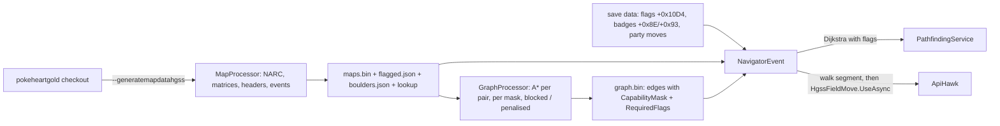

# Spec: Pathfinder map data rebuild, flag-gated routes, and HM use (HGSS)

Status: Draft for owner review, 2026-11-03
Last updated: 2026-11-03
Owner: Phil
Related: [research: the spike](../research/pathfinder-maps-flags-hms.md) (the source for every value, timing and rule here), [HGSS state reader spec](hgss-state-reader.md) (the field script chain and its press loop), [headbutt spec](headbutt-encounter.md) (the same A-at-an-object step), [QA automation](qa-automation.md), [feature workflow](feature-workflow.md), the guide page [Wild encounters](../guide/04-hunts/01-wild-encounter.md), plan [phase 11](../plans/2026-10-cleanup-and-hardening.md#phase-11-pathfinder-map-data-flag-routes-and-hms)

## Summary

Three changes to the HGSS pathfinder, in the order they depend on each other.

1. **The map data is rebuilt from the `pokeheartgold` checkout** with the scripts that ship in `Scripts/Maps`, which today need inputs that no longer exist and crash before the graph step. The command takes the checkout and an output folder, unpacks the land-data NARC itself, reads the header table from the decomp source and matches each header's event file exactly. The rebuilt `Data/HGSS` corrects three overworld maps and drops an orphan map.
2. **Routes depend on script flags.** An NPC with an event flag exists only while that flag is clear (the game's one rule). Those tiles become flag-gated in the map, the graph's edges carry the flags they need, and the bot reads the save's flag array once per navigation. A guard who has left no longer blocks the route; a rival who has not yet moved still does.
3. **The navigator uses HMs.** The capability passed to the pathfinder is built from the party's moves and the player's badges, both read from RAM. Each HM use at an obstacle is the same gated step as a headbutt: a held A starts the field script, Yes at the menu, A at the text, then the field free. The hand-timed HM macros in `CreateMacro` are deleted.

The spike proved the rebuild (10 s for the maps, 30 s for the graph), the flag rule and its array in RAM, and Rock Smash, Cut and Surf on the emulator with memory reads and macros only.

## Goals

- G1: `--generatemapdatahgss <decompDir> <outputDir>` rebuilds `Data/HGSS` from a `pokeheartgold` checkout on a clean machine, and the committed data is what that command produces.
- G2: a route is never blocked by an NPC the save has already dismissed, and never crosses one it has not, on the cross-map graph and in the in-map walk alike.
- G3: a walk that needs Cut, Surf, Rock Smash or Strength is found and taken when a party Pokémon knows the move and the player has its badge, and is not attempted otherwise.
- G4: every HM use is gated on memory: the script id, the menu native, the text native, the field free, and for Surf the avatar's state. No timed press remains.
- G5: the owner's saves are never written; QA runs on a throwaway save that starts indoors.

## Non-goals

- Fly, Teleport, Dig and Flash: party-menu or route-shortcut moves, not obstacles. Fly as a route shortcut is a later spike.
- Waterfall, Whirlpool and Rock Climb beyond what the pathfinder already models. They stay in the capability (badge and move) and keep their tile rules; their field scripts (10005, 10016, 10003) are the same shape as the three proven ones but were not run, so the HM step handles them with the same gates and QA does not cover them yet.
- Objects that move around (walking trainers' ranges stay the 0x11 penalty tiles they are).
- RS. RS has no map data (`HasOverworldNavigation` is false).
- The current map's objects after a Continue. The game restores the saved map's objects on Continue rather than loading the header's; the flag read is right for every map the walk enters by a warp, and the first map is where the player already stands.

## Requirements

| ID | Requirement | Priority | Acceptance |
|---|---|---|---|
| FR-1 | `--generatemapdatahgss <decompDir> <outputDir>`: `MapProcessor` unpacks `files/a/0/6/5` (NARC: BTAF offsets into GMIF) to the move-permission files, reads the matrices from `files/fielddata/mapmatrix/map_matrix/map_matrix_NNNN_*.bin`, and reads the header table from `src/data/map_headers.h` (`[MAP_X] = { .matrixId = …NNNN…, .eventsBank = NARC_zone_event_NAME_bin }`, ids from `include/constants/maps.h`). The `headerCsv` and `romDataDir` arguments go. | Must | On this machine the command writes `maps.bin`, `boulders.json`, `mapreverselookup.json` and `graph.bin` byte-equal to the committed files; unit tests for the NARC reader and the header parser on small fixtures. |
| FR-2 | Each header's event file is the one its events bank names (`153_T22PC0101.json`), never a substring match. `InternalName` in the lookup becomes the bank name. | Must | Headers 9, 19 and 174 take `006_R01`, `016_R11` and `168_D47`; the Pokémon Center test (`EndsWith("PC0101")`) still holds. |
| FR-2b | `MapProcessor.GenerateMapFile` tests the rock-climb behaviours (0x4B, 0x4C) before the blocked permission bit, so a climbable wall is `MAP_RockClimb` (0x08) as the constant already says; and a cell with behaviour 0x08 and permission 0x0A (the brink above a waterfall) is blocked. `GraphProcessor` keeps the Rock Climb mask it already has. | Must | Mt. Mortar 1F entrance (bot map 76) has five 0x08 tiles at (74..78, 40) and Tohjo Falls (83) has row 12 blocked except the five tiles atop each fall; the committed graph gains Rock Climb edges; a unit test on a four-cell fixture. |
| FR-3 | The graph step runs on a clean output folder: `GraphProcessor` and the `PathfindingService` it uses take the `MapService` built from the fresh `<outputDir>`, and no `GraphService` is constructed before the graph exists. `GetMapLookups` is called with `internalId: true` for bot map ids. | Must | The command runs end to end in an empty folder; the orphan map 472 is gone. |
| FR-4 | An object with a non-zero event flag (every kind but `FLAG_MAPTEMP_*`, and not a tree, rock or boulder) is written as `MAP_FlaggedNpc` (0x12) on its tile, with its walking range as today, and `Data/HGSS/flagged.json` lists `{botMapId: [{x, y, flag}]}` with the flag id from `include/constants/flags.h`. A `FLAG_NOTHING` object stays a wall. | Must | 820 entries on 209 maps; a unit test on a two-object fixture. |
| FR-5 | `ASearch` takes the set flags (`IReadOnlySet<int>`): a `MAP_FlaggedNpc` tile is free when its flag is set and blocked when it is clear; the walking-range tiles around it keep their penalty. | Must | Unit test: a corridor closed by a flagged NPC opens when the flag is in the set. |
| FR-6 | `GraphProcessor` computes, per node pair and capability mask, two edges: one with every flagged tile blocked (requires no flags) and one with every flagged tile free at a cost penalty of 50 per crossing, so the path crosses as few as it can; the second edge's `RequiredFlags` are the flags of the tiles it crossed, and it is kept only when it exists and the first does not or is costlier. `graph.bin` gains the flag list per edge (u16 count, u16 ids). | Must | Unit test on a hand-built map; the committed graph has at least one edge with flags; generation under 2 minutes on this machine. |
| FR-7 | `Djitriska` uses an edge only when every `RequiredFlags` id is set in the flags passed in; `NavigatorEvent` reads the 364-byte flag array at save data + 0x10D4 (`HgssPointerService.EventFlagsOffset`) once per navigation and passes it to the path search and every in-map `Pathfind`. | Must | Unit test: a route that needs a flag is found only with the flag set. |
| FR-8 | `Capability` is built by `NavigatorEvent` from the party (`PokemonData.Moves` of every party member) and the two badge bytes at save data + 0x8E (Johto) and + 0x93 (Kanto) (`HgssPointerService.JohtoBadgesOffset`, `KantoBadgesOffset`): Cut needs move 15 and Hive (Johto bit 1); Rock Smash 249 and Zephyr (bit 0); Strength 70 and Plain (bit 2); Surf 57 and Fog (bit 3); Waterfall 127 and Rising (bit 7); Whirlpool 250 and Glacier (bit 6); Rock Climb 431 and Earth (Kanto bit 7). The three `new Capability()` sites in `NavigatorEvent` take it. | Must | Unit tests over a fake party and badge bytes; a log line names the capabilities once per navigation. |
| FR-9 | `CreateMacro` stops emitting HM presses. A path segment ends at each HM action; `NavigatorEvent` runs the walk up to the obstacle, then `HgssFieldMove.UseAsync(move)`, one driver for all seven moves: turn with `H.<dir>.4` until the facing byte (`FieldSystem + 0x1DC4`) is the obstacle's direction; `H.A.4`; wait for the move's script id (10000 Cut, 10001 Rock Smash, 10002 Strength, 10003 Rock Climb, 10004 Surf, 10005 Waterfall, 10016 Whirlpool); then, until the field task is gone: `H.A.4` when the innermost native is `MENU_CHOICE`, `H.A.4` when it is `PRINTING` or `WAIT_BUTTON` and the state has not changed for 1 s (Strength's first text waits for a button before its menu; every move's "used" text waits after it). After field free, re-read the position and, for Surf, avatar state 2 (`FieldSystem + 0x40`, state at + 0x18, `HgssPointerService.PlayerAvatarOffset`, `PlayerAvatarStateOffset`): Waterfall ends on the water above the fall, Rock Climb on the far side of the wall, Whirlpool on the water beyond it, Surf on the first water tile, Strength where it stood (the push is the next move leg). Each wait is a stale-timeout naming what it saw, 15 s for the field task. Then the walk continues from the live position. | Must | Unit tests over a fake memory client for the step order; QA `hgss-hm-rocksmash`, `-cut`, `-surf`, `-strength`, `-waterfall`, `-rockclimb`, `-whirlpool`. |
| FR-10 | A script that starts with a different id, or `800C = 0` after the badge check, stops the walk with one sentence naming the move and what the game answered; the segment is not retried. | Must | Unit test; QA `hgss-hm-refused` (badge byte cleared on a throwaway copy): the route to the obstacle is not planned, since FR-8 already excludes it, and a forced use stops with the sentence. |
| FR-11 | Surfing is part of the walk state: a leg that leaves water onto land needs no press; a leg that starts on water with avatar state 0 re-surfs with FR-9 first. Descending a waterfall is a plain leg downward (the game carries the player; no move, so the graph's downward edge needs Surf only). Leaving a map is a step off the warp tile in the exit direction; arriving on a door tile from outside warps on its own. | Must | QA `hgss-hm-surf` rides onto water, moves, and returns to land; `hgss-hm-waterfall` goes up and comes back down. |
| FR-12 | The Wild encounter guide page's sentence "It walks only where no field move is needed" becomes the rule of FR-8 in plain words, with the badge each move needs, and a sentence that NPCs the story has moved no longer block the bot. A new section in `01-install.md` says the map data ships with the bot and names the command for a developer. | Must | Reviewer reads the pages. |
| NFR-1 | Reading the flags and the badges adds under 50 ms to a navigation. | Should | Logged time. |
| NFR-2 | `maps.bin` grows by no more than the flagged tiles' byte change (none; same size); `flagged.json` under 100 KB; `graph.bin` under 100 KB. | Should | Sizes in the PR. |

## Design

### Data flow

### New things

| New | Why |
|---|---|
| `Data/HGSS/flagged.json` | The flag-gated tiles with their flag ids; the map byte alone cannot carry a 12-bit flag id. |
| `Constant.MAP_FlaggedNpc` (0x12) | One tile kind for "an NPC that exists while its flag is clear". |
| `Edge.RequiredFlags` and the `graph.bin` field | The cross-map search must know which flags an edge needs. |
| `HgssFieldMove` (`BotEvents/HgssFieldMove.cs`) | The one gated HM step, seven moves, one caller (`NavigatorEvent`); replaces the timed presses in `CreateMacro`. |
| `HgssPointerService.EventFlagsOffset`, `JohtoBadgesOffset`, `KantoBadgesOffset`, `PlayerAvatarOffset`, `PlayerAvatarStateOffset`, `FieldMoveScripts` | Every new read goes through a commented member (architecture rule). |
| A NARC reader and a header parser in `Scripts/Maps` | The inputs come from the checkout now; two small static methods, tests on fixtures. |

Nothing else: no package, no interface, no config key. `Capability` stays the class it is; `CapabilityType` keeps its seven bits.

### Deleted

The timed HM strings in `PathfindingService.CreateMacro` (`T.A;W.70;T.A;W.60…` for Surf, Whirlpool, Waterfall, Rock Smash and Cut), the `headerCsv` and `romDataDir` arguments and the `MatrixProcessor.ReadHeaderFile` CSV reader, and the `MovePermissions` step's dependence on a pre-extracted folder.

### Architecture and guide

`docs/architecture/system-overview.md`'s map-and-graph row names `flagged.json` and the flag-aware search; section 11's setup command line changes to the new arguments. The guide pages change as FR-12.

## QA

| Scenario | Save | Steps | Checks |
|---|---|---|---|
| `hgss-hm-rocksmash` | `hgss.qa-hm` | Launch Bot + Continue; a navigator walk to (472, 439) (Route 32, past the rock at (471, 439)). | The route includes the rock; script 10001 then `MENU_CHOICE`, `PRINTING`, field free in the log; the player ends on (472, 439); save equals `.bak`. |
| `hgss-hm-cut` | `hgss.qa-hm` | A walk to (462, 319) (past the tree at (462, 320)). | Script 10000; the player ends on (462, 319). |
| `hgss-hm-surf` | `hgss.qa-hm` | A walk to (462, 362) (water) and back to (462, 359). | Script 10004; avatar state 2 on the water, 0 back on land; both positions reached. |
| `hgss-hm-strength` | `hgss.qa-hm-mortar` | Out of the Route 42 gatehouse (through the Suicune cutscene at (434, 175)), surf to Mt. Mortar's middle door (464, 175), down to B1F, a walk to (26, 37) (the boulder at (26, 38), approached from (26, 39)). | Script 10002 with the extra text press; the boulder object (sprite 84) at (26, 37) after the first push step; the player on (26, 38). |
| `hgss-hm-waterfall` | `hgss.qa-hm-mortar` | On 1F, a walk to (45, 21) (above the fall at (45, 22)) and back to (45, 23). | Script 10005; field task 021F2945; up in about 10 s, down with no script. |
| `hgss-hm-rockclimb` | `hgss.qa-hm-mortar` | Out and in by the east door (493, 171), a walk to (79, 40) (the wall at (74..78, 40) from (73, 40)). | Script 10003; field task 021F2629; the player on (79, 40). |
| `hgss-hm-whirlpool` | `hgss.qa-hm-r27` | Surf from (755, 396) to (805, 412) (the whirlpool at (804..806, 409..411) from (805, 408)). | Script 10016; field task 021F2DD1; the player on (805, 412), still surfing. |
| `hgss-hm-refused` | a throwaway copy of `hgss.qa-hm` with the badge byte cleared | The same walk to (472, 439). | No route through the rock is planned (the walk stops with "no path" or takes a rock-free route); no script 10001 in the log. |
| `hgss-flag-route` | `hgss.qa-hm` | Unit-level: the Dijkstra on the committed graph from Route 32 to a destination that needs a flag the save has not set, then with the flag set. | Different routes; no emulator. |
| `hgss-map-rebuild` | none | `--generatemapdatahgss C:\Code\pokeheartgold <tmp>` | The four files byte-equal to `Data/HGSS`; under 2 minutes. |

The walks go through the Electron UI with the Playwright driver (a "Walk to" action does not exist; QA uses the Go To Pokémon Center walk with the Route 32 Center as the start and a destination reached by the existing `FindNodePath` through a dev endpoint, as the headbutt QA drove its return walk). The `hgss.qa-hm` save row is in [QA automation](qa-automation.md).

## Tasks

| Task | Scope | Files |
|---|---|---|
| P1 | FR-1 to FR-3: the rebuild from the checkout, exact event files, the graph step on a clean folder; regenerate `Data/HGSS` | `Scripts/Maps/*.cs`, `Tools/SetupCommands.cs`, `Data/HGSS/*`, tests |
| P2 | FR-4 to FR-7: flagged tiles, `flagged.json`, the flag-aware A* and Dijkstra, the flags read | `Scripts/Maps/MapProcessor.cs`, `GraphProcessor.cs`, `Pathfinding/*.cs`, `Service/Pointers/HgssPointerService.cs`, `BotEvents/NavigatorEvent.cs`, tests |
| P3 | FR-8 to FR-11: the capability from RAM, `HgssFieldMove`, the segment split, the deletions in `CreateMacro` | `BotEvents/HgssFieldMove.cs`, `BotEvents/NavigatorEvent.cs`, `Pathfinding/PathfindingService.cs`, `Service/Pointers/HgssPointerService.cs`, tests |
| P4 | FR-12 and QA: the ten scenarios, the three save rows, the guide pages | `ShinyBotHunter.Qa/dashboard/hgss-hm-*.spec.ts`, `docs/guide/**`, `docs/specs/qa-automation.md` |
| P5 | Close-out: architecture, this spec's status, plan notes | `docs/**` |

P1 first; P2 after P1 (it changes the data the rebuild writes); P3 after P1 (it needs the lookups' names only); P4 and P5 last.

## Open questions

> **OPEN:** FR-6's 50-per-crossing penalty is a guess at "as few as possible"; the owner may prefer the edge to be kept per crossed object instead of per path.

> **OPEN:** the Route 42 Suicune and Eusine cutscene at (434, 175) fires on `hgss.qa-hm-mortar`'s first walk; the QA scenario either presses through it (eleven A's, as the spike did) or the save gets the event's flag, which the spike did not identify. The owner picks; a save with the flag set is the cleaner scenario.

> **OPEN:** FR-11's step-off-the-warp-tile rule was seen on four doors; whether `NavigatorEvent`'s warp legs already do it is for P3's first run to say.

## Changelog

- 2026-11-03: first draft, from the spike of the same day.
- 2026-11-03: second run of the spike: FR-2b (rock-climb and brink tiles), FR-9 as one driver proved on all seven moves, FR-11's waterfall descent and warp exits, four QA scenarios and two saves, the Strength open question closed and the cutscene one opened.
