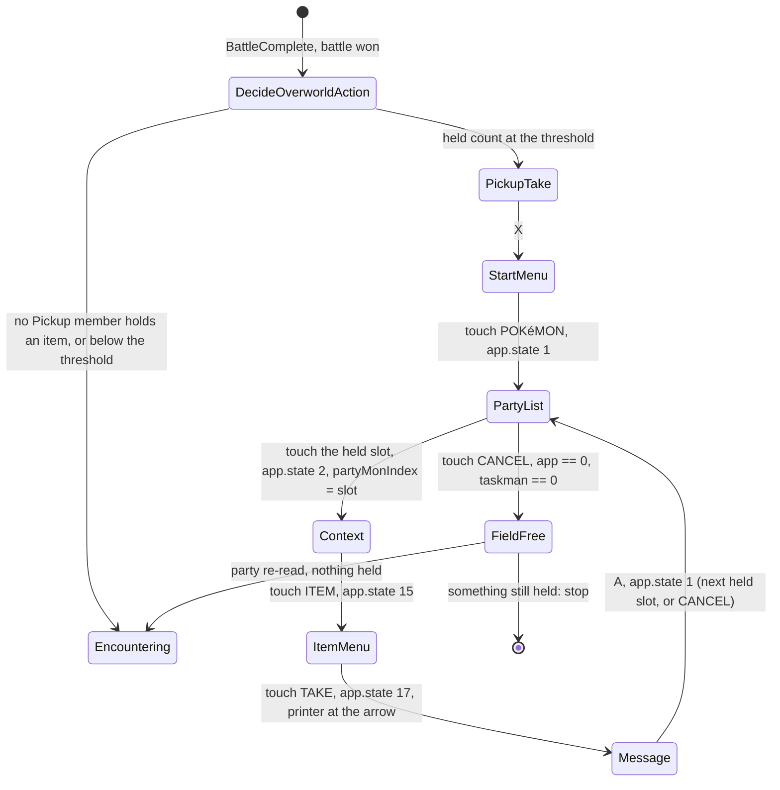

# Spec: Pickup mode (HGSS)

Status: Implemented (epic #273, 2026-11-08): FR-1 to FR-11 and NFR-1, NFR-2, PRs #280, #281, #282, #283, #284 on feature/pickup-mode, and #285 (QA tooling: the RAM party read retried on a torn record). All three QA scenarios passed on f72c233; run folders are in the research doc's [Evidence](../research/pickup.md#evidence) and on the epic. Divergences are under [What diverged](#what-diverged).
Last updated: 2026-11-08
Owner: Phil
Related: [research: the spike](../research/pickup.md) (the source for every value, timing and rule here), [headbutt encounter spec](headbutt-encounter.md) (the greyed-out choice and the party-read cache this reuses), [HGSS state reader spec](hgss-state-reader.md) (the sub-app reads), [QA automation](qa-automation.md), [feature workflow](feature-workflow.md), the guide page [Wild encounters](../guide/04-hunts/01-wild-encounter.md)

## Summary

A **Pickup** checkbox on the HGSS Wild Encounter and Chained Encounter actions. With it on, the bot fights as the train mode already does, and after a won battle, when party members with the Pickup ability hold items, it opens the Pokémon menu from the field, takes every held item into the bag, and goes back to hunting. Pickup only rolls for an empty-handed Pokémon (10 % each per won battle, never on a flee), so taking the items is what keeps the farm running; with five Aipom that is about one item every two battles while all five are empty.

The checkbox is offered only while a train mode is selected, and it is greyed out, with the reason, when no party member has the Pickup ability; Start refuses it with the same sentence. An indefinite farm is the existing target level set above 100, which the dashboard's field must allow.

The spike proved the three parts on a copy of the owner's Route 33 save: the roll's rule from the decomp, 40 won battles in the existing train mode with five pickups (and none once every Aipom held one), and the take loop driven from memory in 10.4 s for five Pokémon.

## Goals

- G1: Pickup is one checkbox on the actions that already fight; no new action, no new encounter type.
- G2: the checkbox is visible only with a train mode, greyed out with the reason when the party has no Pickup member, and Start refuses it with the same sentence.
- G3: items are taken only when a Pickup member holds one, from the party read the bot already does, and every step of the menu trip is confirmed by state; no blind macro.
- G4: a trip that goes wrong (a wrong screen, a held item that is not taken, a stuck message) stops the hunt with a plain message instead of looping or pressing on.
- G5: the farm can run indefinitely: a target level of 101 or more never completes.

## Non-goals

- Levelling the Pickup Pokémon. The operator picks the levels (the tier picks the loot); switch training exists for that.
- Honey Gather, Pay Day, or any other end-of-battle item. The loop takes whatever a Pickup member holds; it does not identify how it got there.
- Giving items, or deciding what to do with the bag. Items go to the bag and stay there.
- A bag at 999 of one item. Not measured in the spike; the message, if any, is a stop (G4).
- RS. The party menu read here is HGSS's.
- Mail. A Pickup Pokémon never holds mail; the Mail entry that replaces Item is not handled (stop, G4).

## Requirements

| ID | Requirement | Priority | Acceptance |
|---|---|---|---|
| FR-1 | `NewEventLegArguments` and `NewEventArguments` gain `bool? Pickup`. `EncounterParameters` in `EventRegistry` adds the conditional parameter `Pickup` with the condition `TrainType` `Neq` `None`, so the dashboard shows it only with a train mode. `GameState` gains `Pickup` (bool), set per leg by `BotService` and `ChainedOrchestratorEvent` as `TrainType` is. | Must | Unit test: the schema carries the conditional; a leg with Pickup sets the state; `EventRegistryTests`' schema snapshot updated. |
| FR-2 | Validation in `BotService` (`StartWildEncounter`, `StartChainedEncounter`): a leg with `Pickup` true and `TrainType` `None` is a 400, "Pickup needs a train mode: the Pokémon must be knocked out, not fled from." A leg with `Pickup` true and no party member whose `Ability` is 53 (`ABILITY_PICKUP`, `include/constants/abilities.h`) is a 400, "No Pokémon in your party has the Pickup ability." Both from a fresh party read, like the headbutt guard (headbutt spec FR-4), since the greyed-out box can be stale. | Must | Unit tests on the leg validation; QA: `hgss-pickup-greyed` posts both through the API and sees the texts. |
| FR-3 | Availability: `GetBotActionsAsync` fills `DisabledChoices["Pickup"]["true"]` with the FR-2 ability sentence when no party member has ability 53, on the same cached party read and the same slot-entry cache as the headbutt refusal (`EmulatorSlotRegistry`, the headbutt spec's FR-3 rules: one read, cleared when an event starts or ends and on `getParty`). A read that fails gives the headbutt spec's "could not be read" sentence. | Must | Unit tests: a party with ability 53 in slot 4 enables it; none disables it with the sentence; one read for both refusals. |
| FR-4 | Dashboard: `Pickup` renders as a checkbox (`ActionParamFields.tsx`, beside `SoundOn` and `RequireFemale`; the label "Pickup"), disabled with the reason appended when `disabledChoices.Pickup.true` is set; a checked box that becomes disabled on refresh is cleared. `LEG_PARAM_KEYS` gains `Pickup` and `buildLegBody` sends it as a boolean. The Target Level field's `max` becomes 101, so 101 is the way to farm without end (G5); the label gets the hint "101 = no end". `types/api.ts`: `pickup?: boolean` on the leg, and the field on `disabledChoices`. | Must | Vitest on the checkbox helper and `buildLegBody`; QA: `hgss-pickup-greyed` sees the disabled box and its text; `hgss-pickup` sets 101. |
| FR-5 | `OrchestratorEvent`: after `BattleComplete` with `Pickup` on and the battle won, the party read in `DecideOverworldAction` (already there) counts members with ability 53 and a non-zero `HeldItem`. When the count equals the number of Pickup members, or is at least `PickupTakeAt` (a `Configs/Events` setting, default 0 = only when all hold), push a new `PickupTakeEvent` before `Encountering`. A fled battle (the lead could not fight, the target rule said flee) skips the check. | Must | Unit test over a fake party: all-held triggers, partial does not at the default, partial does at a threshold, a flee skips. |
| FR-6 | `PickupTakeEvent`, HGSS only, from the field free: press X, wait for the start menu (`app == 0 && taskman != 0`, stale 5 s); touch POKéMON (44, 77), wait for the party menu (`app != 0 && app.state == 1`, stale 10 s); for each held slot `i` (0-based): touch the slot ((63, 27), (191, 27), (63, 77), (191, 77), (63, 123), (191, 123)), wait for `app.state == 2 && partyMonIndex == i`; touch ITEM (191, 106), wait for `app.state == 15`; touch TAKE (191, 66), wait for `app.state == 17` and the text printer at the arrow (slot 0, `pr.state` 2 or 3); press A, wait for `app.state == 1`; then touch CANCEL (227, 178) and wait for the field free (`app == 0 && taskman == 0`, stale 10 s). Every touch is `S.x.y.3` after `W.5` (the menu input-ready gap). Each wait is `GameStateWait.UntilAsync` on a snapshot that carries the party menu's `app.state` and `partyMonIndex` (FR-8). | Must | Unit test over scripted snapshots for the whole loop with two held slots; QA: `hgss-pickup` takes five. |
| FR-7 | After the trip, read the party again: any Pickup member still holding an item is a stop, "Pickup: {name} still holds {item} after the take; check the Pokémon menu." A stale-timeout in any step is a stop with the step's name and the last snapshot, like the headbutt stops; the event clears its macro first. An Item entry that is Mail (`ItemIdIsMail`) is not expected (non-goal) and surfaces as the FR-7 "still holds" stop. | Must | Unit tests for both stops. |
| FR-8 | State reader: an `OtherApp` snapshot gains `AppState` (`app + 0x14`) and `PartyMonIndex` (`[app + 0x1C] + 0xC65`, null when the data pointer is NULL), read in the existing `app` block (grow it to `AppDataOffset + 4`) and one new chain block `partyMenu` (`0, 4, 0x1C, 0xC65`, 1 byte). `HgssPointerService` gains `PartyMenuMonIndexOffset => 0xC65` and the state constants (`PartyMenuList = 1`, `PartyMenuContextMenu = 2`, `PartyMenuItemMenu = 15`, `PartyMenuTakeMessage = 17`) with the address table's comment format (symbols `PartyMenuState`, `PartyMenu.partyMonIndex`; status observed; scenario `hgss-pickup`). The HGSS state reader spec's read table gains the next free rows (R39, R40) and the block table the new block; `app.ovyId` is `0xFFFFFFFF` for this app and is not used to identify it. The battle and field classifications are unchanged. | Must | Unit test: a scripted `app` block with state 15 and index 3 classifies `OtherApp` with both fields; existing reader tests unchanged. |
| FR-9 | Logging: one `[Pickup]` line per won battle with the held count and the decision, one per take naming the slot and the item id, one for the trip's total ms, and the stop lines of FR-7. | Should | QA logs. |
| FR-10 | Persistence: nothing new. Encounters are recorded by the battle path as today; the item taken is in the log only. | Must | Reviewer check. |
| FR-11 | The guide page [Wild encounters](../guide/04-hunts/01-wild-encounter.md) documents Pickup in the same PR as the dashboard change: what the party needs (a lead that wins, Pokémon with the Pickup ability, the level tiers and what they give, in plain words), the checkbox and why it is greyed out, target level 101 for no end, what a trip looks like, and the stops. | Must | Reviewer check (AGENTS.md, the guide rule). |
| NFR-1 | A trip for five Pokémon under 15 s on the dev PC (spike: 10.4 s). | Should | QA timings. |
| NFR-2 | Thirty consecutive won battles with Pickup on the spike save with no stall, every trip ending field free, every held item taken. | Must | QA: `hgss-pickup`. |

## Design

### The cycle

### Where it lives

- `BotEvents/PickupTakeEvent.cs`: the trip (FR-6, FR-7), an `AbstractBotEvent` pushed by `OrchestratorEvent` and popped when the field is free again, like the heal walk.
- `OrchestratorEvent.DecideOverworldAction`: the count and the push (FR-5). The party read is the one already there; `PokemonData.Ability` and `HeldItem` are already parsed by `HgssPokemonParser`.
- `BotService`: the two refusals (FR-2) and the greyed-out reason (FR-3), beside the headbutt ones.
- `HgssFieldSystemStateReader` and `HgssPointerService`: the party menu's two values (FR-8).
- Dashboard: the checkbox, the level cap, the leg body (FR-4).
- `Configs/Events/Pickup.json`: `PickupTakeAt` (FR-5), the touch targets (FR-6) and the stale-timeouts, so a measured value changes without a build, like the other event configs.

### Why these choices

- **One checkbox, not a mode.** The fight path is the train mode; Pickup only adds the trip. Tying it to `TrainType` in the schema keeps the UI honest without a new dropdown value.
- **Take when all hold, by default.** Every held item costs a 10 % roll on every later battle, but a trip costs about 2 s plus 1.4 s per Pokémon against 30 s per battle. With five Aipom, taking at "all held" loses little and keeps the trips rare; the threshold is a config value for an operator who wants fewer empty rolls.
- **Memory-gated touches.** The spike's first loop pressed A before the "Received" message reached its arrow; the press was dropped and the next touches landed on Switch. Every step waits on `app.state`, `partyMonIndex` or the printer, as the field presses do.
- **Target level 101.** `BotService` already accepts it and `DecideOverworldAction` never completes it. Raising the dashboard cap by one is the smallest change that gives "no end" without a new parameter; the guide says what it means.

## QA scenarios

| Scenario | Save | Steps | Pass when |
|---|---|---|---|
| `hgss-pickup` | `hgss.qa-pickup` (Typhlosion Lv 37 leading, five Aipom with Pickup, empty-handed) | Launch + Continue; Wild Encounter, Route 33, ShinyTarget, Run, xRange 3, train Standard, target level 101, Pickup on; run until three trips have happened or 30 won battles | every won battle logs the `[Pickup]` count; each trip ends field free with every held item taken (the party read in the log, and the party in RAM read through `egg-pid.ts`'s `decodeMon`; `getParty` carries no held item or ability); no stop; save equals `.bak`; trips under 15 s |
| `hgss-pickup-take` | `hgss.qa-pickup-held` (the same, five items in hand) | Launch + Continue; the same action; the first decision must be a trip before the first encounter | five takes logged in order, field free, party empty, under 15 s |
| `hgss-pickup-greyed` | `hgss.qa-route33` (no Pickup member) | Dashboard: Wild Encounter with train Standard; API: Start with Pickup and with `TrainType` `None` | the checkbox is disabled with the ability sentence; the two API Starts are 400 with the FR-2 texts |

## What diverged

Where the build differs from this spec as approved (2026-11-07). The requirements and design above stay as written; this list keeps the record.

- FR-5, FR-9: no flee skip. A fled battle cannot change a held item. So `OrchestratorEvent.PickupSlotsDue` runs on every `DecideOverworldAction` decision that goes on to `Encountering`, the first one before any battle included, and not on one that sends the bot to heal or home; there is no won or fled flag. The count line is logged per decision, not per won battle (#283).
- Where it lives, FR-5: `PickupTakeEvent` is not pushed and popped. `DecideOverworldAction` awaits it inline with the event's cancellation token, and there is no new `EventState`. A stop clears the macro and parks the orchestrator in `Waiting`, with the sentence logged as a `[Pickup]` line. Resume returns to the decision, which reads the party again (#283).
- FR-6: the trip first waits for the field free (`fieldFreeStaleMs`), because `BattleComplete` can come while a field task runs, and that task would confirm the X. The spec gives no stale-timeout for the per-slot waits; they use `stepStaleMs`, 5 s. `Pickup.json` holds `startMenuStaleMs` 5000, `partyMenuStaleMs` 10000, `stepStaleMs` 5000 and `fieldFreeStaleMs` 10000 (#283).
- FR-7: `{item}` reads `item {id}`, the item number, because there is no item-name table: "Pickup: {name} still holds item {id} after the take; check the Pokémon menu." A stale-timeout stop is `Pickup: Waited for {step}; the game state stayed {snapshot}` (`GameStateTimeoutException`) (#283).
- FR-9: the lines are `[Pickup] held H of M pickup members; trip|no trip`, `[Pickup] took item I from slot N (name)`, `[Pickup] trip took T ms`, and the stop lines. A slot holding mail is not visited. It logs `[Pickup] slot N (name) holds mail, item I; not visited` and then gets the FR-7 still-holds stop (#283).
- FR-8: `OtherApp` also carries `TextPrinter` (`pr.state` of slot 0), which is what FR-6's take-message gate reads. The `app` block was already 0x20 bytes, which is `AppDataOffset + 4`, so it was not grown (#280).
- FR-4: the checkbox's helper `pickupChoice` is in `components/admin/actionSchema.ts`, and `ActionParamFields.tsx` calls it. `buildLegBody` sends `pickup` only while Train Type is not None, so a box that was ticked and then hidden is not sent (#282).
- QA: the scenarios read party RAM through `pickup.ts` and `egg-pid.ts`'s `decodeMon`, not through `getParty`, because `getParty` carries no held item or ability. The QA table above now says so (#284).

## Open questions

- Whether a fainted Pickup member still rolls (the decomp checks species, egg and item only). Not needed for the mode; worth a line in the research doc when seen.
- The threshold's unit: a count of held members (as written) or a share of the Pickup members. A count is simpler and the party is at most six. Answered: a count; `pickupTakeAt` is 0 to 6 (`PickupConfig.Validate`).

## Changelog

- 2026-11-07: first draft, from the spike.
- 2026-11-08: Implemented (PRs #280 to #284, QA tooling #285); What diverged added; the QA table's party check reads RAM, not getParty.
