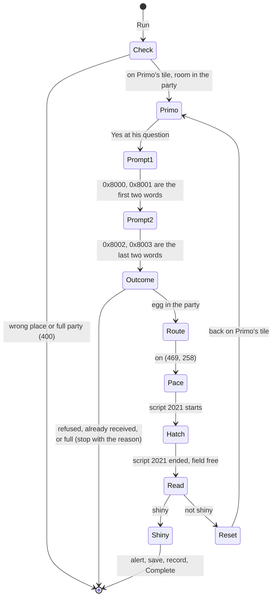

# Spec: Primo's Slugma egg hunt (HGSS)

Status: Implemented (epic #240, 2026-11-02). FR-1 to FR-17 except FR-13 (removed) and NFR-1, NFR-2 are built; the five QA scenarios passed on `feature/primo-egg-hunt`, run folders in the [plan's implementation notes](../plans/2026-10-cleanup-and-hardening.md#implementation-notes-primo-egg-hunt-2026-11-02); divergences are in the changelog. Required before the branch reaches `main` (owner, 2026-11-02): E8 (#260, Confirm's A gated on the byte the question writes; no doubled press) and E9 (the password scenario on two more saves with other trainer and secret IDs).
Last updated: 2026-11-02
Owner: Phil
Related: [plan phase 10](../plans/2026-10-cleanup-and-hardening.md#phase-10-primos-slugma-egg-hunt-its-own-spec), [research: the spike](../research/primo-slugma-egg.md) (the source for every value, rule and timing here), [HGSS state reader spec](hgss-state-reader.md) (the field script chain), [headbutt encounter spec](headbutt-encounter.md) (shares one change to the press loop), the Togepi egg hunt (`HgssTogepiEggEvent`, guide page [Togepi egg](../guide/04-hunts/04-togepi-egg.md)), [QA automation](qa-automation.md), [feature workflow](feature-workflow.md)

## Summary

A new HGSS action, **HGSS Primo Egg**, beside **HGSS Togepi Egg**. The save stands facing Primo in the Violet City Pokémon Center. One cycle: talk to Primo, enter the Slugma password in his two easy-chat prompts, take the egg, walk to the Togepi hunt's line outside the Mart and pace it with the Togepi pacing macro until the egg hatches, answer No to the nickname question, read the hatched Slugma. Shiny: Discord alert, save, record the catch, stop. Not shiny: log the encounter, soft reset to the save in front of Primo, go again.

The Togepi hunt moves onto the same hatch handling in the same epic (owner, 2026-11-02): its stall detection, its hand-timed hatch macro and the false-stall retries go, replaced by the hatch script's own start and end signals, with the day care counter logged while pacing, through one hatch step both events call.

Every step is gated on memory, as the spike ran it: the password is computed from the trainer ID with the game's own rule, the easy-chat screen is driven from its own cursor bytes and confirmed from Primo's script variables, the pacing is watched through the day care's step counter, and the hatch is started and ended by its field script, not by a stalled position or a timed macro. One cycle is 13 minutes 45 s, measured twice end to end on the gated steps: 40 s soft reset, 51 s at Primo, 14 s to the line, 11 minutes 40 s of pacing, 17 s of hatch. The spike also showed why the easy-chat presses stay gated rather than replayed as a fixed macro: the app's screen transitions vary by more than any fixed wait absorbs, and the gated entry is already within about 20 percent of the game's own latency floor.

## Goals

- G1: the hunt runs from the dashboard like the Togepi hunt, one action with one Milestone field, with no operator action after Run.
- G2: no blind macro decides anything. Every press is confirmed by a memory value changing; every wait ends in the awaited state, cancellation, or a stale-timeout that names what it waited for and what it saw.
- G3: a bad setup is refused at Run with one sentence: wrong place, full party.
- G4: the walk reuses the Togepi hunt's line and its pacing macro (owner's choice, 2026-11-02).
- G5: the shiny path is the Togepi hunt's: alert, save, record, stop.
- G6: the Togepi hunt hatches the same way, and nothing timed or stall-based is left in either egg hunt.

## Non-goals

- Primo's Mareep and Wooper eggs. The rule covers them (egg types 8 and 9), so adding them later is a parameter and two species ids; this epic hunts Slugma only.
- Changing how the Togepi hunt receives its egg or finds its start tile. Only its walk-and-hatch half changes (FR-17).
- Faster walking: running, the bicycle, or a Flame Body Pokémon in the party (which halves the cycles; the egg itself never counts). The guide can suggest the last; the bot does not depend on it.
- Detecting a shiny before the hatch. The egg's PID is fixed when Primo hands it over, but the hunt decides after the hatch, as the Togepi hunt does, because that is what a player sees.
- RS. Primo is HGSS only.

## Requirements

| ID | Requirement | Priority | Acceptance |
|---|---|---|---|
| FR-1 | Registry entry `HGSS Primo Egg`: `RequiredParameters = ["PhaseName"]`, requires `HasEggs`, `OwnsEmulators: false`, created by `BotService.StartPrimoEggAsync`. | Must | Unit test: the entry is listed for an idle HGSS bot and not for RS. |
| FR-2 | Run refuses, with a 400 and one sentence, before the event starts: a full party (`EnsurePartyHasRoomForEggAsync`, as the Togepi hunt); not standing on map 158 (Violet Pokémon Center 1F) at (12, 12) facing Up ("Stand facing Primo in the Violet City Pokémon Center: map 158, tile (12, 12), facing up."). | Must | Unit tests; QA: `hgss-primo-egg-refusals`. |
| FR-3 | `PrimoPassword.Encode(trainerId, egg)` returns the four easy-chat word ids for Primo's egg password (Slugma is egg 10), by inverting the decode the research doc gives step by step: the type and checksum bytes, the left rotations that undo the game's right rotations, the XOR mask, and the bank indexes from the byte differences modulo the bank size. The bank is a static table of the 351 word ids in `pms_aikotoba` (`files/resource/eng/pms_aikotoba/pms_aikotoba.s`, in its order), commented with that file. A `Decode` port of `ov02_0224CBF8` and `ov02_0224CAB8` lives in the test project only, to check the encoder. | Must | Unit tests: trainer ID 60647 gives KLUTZ, TEACHER, DARK, STEADFAST (1085, 1337, 981, 1062); for 3,000 seeded random trainer IDs and eggs 8 to 10, the egg decode returns the egg and the wallpaper decode fails. |
| FR-4 | The trainer ID is read from the save data in RAM: `[[0x021D4158] + 0x0C] + 0x84` (u16, `PlayerProfile.id`'s visible half). | Must | Unit test with a fake memory; QA: the password lines in `hgss-primo-egg-password`. |
| FR-5 | Primo's conversation: press A at Primo; press through his script (field script 5) with the navigator's rules (A at a text arrow, one A at the menu native for Yes) until the easy-chat app (overlay 102) opens; enter two words (FR-6); `HgssEasyChatInput.ConfirmAsync` drives Confirm and Yes at "Is this your answer?" (Yes is the default): Down to Confirm's row; one A, confirmed by the byte of the easy-chat block that the question's opening writes (found on the emulator by E8, #260, and named in the research doc: the question handler at +0x2C read 0x021E8D95 with its step at +0x28 reading 1, while the handler at +0x20 stayed 0x021E7AA5); the first press of each prompt waits for the opening handler at +0x2C to clear; one A at Yes, confirmed by +0x28 leaving 1 or the app closed, 19 to 22 frames late (#264). Each A is one gated press; an A answered by its own retry is a doubled press and a bug (principle 2.19). Repeat for the second prompt; then press through to the end of the script. After each prompt, before anything else, the script's special variables must read the intended words (env + 0x8C, `0x8000` to `0x8003`); after the check, `0x800C` classifies the outcome: 255 or 0, the password was refused; 10, the egg was already received (`FLAG_GOT_SLUGMA_EGG_FROM_PRIMO` set); 6, the party is full; 1 to 5, the egg was given. Anything but 1 to 5 stops the hunt with that reason. At the end the party must hold a Slugma egg (species 218, egg flag set); its PID is logged. The trainer ID, the password and the two variables after each prompt are logged as word ids (`[PrimoEgg] trainer ID 60647, password 1085 1337 / 981 1062`, `[PrimoEgg] after prompt N: 0x8000=.. 0x8001=..`). | Must | Unit test of the classification over scripted variables; QA: `hgss-primo-egg-password`. |
| FR-6 | `HgssEasyChatInput.EnterAsync(slot, word)` drives the easy-chat app from its data block `[[[0x021D4158] + 0] + 4] + 0x1C]` with the research doc's fields: the screen handler at +0x20 (slots 0x021E7AA5, group grid 0x021E8241, word list 0x021E87B5), the slot cursor (+0x4C row, +0x4E column), the grid cursor (+0x50, row × 3 + column), the list (+0x54 scroll, +0x56 max scroll, +0x58 count, +0x5A column, +0x5B row), busy (+0x1C), the group tables (+0xA4 counts, +0xD4 offsets, +0x104 words) and the chosen words (+0x10, +0x12). Steps: slot cursor to the slot, A until the screen is the grid; grid cursor to the word's group (types and abilities: 4, Trainer 5, People 6, Greetings 7, Lifestyle 8, Feelings 9, Tough words 10, Union 11), A until the list; the word's index from the group's in-memory list; R and L to within five rows, then Down and Up, then Right and Left; A until the slots; the slot must hold the word. Each press is a 4-frame hold, sent only while the app takes input (+0x1C = 0 with no handler at +0x2C, or the question with +0x28 = 1), confirmed within 1 s by the byte it writes (a move its cursor, an A the step 4, 1 or 3 or the screen after it, Confirm +0x2C = 0x021E8D95), and pressed again, at most three times, only when that byte proves the press was dropped; the screen change after a landed A is awaited up to 3 s and never retried (principle 2.19, #264). A word missing from its group's list (a locked group) stops with the word's id. | Must | Unit tests over a scripted fake app: the press sequence for KLUTZ (55 in Status), TEACHER (86 in Lifestyle), STEADFAST (111), a missing word, a dropped press. QA: `hgss-primo-egg-password` logs each prompt's presses and time (spike: 33 and 29 presses, under 12 s each). |
| FR-7 | The press list is cached for the run per slot and word: it depends only on the starting cursors (which every prompt resets) and the word. It is stored only after the slot reads back the word, and retried presses are not in it. It is never replayed as a fixed macro: the gates in FR-6 decide when each press goes (the research doc's pacing measurements show a fixed replay loses presses), and a press that needs a retry is logged. | Must | QA: the press lines are identical across cycles. |
| FR-8 | The walk to the line, from Primo's tile: one navigator walk, the heal flow's own return walk (`NavigatorEvent`, `ReturnToStart`), to the config's `lineMapId`, `lineX`, `lineY` (map 73, (469, 258)). It runs A* per segment across the Center's door, with the navigator's rules: the stall rule (2.5 s on one tile with the field free; the timer is held while the field is not free), the blocked-segment recovery (B, the tile penalised, rerouted, at most three times per segment) and its stale-timeouts. The walk must end on that tile. Anywhere else (the route abandoned, a stale-timeout parked, no path) stops the hunt with the tile and the navigator's state. Professor Elm's Pokégear call, which rings during the walk on a fresh save, is ignored: unanswered it runs no script and blocks nothing, so nothing dismisses it (owner, 2026-11-02; principle 2.20). | Must | Unit tests; QA: `hgss-primo-egg-hatch` logs the navigator's path, the door crossing and the line reached. |
| FR-9 | Pacing: the Togepi hunt's macro as a repeating macro, `RP_` of `M.Left.458.<TrainerX>;M.Right.500.<TrainerX>` (the line x 458 to 500 at y 258; owner's choice). While pacing, log every 30 s the day care's egg step counter `[[0x021D4158] + 0x0C] + 0x17E8` (0 to 254, reset at every cycle boundary). Stop the macro (`macro_clear`) as soon as the state reader reports field script 2021 (`std_hatch_egg`). A stale-timeout fires when the counter has not changed for 30 s while pacing (blocked line). The egg's cycles byte (block A 0x14, `PokemonData.Happiness`) is never read for anything: it reaches 0 with a whole cycle of steps still to walk, so no countdown or check is built on it (owner, 2026-11-02). | Must | QA: the counter is logged while pacing and script 2021 starts (spike: on the step after counter 254). |
| FR-10 | The hatch: at script 2021's native 0x02041001 (`WaitABPress`), one A, confirmed by the hatch app (overlay 95) opening. In the app, wait until the Yes/No pointer (hatch app data + 0x88) is a valid pointer and its cursor (+0x19) reads 1 or 2; press Down until it reads 2 (No); A, confirmed by the app closing. Then wait until script 2021 has ended and the field is free (stale-timeout 30 s). The party slot that held the egg must now be Slugma with the egg flag clear and the egg's PID. | Must | Unit test over scripted snapshots; QA: `hgss-primo-egg-hatch`. |
| FR-11 | After the hatch: log the hatched Slugma as an encounter (`AddEncounterAsync`: Game HGSS, Milestone, GameFileName). Shiny: `ShinyAlertService.NotifyTargetFoundAsync(…, "hatched")`, the `SaveGame` macro, `AddCaughtPokemonAsync`, `FlushSave`, a post-save delay (a private constant), Complete. Not shiny: the `SoftReset` macro, the reset delay, `ContinueGameWithRandom`, wait for the field; the player must be back on Primo's tile and facing (FR-2's check), else stop with where it is. | Must | QA: `hgss-primo-egg-hatch` (not shiny), `hgss-primo-egg-shiny`. |
| FR-12 | Config `Configs/Events/PrimoEgg.json`, loaded and validated once by `BotService.StartPrimoEggAsync` at Run and passed to the event, so a bad file is a 400: `eggSpecies` (218), `egg` (10), `startMapId` (158), `startX` (12), `startY` (12), `startFacing` ("Up"), `lineMapId` (73), `lineX` (469), `lineY` (258), `hatchAxis` ("x"), `hatchLow` (458), `hatchHigh` (500), `softResetMacro`, `continueMacro`, `saveMacro`, `softResetDelayMs`, `postContinueDelayMs`, `hatchStaleMs` (one stale value for the pacing counter and the hatch waits; `pacingStaleMs` dropped with the E4 plan, 2026-11-02). | Must | Config validation tests. |
| FR-13 | Removed (owner, 2026-11-02): the egg's cycles byte is not read, see FR-9. | — | — |
| FR-14 | New address members in `HgssPointerService`, each with the address table's comment format (symbol or origin, kind, status, scenario): the save data offset (`FieldSystem.saveData`, + 0x0C), the trainer ID (+ 0x84), the egg step counter (+ 0x17E8, `Daycare.egg_cycles`), the special variables (env + 0x8C), the easy-chat fields (FR-6), the hatch Yes/No pointer and cursor (FR-10), the natives and screen handlers the hunt branches on (0x02041001, the three easy-chat handlers), and the script ids (5, 2021). The HGSS state reader spec's read table gains a row for each new read. | Must | Reviewer checklist (state reader spec FR-9). |
| FR-15 | `NavigatorEvent.PressThroughScriptAsync` gains an optional predicate that ends the loop (default `FieldFree`), so Primo's text can be pressed through until the easy-chat app opens. This epic added it (E5a, with the headbutt branch's 32e10e6 hunk unchanged; the loop returns its ending snapshot); the headbutt spec's FR-7 finds it present. | Must | The heal and poison callers' tests unchanged. |
| FR-16 | Guide page `docs/guide/04-hunts/06-primo-egg.md` and its line in the guide's table of contents, in the guide's plain-words style: what the save needs (facing Primo in the Violet Pokémon Center, a free party slot, the Slugma egg not yet received on that save), what a cycle does and how long it takes, the walk on the street outside the Mart, the stop on a shiny. | Must | Reviewer check (the guide rule in AGENTS.md). |
| FR-17 | The Togepi hunt uses the shared hatch step (`HgssEggHatch`, below) for its walk-and-hatch half: it paces its corridor with its existing macro until field script 2021 starts, logs the day care counter, answers the nickname question from the hatch app's cursor, and waits for the script to end and the field to be free before reading the party. Deleted in the same PR, with nothing kept behind a flag: `PaceUntilStalledAsync`, `PlayHatchAnimationAsync`, the false-stall loop in `WaitForHatchAsync`, the constants `StallPollIntervalMs`, `StallReadsRequired` and `MaxFalseHatchRetries`, `EggHuntConfig.HatchAnimationMacro` and `HatchTimeoutMs` with their validation, the `hatch_egg_animation.yaml` macro, and the class comment's account of stall detection. `EggWaitTimeoutMs`, the receive macro, the start-tile walk and the soft reset stay. The Togepi guide page loses its "Position stalled" entry and says the hatch starts on the game's own signal. | Must | The Togepi event's unit tests updated to the shared step; `grep -rn "Stall\|HatchAnimationMacro\|HatchTimeoutMs"` over `BotEvents/HgssTogepiEggEvent.cs`, `BotEvents/EggHuntConfig.cs`, `BotEvents/HgssEggHatch.cs` and `Macro/Configs/HGSS/` empty (`NavigatorEvent`'s walk-leg stall is a different rule and stays); QA: `hgss-togepi-egg-hatch`. |
| NFR-1 | A not-shiny cycle under 20 minutes on the dev PC (spike: about 14). | Should | QA timings. |
| NFR-2 | Two consecutive not-shiny cycles with no stall and every gate passing. | Must | QA: `hgss-primo-egg-hatch`. |

## Design

### The cycle

### Where it lives

| Piece | Location | Notes |
|---|---|---|
| Password | `Games/Hgss/PrimoPassword.cs` | Pure; the bank table and `Encode`. |
| Easy chat | `Games/Hgss/HgssEasyChatInput.cs` | Takes `IMemoryClient`, `ICommandClient` (for the presses) and the pointer service; `EnterAsync` and `ConfirmAsync`; knows nothing about Primo. |
| Hatch step | `BotEvents/HgssEggHatch.cs` | One class, two callers: `PaceUntilHatchAsync(pacingMacro)` (run the repeating macro, log the day care counter, stop on script 2021, stale-timeout when the counter stops changing) and `HatchAsync(eggPid)` (A at `WaitABPress`, No at the nickname, wait for the script to end and the field to be free, read the party once the field is free and return the slot by PID). Takes the bot, the pointer service, the `PokemonStateReader` and one stale `TimeSpan`; knows no egg species. |
| Events | `BotEvents/HgssPrimoEggEvent.cs`, `BotEvents/PrimoEggConfig.cs`, `Configs/Events/PrimoEgg.json`; `BotEvents/HgssTogepiEggEvent.cs`, `BotEvents/EggHuntConfig.cs`, `Configs/Events/TogepiEgg.json`, `Macro/Configs/HGSS/hatch_egg_animation.yaml` (deleted) | The Primo event like the Togepi one; the Togepi one shrinks (FR-17). |
| Registry and Run | `Games/EventRegistry.cs`, `Service/BotService.cs` | FR-1, FR-2. |
| Addresses | `Service/Pointers/HgssPointerService.cs`, `docs/specs/hgss-state-reader.md` | FR-14. |
| Press loop | `BotEvents/NavigatorEvent.cs` | FR-15. |
| Guide | `docs/guide/04-hunts/06-primo-egg.md`, `docs/guide/README.md` | FR-16. |

### New things

| Thing | Reason |
|---|---|
| `HgssEggHatch` | The hatch step with two real callers (FR-9, FR-10, FR-17); the Togepi event's three private methods and their constants become it. |
| `HGSS Primo Egg` registry entry, `HgssPrimoEggEvent`, `PrimoEggConfig`, `PrimoEgg.json` | The hunt itself, beside the Togepi hunt's three. A separate config class because Primo's hunt has no receive macro and has the line's start tile; reusing `EggHuntConfig` would leave fields that mean nothing for one of the two. |
| `PrimoPassword` | The password rule; pure, tested without an emulator. |
| `HgssEasyChatInput` | The only code that drives overlay 102; Primo is its first user, so it is a class with one caller, justified because the easy-chat screen is a boundary of its own (an app with its own state) and is tested through a fake app. |
| The address members (FR-14) | The address table rule. |
| The predicate parameter (FR-15) | Shared with the headbutt epic. |

No package, project, interface or folder.

## QA

QA runs on the final feature branch through the Electron UI with the existing Playwright driver, screen-recorded, one emulator run at a time. The bot saves in-game only on a shiny, so every scenario except `hgss-primo-egg-shiny` compares the save with its `.bak` afterwards; `hgss-primo-egg-shiny` runs on a throwaway copy of the save and ROM made by the scenario and deleted after it.

| Scenario | Save | What it does | Asserts |
|---|---|---|---|
| `hgss-primo-egg-refusals` | `hgss.qa-primo-full`, then `hgss.qa-primo` after `runMacro` steps off Primo's tile | Run from the UI on each. | The full-party sentence; the wrong-place sentence; no event starts. |
| `hgss-primo-egg-password` | `hgss.qa-primo`, `hgss.qa-primo-tid2`, `hgss.qa-primo-tid3`, chosen by `QA_PRIMO_ROM` | Run; wait for the egg; cancel. | The password lines, with the words computed from the trainer ID read in RAM (KLUTZ, TEACHER, DARK, STEADFAST for trainer ID 60647), the script variables after each prompt, outcome 5 (the party count), a Slugma egg in the party, the press count and time per prompt. |
| `hgss-primo-egg-hatch` | `hgss.qa-primo` | Run; two full cycles; cancel. | The navigator's path found, the Center door crossed, on the line; the day care counter logged while pacing and script 2021 starting; the nickname answered No; two `encounters` rows with species Slugma for the milestone, with the logged egg PIDs, different from each other; back on Primo's tile after each soft reset; NFR-1 timings. |
| `hgss-togepi-egg-hatch` | `hgss.qa-togepi` | Run the Togepi hunt from the UI; one full cycle; cancel. | The egg received by the existing macro; the day care counter logged while pacing and script 2021 starting; No at the nickname; one Togepi row; no "stalled" line anywhere in the log; back on the start tile after the soft reset. |
| `hgss-primo-egg-shiny` | a throwaway copy of `hgss.qa-primo` | After the egg is received, the scenario rewrites the egg's PID in party RAM to a shiny PID for trainer ID 60647 and SID 55034 (decrypt, set the PID, recompute the checksum, re-encrypt in the new block order, ApiHawk write), then lets the hunt walk and hatch. The rewrite must land between `[PrimoEgg] outcome 5` and `[PrimoEgg] egg in slot`, because `HatchAsync` finds the slot by the PID read at receipt; a lost race fails with a rerun message. | The Discord alert, the `CaughtPokemon` document, the event Complete, the save written on the copy; the copy is deleted afterwards. This proves the shiny path end to end; the PID rewrite is QA tooling, never bot code. |

Saves (added to the QA save table): `hgss.qa-primo` = the owner's `SS-Slugma` with one party member removed by PKHeX (the spike's `SS-Slugma-Room`; SoulSilver rev 0, trainer ID 60647, SID 55034, facing Primo, five Pokémon); `hgss.qa-primo-full` = the owner's `SS-Slugma` as made, six Pokémon; `hgss.qa-togepi` = a copy of `hgss.qa-primo` made by a PKHeX recipe and placed on the Togepi hunt's start tile in one emulator session (the recipe and the placing session are in [QA automation](qa-automation.md)). The pristine copies of the three live in `../shinybothunterqasaves/hgss/`. The milestones `Primo Slugma` and `Togepi Egg` are written to Mongo.

## Suggested task split

| Task | Scope | Files |
|---|---|---|
| E1 | FR-3: the password and its tests | `Games/Hgss/PrimoPassword.cs`, tests |
| E2 | FR-6, FR-7, FR-14: the easy-chat input and every new address member; tests over a fake app | `Games/Hgss/HgssEasyChatInput.cs`, `Service/Pointers/HgssPointerService.cs`, `docs/specs/hgss-state-reader.md`, tests |
| E3 | Removed with FR-13 | — |
| E4 | FR-9, FR-10, FR-17: `HgssEggHatch`, the Togepi hunt moved onto it with the deletions, its guide page | `BotEvents/HgssEggHatch.cs`, `BotEvents/HgssTogepiEggEvent.cs`, `BotEvents/EggHuntConfig.cs`, `Configs/Events/TogepiEgg.json`, `Macro/Configs/HGSS/hatch_egg_animation.yaml`, `docs/guide/04-hunts/04-togepi-egg.md`, tests |
| E5a | #245. FR-4, FR-5, FR-8, FR-11, FR-12, FR-15: the press-loop predicate, the config, the event and its step tests | `BotEvents/HgssPrimoEggEvent.cs`, `BotEvents/PrimoEggConfig.cs`, `Configs/Events/PrimoEgg.json`, `BotEvents/NavigatorEvent.cs`, tests |
| E5b | #251. FR-1, FR-2, FR-16: the registry entry, the Run checks, the guide pages | `Games/EventRegistry.cs`, `Service/BotService.cs`, `docs/guide/04-hunts/06-primo-egg.md`, `docs/guide/README.md`, one line each in `docs/guide/03-dashboard.md`, `05-discord.md`, `07-when-something-goes-wrong.md`, tests |
| E5c | #255, after the first QA pass. The walk's legs close the Violet City signpost box; replaced by E5d | `BotEvents/HgssPrimoEggEvent.cs`, `docs/guide/04-hunts/06-primo-egg.md`, tests |
| E5d | #257. FR-8, FR-12: the walk through the navigator, the fixed legs and the sign handling deleted; a building exit overshot in the exit's direction | `BotEvents/HgssPrimoEggEvent.cs`, `BotEvents/PrimoEggConfig.cs`, `Configs/Events/PrimoEgg.json`, `Pathfinding/PathfindingService.cs`, `ShinyBotHunter.Qa/dashboard/hgss-primo-egg-hatch.spec.ts`, `docs/guide/04-hunts/06-primo-egg.md`, tests |
| E6 | QA: the five scenarios, the PID rewrite helper, the saves and their rows | `ShinyBotHunter.Qa/dashboard/hgss-primo-egg*.spec.ts`, `hgss-togepi-egg-hatch.spec.ts`, `docs/specs/qa-automation.md` |
| E7 | Close-out: architecture sentence, this spec's status, plan notes | `docs/**` |
| E8 | #260. FR-5: Confirm's A gated on the byte the question's opening writes, found on the emulator; the Yes A on the app closing; no press answered by its retry; the research doc's Confirm rows | `Games/Hgss/HgssEasyChatInput.cs`, `docs/research/primo-slugma-egg.md`, tests |
| E9 | FR-3, FR-5 against the game on other trainer IDs: two more saves (`hgss.qa-primo-tid2`, `-tid3`, PKHeX copies of `hgss.qa-primo` with other trainer and secret IDs), `hgss-primo-egg-password` parameterised by save, run on all three; the password lines must match `PrimoPassword.Encode` and outcome 5 on each | `ShinyBotHunter.Qa/dashboard/hgss-primo-egg-password.spec.ts`, `docs/specs/qa-automation.md` |

E1 and E2 run in parallel; E4 after E2 (it needs the step-counter and hatch members); E5a after E2 and E4; E5b after E5a; E6 after E5b; E5c after E6's first QA pass, E5d after E5c; E7 after E6; E8 and E9 after E7, E9's runs on E8's tip.

## Open questions

- The owner's `SS-Slugma` save has six Pokémon. The hunt refuses it (Primo would too); the operator deposits one, or QA uses `hgss.qa-primo`.
- Resolved by the owner (2026-11-02, after #255): the walk goes through the navigator, not fixed legs; see FR-8.
- Resolved by the owner (2026-11-02): Professor Elm's Pokégear call is not an obstacle and is never dismissed; see FR-8.
- Resolved by the owner (2026-11-02): #260 is required, as E8; the password rule is proved against the game on two more trainer IDs, as E9.
- Resolved by assumption: Slugma only, Mareep and Wooper later (non-goals).

## Changelog

- 2026-11-02: first version, from the spike of the same day; walk moved to the Togepi line and the Togepi hunt's migration added at the owner's request; approved.
- 2026-11-02: FR-13 and E3 removed during decomposition (owner): the egg's cycles byte already exists as `PokemonData.Happiness`, and it reaches 0 with a whole cycle of steps still to walk, so nothing reads it; the pacing log line and the blocked-line timeout use the day care counter alone (FR-9, FR-17). FR-12: one stale key, `hatchStaleMs`.
- 2026-11-02: FR-8, the walk to the line goes through the navigator rather than fixed legs (#257); FR-12, `routeToLine` replaced by `lineMapId`, `lineX`, `lineY`.
- 2026-11-02: FR-5, `HgssEasyChatInput.ConfirmAsync` drives Confirm and Yes, so the event never presses inside the app (E2, #242 answer 1); the trainer ID, the password and the variables after each prompt are logged as word ids (E5a, #245 answer 4). FR-6, a missing word stops with its id, not its name (#242 answer 2).
- 2026-11-02: FR-7, the press list is cached per slot and word, stored only after the slot reads back the word, without retried presses (E2).
- 2026-11-02: FR-12, `PrimoEgg.json` is loaded once by `BotService.StartPrimoEggAsync`, which needs the start tile for the Run check, and passed to the event; a bad file is a 400 (E5b, #245 answer 3).
- 2026-11-02: FR-17, the acceptance grep is scoped to the Togepi event, its config, the hatch step and the HGSS macros; `NavigatorEvent`'s walk-leg stall is another rule and stays (#244 answer 1).
- 2026-11-02: FR-11, the shiny order is alert, `SaveGame`, `AddCaughtPokemonAsync`, `FlushSave`, then a post-save delay kept as a private constant, without the Togepi event's extra 1 s delay (E5a, #245 answer 5).
- 2026-11-02: FR-15, the predicate is added by this epic (E5a, the headbutt branch's 32e10e6 hunk unchanged); the headbutt epic finds it present.
- 2026-11-02: the hatch step takes the bot, the pointer service, the `PokemonStateReader` and one stale `TimeSpan`, and reads the party once after the field is free, so the Togepi event's party read retries are gone (#244 answers 2 and 3). A cancel while pacing or hatching now ends with `OperationCanceledException`, where the deleted `WaitForHatchAsync` returned null (E4).
- 2026-11-02: task split: E3 removed with FR-13; E5 split into E5a (#245) and E5b (#251); E5c (#255) and E5d (#257) added after the first QA pass.
- 2026-11-02: FR-5 and FR-6, every press is gated on the byte it writes and a retry is only for a dropped press (principle 2.19, from #260); FR-8, Elm's call is ignored (principle 2.20); E8 (#260) and E9 (the password on other trainer IDs) added as required before `main` (owner).
- 2026-11-02: QA, `hgss.qa-togepi` added to the saves, made by a PKHeX recipe and a placing session recorded in [QA automation](qa-automation.md); the pristine saves live in `../shinybothunterqasaves/hgss/`; the milestones are in Mongo; the shiny scenario's PID rewrite must land between `outcome 5` and `egg in slot` (#246 answers 1 to 4).
- 2026-11-02: from QA. The first `hgss-primo-egg-hatch` runs (on b1bf50e) stopped on the Violet City signpost, which the fixed `y:264` leg faced; E5c (#255) closed the sign box, and E5d (#257) replaced the legs with the navigator walk, whose A* route never faces the sign. E5d also changed `PathfindingService`: a building exit is overshot in the exit's direction (`ExitDirection`), not the last step's, so a route that reaches the Center's mat from the side walks out through the door. The password run showed that "Is this your answer?" keeps the slots handler 0x021E7AA5, so `ConfirmAsync`'s first A is pressed again once before the app closes; the [research doc](../research/primo-slugma-egg.md) is corrected.
- 2026-11-02: implemented (epic #240).
- 2026-11-02: FR-5, Confirm's A gated on the question handler at +0x2C (0x021E8D95) with its step at +0x28 reading 1, and the first press of each prompt on the opening handler at +0x2C clearing (E8, #260).
- 2026-11-03: FR-5 and FR-6, every easy-chat press waits for the app to take input and an A is gated on the step it writes; a slow screen change is awaited, never pressed again; the Yes on +0x28 leaving 1 (E10, #264, from a frame-by-frame probe).
