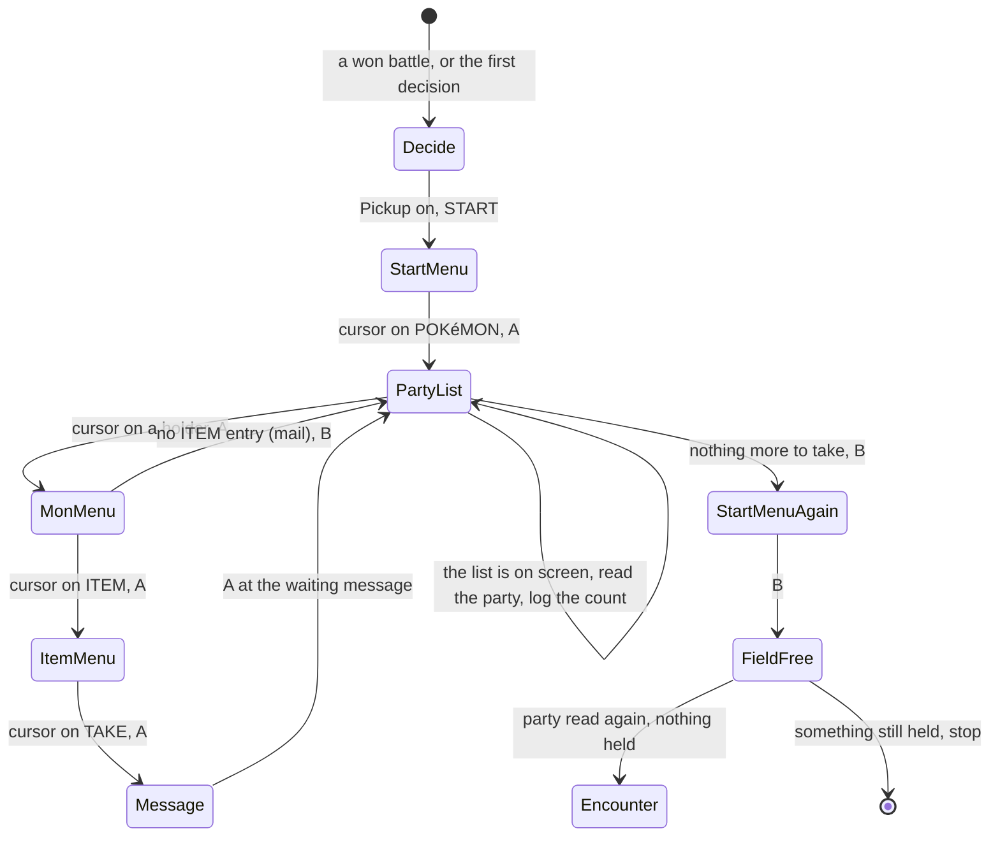

# Spec: Pickup in Ruby and Sapphire

Status: Draft, from the spike of 2026-11-21. Not started.
Last updated: 2026-11-21
Owner: Phil
Related: [research: the spike](../research/rs-pickup.md) (the source for every address, rule and timing here), [HGSS Pickup spec](pickup-mode.md) (the mode this opens to a second game; its FR numbers are cited as "HGSS FR-n"), [Pickup items windows](pickup-items-dashboard.md), [RS navigation and training](rs-navigation-and-training.md) (the train mode that wins the battles), [RS wild encounter](rs-wild-encounter.md), [QA automation](qa-automation.md), [feature workflow](feature-workflow.md), the decision [Hunts act as a human would](../decisions/global.md), AGENTS rule 16.

## Summary

The **Pickup** checkbox on Wild Encounter opens to Ruby and Sapphire. With it on, the bot trains as it already does on these games, and after every won battle it opens the start menu, chooses POKéMON, looks at the party list, takes every item a Pickup member holds through ITEM and TAKE, and closes the menus. That is the HGSS mode with a different menu: buttons instead of touches.

The spike ran the existing train mode for 31 won battles with five Zigzagoon in the party, after which all five held an item, and then drove the whole visit from memory on Sapphire 1.2 and Ruby 1.2: 2.5 s with nothing to take, about 1.7 s more for each item.

Three things on `main` are HGSS-only and are what this feature changes: who counts as a Pickup member (Gen 3 stores an ability slot, not an ability), the visit itself, and the item numbers the Pickup items window uses.

## Goals

- G1: the same checkbox, the same rules around it (only with a train mode, greyed out with the reason, Start refuses with the same sentence), on Ruby and Sapphire.
- G2: the bot looks before it knows: the party is read with the list on screen, after every won battle (the HGSS decision of 2026-11-09).
- G3: every press of the visit is confirmed by the byte it changes; every wait is bounded.
- G4: a visit that goes wrong stops the hunt with a plain sentence.
- G5: the Pickup items window shows Ruby and Sapphire items with the right names and sprites.
- G6: HGSS's Pickup does what it did.

## Non-goals

- Chained Encounter on Ruby and Sapphire. It is not offered there.
- Giving items, selling, or making room in the bag. A full pocket is a stop.
- Levelling the Pickup members. In Ruby and Sapphire the level does not change the loot.
- Mail. A member holding mail is not visited and is the "still holds" stop, as on HGSS.
- Versions 1.0. The profile serves 1.1 and 1.2.

## Requirements

### The choice

| ID | Requirement | Priority | Verified by |
|---|---|---|---|
| FR-1 | `HasPickup` is true for RS. The Pickup choice on Wild Encounter is no longer greyed out by capability; the sentence "Pickup is not available on Ruby and Sapphire." is deleted. HGSS FR-1 to FR-4 apply unchanged: shown only with a train mode, refused without one, and greyed out and refused when no party member has Pickup. | Must | Unit tests on `DisabledByCapabilities` and the Start refusals for both profiles; QA `rs-pickup-greyed`. |
| FR-2 | Who has Pickup is the profile's answer, not a comparison with 53 in `BotService` and the visit. HGSS: `Ability == 53`, as today. RS: the species and the ability slot the Gen 3 parser already gives: Zigzagoon (263), Linoone (264), Meowth (52), Teddiursa (216) and Phanpy (231) with slot 0; Aipom (190) with slot 1. An egg never counts. `PokemonData.Ability` keeps its meaning for Gen 3 (the slot), since it is stored with every encounter. | Must | Unit tests: each of the six species in its slot counts, Aipom in slot 0 and a Zigzagoon egg do not; the HGSS tests unchanged. |

### The visit

| ID | Requirement | Priority | Verified by |
|---|---|---|---|
| FR-3 | The visit is chosen by the profile, as the battle event and the navigator are: HGSS's `PickupTakeEvent`, and a new RS visit. `OrchestratorEvent.DecideOverworldAction` runs it where it runs HGSS's today (HGSS FR-5): on every decision with Pickup on that goes on to an encounter, so before the first battle and after every won one. | Must | Unit test: a decision with Pickup on runs the profile's visit on both profiles; off, never. |
| FR-4 | Opening. From the free field: START, confirmed by the start menu's input task being up (`sub_80712B4`, per game). The cursor is walked to POKéMON (action 1 in the entry list the game keeps) one press at a time, each confirmed by the cursor reading the next position; it is already there on every visit after the first. A, confirmed by callback 2 reading `CB2_PartyMenuMain`, the party task's function reading `HandleDefaultPartyMenu` and the palette fade off. | Must | Unit tests over scripted snapshots; QA log. |
| FR-5 | Looking. With the list on screen the party is read, and the members that have Pickup (FR-2) and hold an item are the slots to take. One log line with the count (FR-10). Nothing is decided from a read made before the list is up. | Must | Unit test: the held slots are those read at the list. |
| FR-6 | Taking, per held slot: Down or Up one press at a time until the party cursor reads the slot (each confirmed by the cursor); A, confirmed by the task function reading `sub_8089D94`; the Pokémon's menu entries are read and the cursor is walked to ITEM (id 2) one confirmed press at a time, because field moves the Pokémon knows come first in that menu; A, confirmed by the task function reading `sub_808A060`; Down, confirmed by the cursor reading 1 (TAKE); A, confirmed by the message printing with the menu window's state at 5 (waiting for a button); A, confirmed by the message ending and the task function back at `HandleDefaultPartyMenu`. A menu with no ITEM entry (mail, id 7) is closed with B, confirmed by the task function, and the slot is left. | Must | Unit tests: two held slots; a member with a field move; a mail holder; QA `rs-pickup-take`, `rs-pickup-field-move`. |
| FR-7 | Leaving: B, confirmed by callback 2 reading `CB2_Overworld`, the start menu's input task up again and the fade off (the game reopens the start menu itself); B, confirmed by the field lock reading 0. | Must | Unit test; QA: every visit ends field free. |
| FR-8 | Presses are the registry's RS macros, 2-frame holds, never a one-frame tap. A retry is only for a press whose confirming byte did not change within a bounded wait, and it is logged. Every wait ends in its state, cancellation, or a stale-timeout that names what it saw. | Must | Review; unit test for a stale-timeout at each step. |
| FR-9 | Stops, each parking the bot in Waiting with its sentence, the macro cleared first, as HGSS FR-7: after the visit the party is read again and a Pickup member still holding an item is "Pickup: {name} still holds {item name} after the take; check the bag and the Pokémon menu." (a full pocket and mail both end here); a stale-timeout names its step and the last snapshot. Resume returns to the decision. | Must | Unit tests; QA `rs-pickup-bag-full`. |
| FR-10 | Log lines as HGSS FR-9, prefix `[Pickup]`: the held count and the decision, written at the list; one line per take with the slot, the name and the item; the visit's total frames and ms; the stops. Each press line names what confirmed it. | Must | QA parses them. |
| FR-11 | Reads and addresses. The visit waits on snapshots from `RsStateReader`, which is at 15 of ApiHawk's 16 blocks with its training reads. The new values come from growing the two-byte field-window block to `0x0202E892`–`0x0202E91F` (it then carries the message-printing flag, the start menu's cursor, count and entries, and the menu window's state) and one new block of 10 bytes at `0x0202FFA8` (the Pokémon menu's cursor, count and entries); the party cursor is the sprite read the battle party screen already makes. Whether these are in the reader or one-frame block reads beside it is the planner's choice; a loop of single reads is not. New table members, each with the table's comment: the three task functions (the same in both games), `gPartyMenuMessage_IsPrinting`, the menu window's state, the Pokémon menu's three values, and per game the start menu's input task and `CB2_Overworld`. Values for 1.1 are the symbol tables', the same as 1.2 for every one of these. | Must | `RsPointerServiceTests`; `RsStateReaderTests`; no address outside the pointer services. |
| FR-12 | Run refuses Pickup, as it refuses a train mode, on a ROM without the per-game addresses (anything but US Ruby or Sapphire), with that refusal's sentence. | Must | Unit test. |

### Items

| ID | Requirement | Priority | Verified by |
|---|---|---|---|
| FR-13 | The Pickup tally and the Pickup items window get Gen 4 item numbers from both games, so names and sprites work with what is already on disk: an RS take is converted from its Gen 3 number before it is recorded (Super Potion 22 to 26, Full Heal 23 to 27, Ultra Ball 2 to 2, Rare Candy 68 to 50, Full Restore 19 to 23, Revive 24 to 28, Nugget 110 to 92, Protein 64 to 46, PP Up 69 to 51, King's Rock 187 to 221; by PKHeX's converter if the planner confirms it gives these, else by that table). An item outside the conversion is recorded as "Item {gen 3 id}" with no sprite. The log lines and the stop sentence name the item. | Must | Unit test: the ten items convert to those numbers and names; QA `rs-pickup` sees a named item with a sprite in the window. |
| FR-14 | The guide: the Ruby and Sapphire page gains Pickup: which Pokémon have it there, that the level does not matter, the item table with its chances, what a visit looks like, room in the bag (20 kinds of item, 99 of each), the stops, and target level 101 for no end. The page's greyed-choices table drops Pickup. | Must | Reviewer reads it. |

### Non-functional

| ID | Requirement | Verified by |
|---|---|---|
| NFR-1 | A visit with nothing to take under 4 s (the spike: 148 frames, 2.5 s). A visit that takes five under 15 s (the spike: 671 frames, 11.2 s). | QA timings. |
| NFR-2 | Thirty won battles in a row with Pickup on the QA save: a visit before the first and after every one, every visit ending field free, every held item taken, no stop. | QA `rs-pickup`. |
| NFR-3 | No ApiHawk change, no new package. HGSS's Pickup unchanged: its unit tests and `hgss-pickup`, `hgss-pickup-take`, `hgss-pickup-greyed` pass. The flee-only RS hunt gains no read (`rs-wild-speed` still at 265 an hour or better). | Tests; QA. |

## Design

### The cycle

### Why these choices

- **The same mode, a second visit.** Everything round the visit is shared already: the checkbox, the refusals, the party-read cache, where the orchestrator runs it, the tally, the window. Two games now have a visit, which is what the profile is for; it is the second implementation, so the seam is allowed by rule 2.
- **A profile answer for "has Pickup".** Changing what the Gen 3 parser writes into `Ability` would change a stored column's meaning for every RS encounter already logged. The rule is six species and a slot.
- **Read the menu, do not count on it.** ITEM's position moves when the Pokémon knows a field move, and the start menu's entries depend on the save. Both lists are in memory and the spike read them.
- **Convert item numbers at the tally.** The window, the sprites on disk and the names are keyed by Gen 4 number; all ten Pickup items exist there. One conversion at the edge leaves the dashboard untouched.
- **The party cursor is walked, not jumped.** Ruby and Sapphire have no touch screen; each Down is one press confirmed by the cursor sprite, about five frames.

### Where it lives

- `ShinyBotHunter/BotEvents/`: the RS visit beside `PickupTakeEvent`; `OrchestratorEvent.cs` takes the visit from the profile.
- `ShinyBotHunter/Games/GameProfile.cs`, `Rs/RsProfile.cs`, `Hgss/HgssProfile.cs`, `GameCapabilities.cs`: the visit, the has-Pickup answer, `HasPickup`.
- `ShinyBotHunter/Service/BotService.cs`: the refusal and the greyed choice ask the profile; the RS sentence deleted.
- `ShinyBotHunter/Games/Rs/RsStateReader.cs`, `Service/Pointers/RsPointerService.cs`, `Games/GameSnapshot.cs`: FR-11.
- `ShinyBotHunter/Service/PickupTally.cs`: FR-13.
- `ShinyBotHunter/Macro/Configs/RS/`: any new press text.
- The guide page `docs/guide/04-hunts/08-rs-wild-encounter.md`, `docs/architecture/system-overview.md`, `docs/specs/qa-automation.md`.

## QA

The save is `rs.qa-pickup` (`../shinybothunterqasaves/rs/qa-pickup.SaveRAM`, made by the spike, sha256 in the research doc): Route 101 grass at (14, 4), the shiny Mudkip at Lv 11 with Water Gun, five Zigzagoon at Lv 2 with nothing held. It is installed pristine before each run over the `SA-Wild` or `RU-Wild` SaveRAM, as `rs.qa-route101` is. Held items, a field move and a full pocket are written into RAM by the scenario (the party record rewritten as the training scenarios rewrite experience; the Items pocket at `gSaveBlock1 + 0x560`, 20 slots of item u16 and quantity u16).

| Scenario | Flow | Passes when |
|---|---|---|
| `rs-pickup` | Wild Encounter on `SA-Wild`, Spin, Train Standard, target level 101, Pickup on; thirty won battles | NFR-2: a `[Pickup]` count line at the list before the first battle and after every won one; every visit ends field free; the party in RAM holds nothing after each visit; every take logged with its item; the Pickup items window shows each taken item with its name and sprite; no stop; visits within NFR-1 |
| `rs-pickup-take` | the five Zigzagoon given Super Potion, Full Heal, Ultra Ball, Rare Candy and Full Restore in RAM; the same action; the first visit, before any battle | five takes in slot order, each press with its confirmation, the field free, the party empty-handed, the bag holding the five, under 15 s |
| `rs-pickup-field-move` | slot 6's first move written to Cut and a Nugget in its hand | the menu's entries logged with the field move first; ITEM found at position 3; the Nugget taken |
| `rs-pickup-bag-full` | the Items pocket's empty slots filled in RAM; a PP Up in slot 2's hand | the take message dismissed, the "still holds" stop with the item's name, the bot Waiting; after the scenario clears the pocket and presses Resume, the next visit takes it |
| `rs-pickup-lead-item` | the Mudkip given an item in RAM, one Zigzagoon given one | only the Zigzagoon's is taken; the Mudkip still holds its item; no stop |
| `rs-pickup-greyed` | `rs.qa-route101` (no Pickup member): the dashboard, then API Starts with Pickup and with Train Type None | the box disabled with "No Pokémon in your party has the Pickup ability."; both Starts 400 with the HGSS sentences |
| `rs-pickup-ruby` | `rs-pickup-take` on `RU-Wild`, then ten won battles | the same checks; proves the per-game addresses |
| `rs-pickup-heal` | `rs-pickup` with the lead's HP written low after a visit | the Pokémon Center trip, the walk back, a visit before the next battle, training goes on |
| Regression | `hgss-pickup`, `hgss-pickup-take`, `hgss-pickup-greyed`, `hgss-pickup-items-window`; `rs-train`, `rs-train-heal`, `rs-wild-sapphire` (Pickup no longer in its greyed list), `rs-wild-speed` | still pass |

## Suggested task split

| Task | Scope | Depends on | Size |
|---|---|---|---|
| P1 | The profile's two answers (the visit, has-Pickup), `HasPickup`, `BotService`'s refusal and greying through the profile, the orchestrator taking the visit from the profile (FR-1 to FR-3, FR-12) | none | M |
| P2 | The reads and the table members (FR-11) | none | M |
| P3 | The RS visit (FR-4 to FR-10) | P1, P2 | L |
| P4 | Item numbers at the tally (FR-13) | none | S |
| Q1 | The QA scenarios, the save's row in `qa-automation.md` | P3, P4 | L |
| D1 | Guide, architecture, close-out (FR-14) | P3 | S |

P1, P2 and P4 can start at once.

## Decided

- Spike: the visit is after every won battle with the party read at the list, by the HGSS decision of 2026-11-09 and the global decision that hunts act as a human would.
- Spike: a full pocket is a stop, not something the bot fixes.

## Open questions

- A Balls pocket that is full, and a slot at 99, were not run; both should end in the "still holds" stop by the decomp.
- Whether PKHeX's Gen 3 item converter gives FR-13's ten numbers. The table is the fallback.
- An Aipom, an egg and a fainted member were not on the emulator; FR-2 is from the decomp.

## Changelog

- 2026-11-21: first draft, from the spike.
