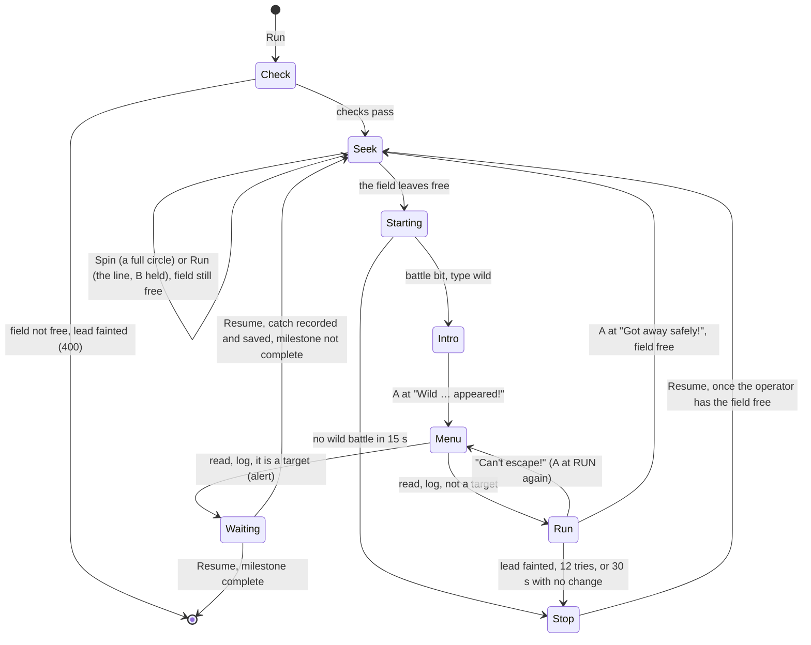

# Spec: wild encounter hunt in Ruby and Sapphire

Status: Implemented on `feature/rs-wild-encounter` (2026-11-15, epic #380). See "As built", "What diverged" and "Evidence".
Last updated: 2026-11-16
Owner: Phil
Related: [research: the spike](../research/rs-wild-encounter.md) (the source for every address, timing and rule here), the HGSS hunt's guide page [Wild and chained encounters](../guide/04-hunts/01-wild-encounter.md), [game profile spec](game-profile.md) (capabilities, the registry), [HGSS state reader spec](hgss-state-reader.md) (the snapshot and the bounded waits this reuses), [QA automation](qa-automation.md), [feature workflow](feature-workflow.md), the decision [Hunts act as a human would](../decisions/global.md), AGENTS rule 16.

## Summary

The existing **Wild Encounter** action opens to Ruby and Sapphire bots. The bot spins a full circle on its tile (Spin) or runs a short line with B held (Run) until a wild battle starts, presses A at "Wild … appeared!", reads the wild Pokémon at the action menu, logs it, and runs: Right, Down, A, then A at "Got away safely!". A target stops the bot at the action menu with the alert, and the operator catches it. Resume records the catch, saves, and carries on.

It is built by reuse, not beside HGSS (owner, 2026-11-15): the same orchestrator, the same Spin and Run events, the same targets, log, alert and Resume. What each game presses lives in the macro registry under the same macro names; what each game reads lives in its address table and its two readers. Only the battle itself is a new, small, Ruby and Sapphire piece.

The spike ran the cycle from memory about 190 times on the 1.2 ROMs with five presses a battle, none missed and none doubled. The target is 270 encounters an hour on the save as it is, with its shiny first Pokémon and no White Flute (owner, 2026-11-15); the spike measured 270 (13.3 s an encounter). Spin and Run each roll for an encounter every 8 frames, and each of their presses is confirmed inside the emulator by the existing move macro. Every value read is at the same address in all six English ROMs, so one address table serves both games.

This first version flees every battle. It does not train, heal, walk to a Pokémon Center or chain.

## Goals

- G1: wild shiny hunting on Ruby and Sapphire 1.2 from the dashboard, through the Wild Encounter action, with its Milestone, Target Type and Encounter Type.
- G2: every press is confirmed by the byte it changes and every wait is bounded (AGENTS rule 16). No timed press anywhere in the Ruby and Sapphire cycle.
- G3: speed. 270 encounters an hour with a shiny first Pokémon and no White Flute (owner, 2026-11-15, after a first target of 304; benchmark `40Cakes/pokebot-gen3`). Seeking runs at the game's own floor of one encounter check every 8 frames, the battle presses are as short as the game reads them, and the bot tells the operator when the save itself is what is slow.
- G4: the wild Pokémon is read when a player would know it: at the action menu, after it has been on screen through the intro.
- G5: one address table for Ruby and Sapphire at every version; nothing read differs by game.
- G6: as little new code as the two games' differences need. Press text goes in the macro registry, reads in the profile; the loop is HGSS's.
- G7: anything that is not the expected wild battle stops the bot for the operator with what it read.
- G8: QA can make the next encounter shiny with a cheat file, as on HGSS, with no QA code in the bot.

## Non-goals

- Fighting, training, Pickup, healing, walking to a Pokémon Center. The spike fought one battle on the same rules, but level-up, a new move and evolution are not mapped. The shared loop is where they would later plug in.
- Chained Encounter on Ruby and Sapphire (each leg ends with a walk home, which needs map data).
- Catching. The operator catches the target, as on HGSS.
- Map data or pathfinding for Hoenn.
- Water and caves as tested ground (owner, 2026-11-15). The Safari Zone, fishing, Rock Smash, and roaming Latios and Latias as a target of their own.
- Versions 1.0 and 1.1 as tested versions. The addresses are the same by the symbol tables, and the existing untested-revision warning applies; the profile still has no table for 1.0.
- Changing what the HGSS hunt does. Its macros move into the registry text for text.
- Emerald, FireRed, LeafGreen.

## Requirements

### What is shared with HGSS

| ID | Requirement | Priority | Verified by |
|---|---|---|---|
| FR-1 | The `Wild Encounter` registry entry serves both games. `HasWildEncounters` comes to mean the spin and run loops and a battle that can be fled; the RS profile declares it. What it used to imply moves to a new capability, `HasTraining` (a battle parser and overworld navigation: train modes, Pickup, healing), which HGSS declares and RS does not; the profile's constructor checks follow. `Chained Encounter` requires `HasOverworldNavigation`. For an RS bot the action's copy greys out, with a reason, Encounter Type Headbutt ("Ruby and Sapphire have no Headbutt trees."), Target Type No Target ("No Target needs a train mode, which Ruby and Sapphire do not have yet.") and Train Type Standard and Switch ("Training is not available on Ruby and Sapphire yet."), by `DisabledChoices`. | Must | Unit tests: Wild Encounter listed for an idle RS bot with those choices disabled; Chained Encounter not listed for RS; HGSS's list unchanged. |
| FR-2 | Spin, one event for both games. `SpinEncounterEvent` keeps its rotation (Up, Left, Down, Right, starting with the direction after the one faced) and its cache of one repeating macro per facing, and builds the macro from four registry macros of the bot's flavor: `SpinUp`, `SpinLeft`, `SpinDown`, `SpinRight`. HGSS's are today's text (`T.Up`, `W.5`, and so on), so its macro string does not change by a character. RS's are `M.Up.34.<a>`, `M.Left.51.<a>`, `M.Down.17.<a>`, `M.Right.68.<a>` with `<a>` = 50350262 (`0x030048B6`, two bytes before the facing byte of object 0): the `M` action holds each direction until the facing byte reads it and releases on that frame, so every turn is confirmed inside the emulator and takes 8 frames. | Must | Unit test: HGSS's four cached macros equal today's strings; RS's four equal the research doc's. QA log: turns in order, the tile unchanged. |
| FR-3 | Run, one event for both games. `RunEncounterEvent` reads the start tile from `IOverworldReader` and takes the two addresses the `M` action watches from the address table (new members, x and y: HGSS's `TrainerX`/`TrainerY`, RS's `0x02025732`/`0x02025734`), instead of casting to the HGSS table. An optional registry macro `RunHold` is joined to the first move's own step with `:` (RS: `H.B.1`, B held until the macro is cleared; HGSS has none and its macro string does not change). It must never be a step of its own before the first move: as a leading step it let the first direction be pressed for one frame before its coordinate was checked, and a battle that ended on the far row sent the player one tile off the line for ever (research doc, "The Run macro's first frame"). | Must | Unit test: HGSS's Run macro equals today's string; RS's equals `M.Down.<far>.33707828:H.B.1;M.Up.<near>.33707828`. QA `rs-wild-run`. |
| FR-4 | Before each Run start on RS the tile must be on the line and inside its two ends, because `M` waits for the coordinate to equal its destination and would hold the direction for ever from outside; otherwise the bot stops ("The player is off the run line."). After each Spin battle on RS the tile must be the start tile ("The player moved while turning."). No map data or pathfinder is involved: the coordinates are the game's own tile numbers on the current map. | Must | Unit test; QA. |
| FR-5 | The orchestrator, one for both games. `OrchestratorEvent` runs the RS hunt with three seams, each chosen by the profile and none by a flavor check in the loop: the battle event (HGSS's `BattleOrchestratorEvent`, RS's FR-9 event); saving after a catch goes through the profile (HGSS: the `SaveGame` macro as today; RS: FR-13); and a profile without overworld navigation completes where it stands instead of walking home. The catch check reads the party and the PC boxes on both games, each through its profile's `BoxLayout` (2026-11-16, #413; before, Ruby and Sapphire's read the party alone). | Must | Unit tests on each seam with a fake profile; HGSS route scenarios unchanged. |
| FR-6 | Logging an encounter and asking the target (today inside `BattleOrchestratorEvent.PokemonDataPending`: `AddEncounterAsync`, `IsTargetAsync`, `NotifyTargetFoundAsync`, Waiting) becomes one method both battle events call. | Must | Unit test; HGSS QA unchanged. |

### What Ruby and Sapphire add

| ID | Requirement | Priority | Verified by |
|---|---|---|---|
| FR-7 | State reader `RsStateReader : IGameStateReader`, from four reads (research doc, "Memory read by the spike"): the field lock, the battle bit, the player's controller function, the battle window's state. `Transitioning` when callback 1 is 0 (title screen, Continue menu); `FieldFree` when the lock and the battle bit are 0; `FieldTask` when the lock is 1 and the battle bit is 0; and with the battle bit set, `BattleMenu` when the controller function is `HandleInputChooseAction` (with the action cursor on the snapshot), `BattleMoveList` when it is `HandleInputChooseMove`, `BattleMessage` when the window state is 5, 8 or 9 (with the state on the snapshot), otherwise `BattleTurn`. The battle type and the outcome are on the snapshot in battle. One snapshot is at most three block reads. | Must | Unit tests on `FakeMemoryClient`, one per state, with the bytes the spike logged. |
| FR-8 | Overworld reader `RsOverworldReader : IOverworldReader`: map id as group × 256 + number from `gSaveBlock1.location`, the tile from `gSaveBlock1.pos`, facing from the player's object (1 down, 2 up, 3 left, 4 right, mapped to `Direction`). The player's object id is read at Run and must be 0, the object the Spin macros watch; otherwise Run refuses. Address table: every new read is a member of `RsPointerService` in the table's comment format; the two function addresses (`0x0802C099`, `0x0802C68D`) say that they are ROM code below `0x0803FBDC`, identical in all six English ROMs. | Must | Unit tests; `RsPointerServiceTests`; QA reads (14, 4) on map (0, 16) at Run. |
| FR-9 | The battle event for RS, from `BattleStart` to `BattleComplete` or Waiting. The battle must show the battle bit within 15 s of the field leaving free, with battle type wild (`0x0004` set; `0x0008`, trainer, and `0x0080`, Safari, clear); a field lock with no battle, or a battle that is not wild, stops the bot ("Something other than a wild battle started."). It presses the registry macro `BattleAdvance` (RS: `H.A.2`) only at `BattleMessage`, confirmed by the window state leaving the value it had: once before the action menu ("Wild … appeared!") and once after running ("Got away safely!"); "Can't escape!" and the others end the same way. | Must | Unit tests with scripted snapshots; QA log: every A names the window state it answered. |
| FR-10 | At the first `BattleMenu` of a battle the event reads `gEnemyParty[0]` (100 bytes) and parses it with the Gen 3 parser; a record that fails its checksum is read again until it passes or 2 s pass (then the bot stops). Then FR-6: log it, ask the target; a target leaves the menu on screen and presses nothing more. | Must | QA: one `encounters` row per battle; `rs-wild-shiny`. |
| FR-11 | Running: at `BattleMenu` with the cursor not 3, the registry macro `BattleCursorToRun` (RS: `H.Right.2;H.Down.2`), confirmed by the cursor reading 3 (a cursor that reads anything else is sent the missing press alone); then `BattleConfirm` (RS: `H.A.2`) only with the cursor at 3, confirmed by the screen leaving `BattleMenu`. If the menu comes back, the escape failed: `BattleConfirm` again, the cursor is still on RUN. The battle is over when the screen is `FieldFree`. The bot stops: when the lead's HP reads 0 at a menu or the outcome reads lost ("The first Pokémon fainted."); after 12 presses on RUN in one battle ("Could not run from this battle."); when the snapshot does not change for 30 s (the stale-timeout, naming the snapshot). | Must | Unit tests for a failed escape, a faint and a trap; QA `rs-wild-failed-escape`. |
| FR-12 | Run refuses with a 400 and one sentence, from fresh reads, for an RS bot: the field is not free ("Close any menu or message and stand in the field."); the party is empty or its first Pokémon has 0 HP ("The first Pokémon in the party has fainted."); a greyed-out choice of FR-1 sent anyway, or Pickup (FR-1's sentences). The Run range rules are the action's existing ones. Six in the party is not refused: a caught Pokémon sent to the PC is found there (2026-11-16, #413). | Must | Unit tests per refusal; QA `rs-wild-refusals`. |
| FR-13 | Saving on RS: the starter hunt's save step (`StarterHuntEvent.SaveViaStartMenuAsync`: read the start menu, walk the cursor to SAVE, the `SaveGame` macro) moves to where the starter hunt and FR-5's save seam both call it, with no change in what it does. After a Resume that finds the target in the party or a PC box the bot saves, records the catch (`AddCaughtPokemonAsync`) and flushes, as HGSS does. | Must | The starter hunt's tests still pass; QA `rs-wild-catch-resume`. |
| FR-14 | Log lines, prefix `[RsBattle]`, beside the shared `[Spin]` and `[Orchestrator]` lines: per encounter the species, level, personality value, shiny value and whether shiny, the presses with what confirmed each, failed escapes, and the battle's frames; every stop with the snapshot it read. `[Spin]` and the Run event log the seek's time. | Must | QA parses them. |
| FR-15 | At Run the bot logs, and returns with the started state for the dashboard to show, one line for each thing in the save that costs speed: the first Pokémon is shiny ("A shiny first Pokémon adds about 1.2 s to every battle."); its level is not above the highest wild level seen so far, checked again after each encounter ("A first Pokémon at or below the wild level gets the long battle transition."). It does not refuse. | Should | Unit test; QA `rs-wild-sapphire` sees the shiny line (the QA save's lead is shiny). |
| FR-16 | Input on RS: no one-frame tap (a one-frame `T.B` every other frame was never read). Battle presses are 2-frame holds; field directions are held by the `M` action. | Must | Review of the RS macro files. |
| FR-17 | The guide: [Wild and chained encounters](../guide/04-hunts/01-wild-encounter.md) gains a Ruby and Sapphire section (or a page of its own beside it, the writer's choice), with the dashboard page's action table: what the save needs (standing in grass; a first Pokémon that outruns what lives there; Poké Balls), Spin and Run, which choices are greyed out and why, that the bot stops at the action menu on a target and what Resume does, the stops and their sentences; and a section on speed: about 270 encounters an hour, and what makes it faster (a first Pokémon that is not shiny, with a short nickname, at a higher level than what lives there; the White Flute or Illuminate; text speed Fast). | Must | Reviewer reads it. |
| FR-18 | Every Gen 3 shiny is checked with PKHeX (`docs/decisions/global.md`, "Every Gen 3 shiny is checked with PKHeX"). At the first `BattleMenu`, after FR-10's checksum and only when the wild Pokémon is shiny, the event runs `LegalityService.Analyze` on the 100-byte record and logs `[RsBattle] legality OK   <Name> PV <pid>` or `[RsBattle] legality FAIL <Name> PV <pid>: logged as not shiny, running` followed by PKHeX's report. A legal shiny goes on to FR-6. An illegal one is written to the encounter log with `IsShiny` false, so it is kept but not counted as a shiny. It is not a target: no alert, no stop, and the battle is fled as in FR-11. A Pokémon that is not shiny is not analysed (NFR-1). | Must | Unit tests: a legal shiny reaches the target path; an illegal one is logged once marked as failed, not alerted, not parked, and fled with five presses; a non-shiny is never analysed; QA `rs-wild-shiny` logs the verdict for `CD631295`. |

### Non-functional

| ID | Requirement | Verified by |
|---|---|---|
| NFR-1 | The target is 270 encounters an hour on Route 101, in Spin and in Run, on the QA save as it is (a shiny first Pokémon, no White Flute; the spike: 270 and 270, counted in game frames at 60 to the second). Measured by wall clock over a timed run with nothing but the bot touching the emulator (owner, 2026-11-15); 266 and 269 an hour, measured at full emulator speed, are acceptable (owner, 2026-11-15), and the scenario fails below 265. The parts, each checked: seeking at no more than 9 frames a check; a fled battle, roll to free field, no more than 700 frames (the spike: 692); no more than 30 of those frames between a state the bot waits for and its press landing (the spike: about 26). | QA `rs-wild-speed`. |
| NFR-2 | No ApiHawk change, no new package or project. New: one capability, two readers, one battle event, address members, registry macro files, the QA cheat and scenarios. Changed: the six shared places of FR-1 to FR-6. | PR description. |
| NFR-3 | HGSS does what it did. Its Spin and Run macro strings are equal to today's (unit tests), its battle event is untouched but for FR-6's extraction, and the HGSS route scenarios pass before the feature merges. | Unit tests; `hgss-route33`, `hgss-route33-train`, `hgss-headbutt`. |

## Design

### The cycle

Seek, Waiting, Resume and the milestone are the orchestrator's, as on HGSS. Intro, Menu and Run are the RS battle event.

### What is reused, and how

The first draft of this spec made a separate action and event for Ruby and Sapphire. The owner asked for the opposite: reuse the macro registry and keep duplication with HGSS low. Reading the HGSS hunt against what the spike proved, the two games differ in three kinds of thing, and each has a home that already exists.

| Differs | Home | HGSS | Ruby and Sapphire |
|---|---|---|---|
| What is pressed | The macro registry, same macro name per flavor | `SpinUp` = `T.Up`, `W.5`; no `RunHold`; the touch macros | `SpinUp` = `M.Up.34.50350262`; `RunHold` = `H.B.1`; `BattleAdvance`, `BattleCursorToRun`, `BattleConfirm` |
| What is read | The profile: address table, `IGameStateReader`, `IOverworldReader` | the FieldSystem chain | four fixed addresses |
| How a battle goes | The profile's battle event | `BattleOrchestratorEvent` (touch screen, training, level-up, evolution) | the RS battle event (A at a message, the cursor, flee) |

Everything else is one copy: the orchestrator's loop and its states, Spin's rotation and cache, Run's line, the targets, the encounter log, the shiny alert, the event runner's Waiting and Resume, the catch check, the milestone.

The registry needs nothing new to do this. A macro file names its flavor, the registry keys by flavor and name, and `GetMacro(flavor, name)` already returns the right text; the one addition is a way to ask whether an optional macro (`RunHold`) exists. The RS macros are constants because the addresses they watch are fixed: Ruby and Sapphire do not move their data as HGSS does.

What cannot be shared is the battle. HGSS's battle event reads the battle app through the HGSS chain, presses the touch screen, and is mostly about fighting. The RS battle is three confirmed presses and a read. Making one class do both would be the abstraction the principles warn against; two battle events behind the profile is two real implementations. Training on Ruby and Sapphire, later, grows the RS battle event and sets `HasTraining`; nothing above it changes.

These seams come from reading `OrchestratorEvent`, `SpinEncounterEvent`, `RunEncounterEvent` and `BattleOrchestratorEvent`, not from running them against Ruby and Sapphire. The planner confirms each against the code.

### Reading the state

Four values tell the whole cycle apart, and none of them depends on the game or the version (research doc, "What memory shows through one cycle"):

| Screen | Lock `0x030006A4` | Battle bit `0x03001BAD` bit 1 | Controller function `0x03004330` | Window state `0x03004226` |
|---|---|---|---|---|
| `Transitioning` (callback 1 at `0x03001770` is 0) | | | | |
| `FieldFree` | 0 | 0 | | |
| `FieldTask` | 1 | 0 | | |
| `BattleMenu` | | 1 | `0x0802C099` | |
| `BattleMoveList` | | 1 | `0x0802C68D` | |
| `BattleMessage` | | 1 | other | 5, 8 or 9 |
| `BattleTurn` | | 1 | other | other |

The snapshot's existing optional fields carry the rest: the window state in `TextPrinter`, the action cursor in `Prompt`, the outcome in `Outcome` when the byte is not 0, mapped from this game's numbers (1 won, 2 lost, 3 drew, 4 ran, 7 caught; `include/constants/battle.h`) to the enum, whose numbers are HGSS's. The battle type needs one new optional field, or the battle event reads it itself; the planner picks.

Because these are the shared `GameScreen` values, the shared events' own waits work unchanged: Spin and Run already wait for "not `Transitioning`, `FieldFree`, `FieldTask` or `OtherApp`" as the start of a battle, and for `FieldFree` before they begin.

`HandleInputChooseAction` is the function that reads the buttons at the action menu, and window state 8 is the state that reads A. Both are the state that takes the input, not one that appears before it (the Sinjoh hunt's lesson).

Launching a Ruby or Sapphire bot with Launch Bot + Continue will now wait for `FieldFree` after the continue, as it already does for HGSS, because the RS profile has a state reader. That is wanted; QA checks it.

### Reading the wild Pokémon

`gEnemyParty[0]` holds it from the encounter roll, in the field, about 1.4 s before the battle screen. The bot does not read it there. It reads at the action menu, when the Pokémon has slid in, shown its colour and, if shiny, sparkled. That is when a player knows, and it is also where the bot would stop for a target, with RUN and BAG on screen for the operator.

### Running

The cursor is 0 (FIGHT) at the start of every battle and RUN is 3: Right sets bit 0, Down sets bit 1. The two go as one macro and the cursor is read once, so A is only ever pressed on RUN. An escape that fails prints "Can't escape!", which waits for A like every other battle message, lets the wild Pokémon move, and brings the menu back with the cursor still on RUN; the spike saw two and four failures in a battle and got away each time. The chance to escape rises with each try, so 12 presses on RUN without leaving means a trap (Arena Trap, Shadow Tag, Magnet Pull), and the bot stops.

Pressing B on every frame outside the menu, as pokebot-gen3 does, is not used: it saved 2 frames a battle and is a timed press.

### Spin and Run, at the game's floor

The game rolls for an encounter at the end of a turn in place exactly as at the end of a step. A turn is 8 frames and a running step is 8 frames, so both modes check 7.5 times a second and neither is faster; walking is half that. The two recorded clips show it frame by frame (research doc, "Videos").

The `M` action holds a direction until the upper half of four bytes equals a number, and lets go on that frame. It was built for HGSS's coordinates, but it does not care what the bytes are:

- Run: Ruby and Sapphire keep the tile as two 16-bit numbers, x then y, so the address of x serves for y and two bytes earlier serves for x.
- Spin: the same action pointed two bytes before the facing byte holds Up until the player faces up (the upper half reads 17 down, 34 up, 51 left, 68 right). That is a confirmed press with no round trip to the bot, which is why it reaches 8 frames a turn where a turn confirmed over HTTP took 16.

Spin turns a full circle, Up, Left, Down, Right, as the HGSS Spin does, from one cached macro per starting direction (owner, 2026-11-15). The spike ran it for 26 encounters: the turns came in order, 8.4 frames each, and the player never left the tile. The direction already faced is never pressed: the macro starts with the next one, and a step whose direction is already faced is satisfied without a press.

So every press of both modes is confirmed by the byte it changes (rule 16), inside ApiHawk, with no ApiHawk change. A timed spin macro is what HGSS has; on Ruby and Sapphire a timed two-direction one walked the player off the tile in the spike.

### Where it lives

- `ShinyBotHunter/Macro/Configs/HGSS/`: `spin_up.yaml`, `spin_left.yaml`, `spin_down.yaml`, `spin_right.yaml` (today's text). `ShinyBotHunter/Macro/Configs/RS/`: the same four, `run_hold.yaml`, `battle_advance.yaml`, `battle_cursor_to_run.yaml`, `battle_confirm.yaml`. `Macro/MacroRegistry.cs`: asking whether a macro exists.
- `ShinyBotHunter/BotEvents/SpinEncounterEvent.cs`, `RunEncounterEvent.cs`: FR-2, FR-3, FR-4.
- `ShinyBotHunter/BotEvents/OrchestratorEvent.cs`, `BattleOrchestratorEvent.cs`: FR-5, FR-6.
- `ShinyBotHunter/Games/GameCapabilities.cs`, `GameProfile.cs`, `Games/Hgss/HgssProfile.cs`, `Games/Rs/RsProfile.cs`, `Service/Pointers/IPointerService.cs`, `HgssPointerService.cs`, `RsPointerService.cs`: the capability split, the profile's seams, the address members.
- `ShinyBotHunter/Games/Rs/RsStateReader.cs`, `RsOverworldReader.cs`, `ShinyBotHunter/BotEvents/RsBattleEvent.cs` (new).
- `ShinyBotHunter/Games/EventRegistry.cs`, `Service/BotService.cs`: FR-1's requirement and disabled choices, FR-12.
- `ShinyBotHunter/BotEvents/StarterHuntEvent.cs`, `Service/RsStartMenuService.cs`: FR-13.
- `PokemonDashboard`: only if the Target Type and Train Type dropdowns do not yet honour `DisabledChoices`.
- `ShinyBotHunter.Qa/Cheats/rs-usa-rev2/`, `ShinyBotHunter.Qa/dashboard/rs-wild-*.spec.ts`.
- The guide, `docs/architecture/system-overview.md`, `docs/specs/game-profile.md` (the capability), `docs/specs/qa-automation.md`.

## QA

Save in `../shinybothunterqasaves/rs/`: `qa-route101.SaveRAM` (the owner's Sapphire save: Route 101 grass at (14, 4), a shiny Lv 7 Mudkip, five Poké Balls, the Running Shoes, trainer IDs 39541 / 17794, text speed Fast). ROM copies `SA-Wild` (Sapphire 1.2) and `RU-Wild` (Ruby 1.2); the save loads on both. The QA install has both SaveRAM files and their `.bak` staged.

The emulator rewrites a 16-byte clock footer on close, so "save unchanged" compares the first 131,072 bytes.

The shiny cheat is one line freezing `gRngValue` (`0x03004818`) at `67F18FB9`, kept in `ShinyBotHunter.Qa/Cheats/rs-usa-rev2/` with a README. It is installed under the game's name (`GBA\Cheats\Pokemon - Sapphire Version (USA, Europe) (Rev 2).cht`, and the Ruby name), loads disabled, and is armed with the hotkey **during a battle**: the hotkey's Shift is the GBA's Select in the QA install, and Select in the field opens a message. The value belongs to this save's trainer IDs and Route 101's rate; the spike's `seed.py` makes another.

A milestone for the game RS (for example `Route 101`) must exist in the QA Mongo.

| Scenario | Flow | Passes when |
|---|---|---|
| `rs-wild-refusals` | API Start on `SA-Wild`: with the lead's HP written to 0; with Headbutt; then with the Select message on screen | each a 400 with its sentence, no event; the last one "Close any menu or message and stand in the field." |
| `rs-wild-sapphire` | Start Wild Encounter on `SA-Wild`, ShinyTarget, Spin, from the UI; ten encounters; cancel | Headbutt, No Target and the train types greyed out with their reasons; ten `encounters` rows, species Wurmple, Zigzagoon or Poochyena, Lv 2 or 3; the turns in the order Up, Left, Down, Right; per encounter exactly five battle presses, each with its confirming value; the player still on (14, 4); the shiny-lead speed line at Run; the save's first 131,072 bytes unchanged |
| `rs-wild-ruby` | the same on `RU-Wild`, five encounters | the same checks; proves one table for both games |
| `rs-wild-run` | Run with y range 1 from (14, 4), ten encounters | the tile stays in rows 3 to 5 of column 14, including after a battle that ended on row 3 or 5; ten rows; steps at 8 frames a tile (B held) |
| `rs-wild-speed` | the save as it is; Spin for twenty minutes, then Run with y range 1 for twenty; no window recorder and no memory access by the scenario while the bot hunts | the rate from the first and last encounter times against the 270 target, failing below 265; NFR-1's per-battle parts from the logged frame counts |
| `rs-wild-failed-escape` | the scenario writes the lead's Speed to 1 in party RAM (`0x030043BE`, two bytes) before Run; Spin; cancel after the first battle in which an escape fails | at least one `[RsBattle]` line for a failed escape followed by another A on RUN with the cursor still 3; no stop. Getting away is not required (owner, 2026-11-15) |
| `rs-wild-catch-resume` | the scenario writes a Master Ball into the first ball slot (`0x02025D34`: item 1, quantity 5); Spin; arms the shiny cheat as `rs-wild-shiny` does; when the bot is Waiting the scenario disarms the cheat and catches it itself (Right, A, Right, A, A; A at each battle message; A twice at the Pokédex page; B at the nickname), waits for the free field, and presses Resume | the bot saves through the start menu; one new `CaughtPokemon` with personality value `CD631295`; the saved SaveRAM holds it in party slot 2; the hunt carries on or completes by the milestone |
| `rs-wild-catch-box` | as `rs-wild-catch-resume`, with the party made six before Run (slot 1 copied into slots 2 to 6, then the count); after the Pokédex page the scenario answers the nickname question (B) and the "… was sent to …'s PC." message (A) as the memory shows them, waits for the free field, reads `gPokemonStorage`'s boxes from `0x020300A4`, and presses Resume | Run starts with six in the party; party count still 6 and personality value `CD631295` in a box slot in RAM; `Found pokemon: True` and the bot saves through the start menu; one new `CaughtPokemon` with that personality value; the hunt carries on with a new seek, no stop and no Complete; the saved SaveRAM differs from the pristine copy |
| `rs-wild-shiny` | Spin on `SA-Wild`; after the second encounter's action menu is logged, arm the cheat; let the bot flee | the next encounter is Wurmple with personality value `CD631295`, shiny; one alert; the bot Waiting at the action menu with no press after the read; the cheat disarmed during that battle and the battle fled by the scenario before shutdown |

Both RAM writes stand in for an edited save (a slow lead, a Master Ball from PKHeX): the spike made them and they behaved as the real thing, and they keep the QA folder at one pristine save. Unit tests cover what the emulator cannot easily produce: the lead fainting, twelve failed tries, a trainer battle, a lock with no battle.

The HGSS scenarios of NFR-3 run before the feature merges, because FR-2, FR-3, FR-5 and FR-6 touch the code they exercise.

## Suggested task split

| Task | Scope | Depends on | Size |
|---|---|---|---|
| W1 | RS address members, `RsStateReader`, `RsOverworldReader`, the profile carrying them (FR-7, FR-8) | none | M |
| W2 | Spin and Run from the registry and the address table: the HGSS macro files, the optional-macro question, the two events, the RS macro files for them (FR-2, FR-3, FR-4) | none | M |
| W3 | The save step moved for both callers (FR-13, first half) | none | S |
| W4 | The capability split and the orchestrator's four seams; the encounter-and-target method (FR-1's capabilities, FR-5, FR-6) | none | M |
| W5 | `RsBattleEvent` and its macro files (FR-9, FR-10, FR-11, FR-14, FR-16) | W1, W4 | M |
| W6 | Wild Encounter for RS: the disabled choices, the refusals, the speed lines, the RS save seam wired (FR-1, FR-12, FR-13, FR-15) | W2 to W5 | M |
| W7 | QA: the cheat and its README, the eight scenarios, the HGSS regression runs, `docs/specs/qa-automation.md` | W1 to W6 | L; the planner may split the catch scenario out |
| W8 | Guide, architecture and game-profile docs, close-out (FR-17) | W6 | S |

W1 to W4 can run side by side once the planner has given the profile and address-table files to one of them (W1 and W4 both add members there).

## Decided

- Owner, 2026-11-15: reuse over a parallel build. One Wild Encounter action; the macro registry holds each game's press text; the loop is shared. This replaces the first draft's separate `RS Wild Encounter` action and event.
- Owner, 2026-11-15: Spin turns a full circle, cached per facing as on HGSS.
- Owner, 2026-11-15: Run holds B.
- Owner, 2026-11-15: the target is 270 encounters an hour with the shiny lead and no White Flute. It was first 304, benchmarked against pokebot-gen3; the spike showed that needs a lead that is not shiny and the White Flute or Illuminate (298 and 311 measured). The bot reports what in the save costs speed (FR-15) and the guide explains it.
- Owner, 2026-11-15: a failed escape goes back to RUN and is a QA scenario (a re-attempt is enough); catch and Resume is a QA scenario with a Master Ball; water and caves do not matter for this version.
- Spike: flee only in this version.
- Spike, replaced by the owner on 2026-11-16: a free party slot was required at Run, because Ruby and Sapphire's box storage was not mapped.
- Owner, 2026-11-16: the catch check reads the PC boxes from memory, as on HGSS; nothing is opened on screen. A full party is neither refused at Run nor a stop ("a full party is not a complete just how in HGSS its not a complete").
- Spike: the bot reads the wild Pokémon at the action menu, not at the roll.
- Spike: Spin and Run are `M` macros, so every direction press is confirmed inside the emulator. A timed spin is not used on Ruby and Sapphire.

## As built

Implemented on `feature/rs-wild-encounter`, epic #380, 2026-11-15. The requirement rows above stand except where "What diverged" says otherwise; the changelog has each change as it was made.

- One `Wild Encounter` action for both games. An RS bot is offered it with Headbutt, No Target, Standard and Switch greyed out with their reasons (`BotService.DisabledByCapabilities`); Chained Encounter is not offered.
- `GameCapabilities.HasTraining` is new; `HasWildEncounters` means the spin and run loops and a battle that can be fled. `GameProfile` has two new members, `CreateBattleEvent` and `SaveGame`.
- `RsStateReader` and `RsOverworldReader`; the RS address members in `RsPointerService`; `IPointerService.RunWatchX` / `RunWatchY`.
- `SpinEncounterEvent` and `RunEncounterEvent` press registry macros (`SpinUp`, `SpinLeft`, `SpinDown`, `SpinRight`, the optional `RunHold`). HGSS's strings are unchanged character for character.
- `RsBattleEvent`: A at a battle message, the read at the action menu, the PKHeX check on a shiny, the log and the target question, Right and Down as one macro confirmed by the cursor reading 3, A on RUN, A at "Got away safely!". Macros `BattleAdvance`, `BattleCursorToRun`, `BattleConfirm`.
- `OrchestratorEvent`: the battle event from the profile, the catch check over the party and the PC boxes on both games (#413), the save through the profile, completing in place without navigation, `LogEncounterAndAskTargetAsync` shared by both battle events.
- `RsPointerService.BoxLayout` is `gPokemonStorage`'s boxes; the RS profile declares `CanReadBoxes` (#413).
- `RsStartMenuService.SaveViaStartMenuAsync` is the save step for the starter hunt and for Resume after a catch.
- Speed lines at Run on `EmulatorState.SpeedLines`, shown on the emulator card.
- QA: `ShinyBotHunter.Qa/Cheats/rs-usa-rev2/`, `rs-wild.ts`, eight `rs-wild-*` scenarios.
- No ApiHawk change, no package, no project, no interface.

## What diverged

1. **FR-3, the Run macro's order.** One order serves both games, HGSS's: `M.Up.<near>.33707828:H.B.1;M.Down.<far>.33707828`. The B hold is still joined to the first move's step.
2. **FR-4 on both games.** The run-line check and the start-tile check have no flavor test, so they apply to HGSS too: Run stops where it used to hang, and Spin stops off its start tile. Spin's check runs at the start of every seek.
3. **FR-7.** One snapshot is one multi-block request of seven small reads from one frame, not three blocks: ApiHawk caps a block at 0x1000 bytes and the values are further apart. The battle type is not on the snapshot; the battle event reads it.
4. **FR-9, the locked field.** Spin and Run hand over only at a battle screen, so the 15 s stop for a locked field with no battle lives in `SpinEncounterEvent.SeekAsync`, for both games. On HGSS a field message during a seek now stops after 15 s where it used to hang.
5. **FR-12.** Two refusals the spec did not have: the player not being map object 0, and a party that cannot be read.
6. **A full party.** Until 2026-11-16 Run refused six in the party and a full party after a catch ended the hunt as Complete, because the catch check read the party alone. Since #413 the check reads the PC boxes and neither happens (owner).
7. **FR-15.** The level line compares each wild level with the lead's level read at Run, so it can only appear after an encounter, never at Run.
8. **FR-18 is new** (owner, 2026-11-15): a shiny is checked with PKHeX before it counts. At first an illegal shiny was not written to the encounter log. Since 2026-11-16 (owner, #414: "lets log it. the data will be useful in the future.") it is written with `IsShiny` false. The column means "counts as a shiny", so the counts are not inflated, and the shiny value of 0 to 7 still tells the row apart. Since #421 the RS starter hunt marks its row the same way.
9. **NFR-1, the rate.** The spike's 270 was counted in game frames at 60 to the second. By wall clock at full emulator speed the bot measured 266.4 to 269.0 an hour in Spin and 269.0 to 273.9 in Run; the owner accepted that. The per-battle parts held in every run: 685 frames from the roll to the free field, about 15 frames across a battle's presses.
10. **The QA window recorder slows the emulator** from 59.6 to 56.95 frames a second, which read as 257 and 259 an hour. `rs-wild-speed` records no emulator video.
11. **FR-16 and the save step.** `RsStartMenuService` still opens the start menu with one-frame taps (`T.Start`, `T.Down`), moved unchanged by FR-13. It worked in every `rs-wild-catch-resume` run; each tap is checked against the menu cursor and retried.

## Evidence

Emulator runs on the dev PC, QA BizHawk, English Sapphire 1.2 (`SA-Wild`) unless marked, 2026-11-15. Run folders are under `ShinyBotHunter.Qa/dashboard/qa-runs/` and are not committed. The bot code of the runs marked (a) is 576790e, the last bot commit before the legality check; those marked (b) include the legality check (6002eb5), which is the bot code of the branch tip.

| Scenario | Run folder | Result |
|---|---|---|
| `rs-wild-refusals` | `20261116-001157` (a) | passed: six in the party, a fainted lead, Headbutt and a field message each a 400 with its sentence, no event |
| `rs-wild-sapphire` | `20261116-000552` (a), `20261116-045819` (b) | passed: ten fled encounters by Spin, five presses each, the player on (14, 4), the greyed choices, the shiny-lead line, the save unchanged |
| `rs-wild-ruby` | `20261116-000906` (a), Ruby 1.2 (`RU-Wild`) | passed: five fled encounters, the same checks |
| `rs-wild-run` | `20261116-004032` (a), `20261116-050112` (b) | passed: ten fled encounters, every seek from rows 3 to 5 of column 14, eight of them from an end row |
| `rs-wild-failed-escape` | `20261116-004325` (a) | passed: four failed escapes in one battle, A on RUN again each time, no stop |
| `rs-wild-catch-resume` | `20261116-004449` (a), `20261116-045613` (b) | passed: the shiny caught with a Master Ball, the save through the start menu after Resume, one `CaughtPokemon`, slot 2 in the saved SaveRAM |
| `rs-wild-shiny` | `20261116-001537` (a), `20261116-041246` (b) | passed: Wurmple `CD631295` after arming, one alert, Waiting with no press after the read; in (b) `legality OK` |
| `rs-wild-speed` | `20261116-041428` (b), twenty minutes a mode, no recorder | Spin 266.4 an hour over 87, Run 273.9 over 90, at 59.63 frames a second; roll to free field mean 685 frames (maximum 692), press frames mean 14.8. Ran before the 265 floor was written into the scenario, so the run itself ended as failed on Spin's 266.4 |
| `rs-wild-speed`, earlier | `20261116-035243` (a), thirty a mode, no recorder; `20261116-004654` (a), with the recorder | 266.6 and 269.0 an hour at 59.6 frames a second; 257.3 and 259.2 at 56.95 |
| `hgss-route33` | `20261116-001725` (a) | passed |
| `hgss-pickup` | `20261116-001946` (a) | passed (the HGSS train path and Pickup) |

Runs of 2026-11-16, after the owner's review of PR #412. Those marked (c) are on the branch tip's bot code (the box read of #413 and the illegal-shiny row of #414 included).

| Scenario | Run folder | Result |
|---|---|---|
| `rs-wild-catch-box` | `20261116-184852` (c) | passed at its first run: Run started with six in the party; the shiny went to box 1 slot 1 (`0x020300A4`); Resume found it there, saved, recorded it, and the hunt carried on with a full party |
| `rs-wild-catch-resume` | `20261116-185121` (c) | passed |
| `rs-wild-refusals` | `20261116-185327` (c), without the six-in-party step | passed |
| `rs-wild-sapphire` | `20261116-185459` (c) | passed |
| `rs-wild-shiny` | `20261116-185750` (c) | passed |
| `rs-wild-run` | `20261116-185913` (c), y axis; `20261116-163554`, x axis (x range 1 along row 4) | passed on both axes |
| `hgss-route33` | `20261116-190208` (c) | passed |
| `hgss-wild-speed` | `20261116-180709`, the dry Route 29 save, twenty minutes a mode, no recorder, a shiny Typhlosion lead | Run 192.2 an hour over 63, Spin 178.2 over 58, against the owner's 189 for a grass route |
| `hgss-wild-speed`, Route 33 (always rain) | `20261116-163901` on this branch; `20261116-172047` on `main` (twelve minutes a mode) | Run 163.4 and 164.6 an hour, Spin 152.7 and 156.8: the feature did not change HGSS's speed |

Not run again on (c): `rs-wild-ruby`, `rs-wild-failed-escape`, `rs-wild-speed`, `hgss-pickup`.

Not run: `hgss-route33-train` and `hgss-headbutt`. Their saves (`Pokemon HeartGold2`, `HG-Headbutt`) are not on the dev PC.

What the emulator found, all in the scenarios and none in the bot: an RS bot has one action, so the card shows no button for it; Cancel when the Admin window is on another tab; A pressed once at a message that was still printing; "Resume" is a label with a Run button. The bot ran its first hunt on the emulator without a change.

## Open questions

None that block the merge. Not run on the emulator: a fainted lead, a trap (twelve tries), a battle that is not wild, a locked field with no battle during a seek, the object-id refusal, a shiny that PKHeX fails, the slow-transition speed line, versions 1.0 and 1.1. Each has unit tests.

## Changelog

- 2026-11-15: first draft, from the spike.
- 2026-11-15: the owner's notes. Second pass on the emulator: Spin and Run as `M` macros at 8 frames a check, B held in Run, 2-frame battle presses (13.3 s an encounter); a failed escape and a Master Ball catch run; two QA scenarios added.
- 2026-11-15: the 304 an hour target. pokebot-gen3's tips tried on the emulator; the speed requirement, the speed lines and `rs-wild-speed` added. The owner then set the target at 270 with a shiny lead and no White Flute.
- 2026-11-15: frame-exact videos of both modes; the Run macro's B hold moved into the first move's step after an overshoot was found and fixed.
- 2026-11-15: the owner asked for a full-circle Spin and for reuse of the macro registry and the HGSS code. Rewritten around one Wild Encounter action, the shared orchestrator, Spin and Run, registry macros per flavor, and an RS battle event; requirements renumbered; task split redone.
- 2026-11-15: FR-3 as built: one order on both games, HGSS's (Up then Down, Right then Left). The RS Run macro is `M.Up.<y - range>.33707828:H.B.1;M.Down.<y + range>.33707828`. The two addresses are `IPointerService.RunWatchX`/`RunWatchY` (HGSS `TrainerX`/`TrainerY`, RS `0x02025732`/`0x02025734`).
- 2026-11-15: FR-4 as built, on both games: Run checks the line before every seek; Spin checks the start tile at the start of every seek, before anything is pressed, not only after a battle.
- 2026-11-15: FR-7 as built: one multi-block request of seven direct reads on one frame (ApiHawk's `MaxBlockLength` is 0x1000). The battle type is not on the snapshot: `RsBattleEvent` reads `gBattleTypeFlags` itself. `Outcome` is on every battle screen.
- 2026-11-15: FR-9 as built: the 15 s lock-with-no-battle stop lives in Spin and Run (`SpinEncounterEvent.SeekAsync`) on both games, with the same sentence. `RsBattleEvent` keeps a 15 s stale for the battle bit; the type check after it is one read.
- 2026-11-15: FR-12 as built: the object id (FR-8) is a refusal at Run for both encounter types: "The player is not the first object on this map, which the bot watches as it turns." An unreadable party refuses with "The party could not be read; try again once the game is in the field."
- 2026-11-15: a full party seen before an encounter on a profile without box reads (after a recorded catch, in practice) ends the hunt as Complete and logs `[Orchestrator] Leave a free party slot so a caught Pokémon stays in the party.` (orchestrator, W4 plan review).
- 2026-11-15: FR-10 as built: a record that fails its checksum for 2 s stops with "The wild Pokémon's record failed its checksum for 2 s."
- 2026-11-15: FR-13 as built: the save step's home is `RsStartMenuService.SaveViaStartMenuAsync`, reached through `GameProfile.SaveGame`. Its start-menu line is prefixed `[StartMenu]`.
- 2026-11-15: FR-14 as built (W2c): `[Run] from (<x>, <y>) macro=<macro>`, and `[Spin] seek:` / `[Run] seek:` in two parts (the macro to the field leaving free, then to the battle screen).
- 2026-11-15: FR-15 as built: the slow-transition line compares each wild level with the lead's level read at Run. The lines travel on `EmulatorState.SpeedLines` to the emulator card.
- 2026-11-15: FR-18 (#408): the owner's rule that every Gen 3 shiny is checked with PKHeX, the Jirachi aside. GBA emulators are unreliable. In the wild hunt an illegal shiny is fled and not written to the encounter log, so it never counts as a shiny.
- 2026-11-15: NFR-1's rate (owner): measured by wall clock over a timed run with no recorder; 266 and 269 an hour at full emulator speed are acceptable; `rs-wild-speed` reports against 270 and fails below 265.
- 2026-11-15: closed out. Status Implemented; "As built", "What diverged" and "Evidence" added.
- 2026-11-16: FR-18 (#414, owner): an illegal wild shiny is written to the encounter log with `IsShiny` false, kept for later and not counted as a shiny; it is still fled, not alerted.
- 2026-11-16 (#413, owner): the catch check reads the PC boxes on Ruby and Sapphire (`gPokemonStorage`, decomp only); the six-in-the-party refusal at Run and the full-party stop are deleted.
- 2026-11-16: the owner's review of PR #412: the catch check reads the PC boxes (#413), an illegal shiny is logged (#414), Run on the x axis and an HGSS speed run on a dry route (#415), a catch with a full party (#417). Evidence added; the box address was read on the emulator.
- 2026-11-16: FR-18 (#421, owner): the RS starter hunt matches the wild hunt; it analyses a starter before writing its row, and an illegal shiny starter is written with `IsShiny` false and reset past.
