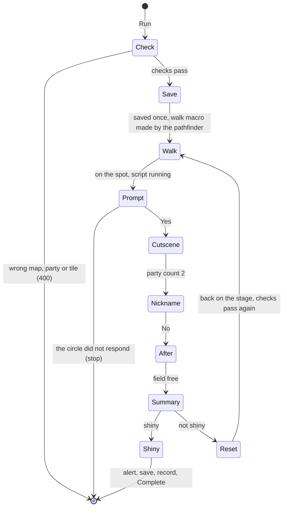

# Spec: HGSS static encounter hunt (Sinjoh Ruins: Dialga, Palkia, Giratina)

Status: In progress on feature/sinjoh-static (owner approved for build, 2026-11-12).
Last updated: 2026-11-12
Owner: Phil
Related: [research: the spike](../research/sinjoh-static.md) (the source for every tile, timing and rule here), [Primo egg hunt spec](primo-egg-hunt.md) (the soft-reset cycle and the shiny ending this reuses), [HGSS state reader spec](hgss-state-reader.md), [pickup mode spec](pickup-mode.md) (the party menu reads), [QA automation](qa-automation.md), [feature workflow](feature-workflow.md), the decision [Hunts act as a human would](../decisions/global.md).

## Summary

One new HGSS action, **HGSS Static Encounter**, with a choice of which one: Dialga, Palkia or Giratina at the Sinjoh Ruins. From a save standing on the Mystri Stage with the event Arceus alone in the party, the bot walks onto the chosen circle, answers Yes, waits through the cutscene, declines the nickname, presses through the dialogue that follows until the field is free, opens the new Pokémon's summary, and reads it there. Not shiny: soft reset and again. Shiny: alert, save, record, done.

The spike ran the whole attempt for each of the three on the owner's save, seven times in all, the last with every press chosen from the script's state, in about 210 s an attempt, with a different personality value each time. The Pokémon is rolled at the hand-over, after the cutscene, at the ordinary 1 in 8,192.

One thing differs from the request: the game needs the party to be **the Arceus alone**, not just an open slot. With a second Pokémon the circles answer "It seems that only a single ARCEUS can stand here...".

## Goals

- G1: one action for static encounters, with the encounter picked from a list; the three Sinjoh targets are the first entries.
- G2: Run refuses, with one sentence, a save that cannot work: wrong map, a party that is not one Arceus, not standing where the walk can start.
- G3: the walk to the spot is made once per run by the navigator's pathfinder and the macro is reused on every attempt.
- G4: the result is seen before it is known: the summary of the new Pokémon is on screen when the party is read (the global decision).
- G5: every press is confirmed by state, every wait is bounded, and a step that goes wrong stops the hunt with what it saw.
- G6: a soft reset always comes back to the same place: the bot saves once at Run, after its checks, so the saved game is the checked game.

## Non-goals

- Getting to the Mystri Stage: the Ruins of Alph event, the walk through the Sinjoh Ruins, Cynthia's first conversation. The operator does that and saves.
- A second gift on the same save. Each kind of Arceus works once; the hunt ends at the first shiny.
- Other static encounters (roamers, Ho-Oh, Lugia, Sudowoodo, the Red Gyarados, and so on). The list is built to take them; none is specified here.
- A battle. This encounter is a gift; statics that are battles will need the battle hunt's read, not the summary.
- RS.
- Several emulators at once. One emulator per bot, as the egg hunts.

## Requirements

| ID | Requirement | Priority | Verified by |
|---|---|---|---|
| FR-1 | Registry entry `HGSS Static Encounter`: required parameters `PhaseName` and `StaticEncounter`, the latter a choice whose values come from the config (FR-10): `Dialga (Sinjoh Ruins)`, `Palkia (Sinjoh Ruins)`, `Giratina (Sinjoh Ruins)`. HGSS only; `OwnsEmulators: false`. | Must | Unit test: listed for an idle HGSS bot with the three choices; absent for RS. |
| FR-2 | Run refuses with a 400 and one sentence, from a fresh read: not on the encounter's map ("Stand on the Mystri Stage in the Sinjoh Ruins."); the field not free; the party not exactly one Pokémon, or that one not an Arceus, or an egg ("The party must be one Arceus and nothing else."); the Arceus neither a fateful encounter nor met at the Hall of Origin in Diamond, Pearl or Platinum ("This Arceus is not the event Arceus or the Hall of Origin one."); the pathfinder finds no walk from the player's tile to the spot ("No path from here to the circle. Stand on the stage in front of the circles."). | Must | Unit tests per refusal; QA `hgss-static-refusals`. |
| FR-3 | After the checks pass, the bot saves once with the `SaveGame` macro and waits for the flush, before the first attempt. From then on every reset returns to the checked state. | Must | QA: the save's play time changes once; the run folder notes that this scenario's SaveRAM differs from its `.bak`. |
| FR-4 | The walk is made by the navigator's pathfinder, once, at Run: `Profile.Pathfinding.Pathfind` from the live map, tile and facing to the encounter's spot on the same map returns the walk macro, and the event keeps that macro for the run. Every attempt replays it; nothing is searched again after a reset, because the reset returns to the saved tile and facing (FR-3) and FR-2's checks after each reset include that the tile and facing are the ones the macro was made from. | Must | Unit test: one `Pathfind` call per run across several attempts; a null macro is FR-2's refusal. QA log: the macro printed once at Run. |
| FR-5 | Running the walk: the cached macro is run and raced against the spot's field script starting (the snapshot leaves `FieldFree` for `FieldTask` with a script), which is the arrival. The macro ending with the field still free and the player on the spot's tile but no script is FR-6's "did not respond"; ending anywhere else is a stop naming the tile. Bounded by a stale-timeout. The pathfinder's map for the stage (bot map 455) has the three spots walkable and gives five-step walks to the side circles and six to the top one from (16, 14); the spike walked the top one and a seven-step variant of the side ones tile by tile (research doc). | Must | Unit test with scripted snapshots; QA log: the walk's time per attempt and the script it ended on. |
| FR-6 | The first prompt: with the spot's script running and its Yes/No menu up, one A (Yes) when the script waits in `MenuChoiceNative`, confirmed by the native changing. The spike's gated attempt did exactly this. If instead the script ends with the field free and the party still one, the spot refused (already received, or this Arceus is used up): stop with "The circle did not respond. This save has already received this Pokémon, or this Arceus has been used." | Must | Unit test; QA. |
| FR-7 | The cutscene: wait for the party count to become 2, pressing A (a 6-frame hold) only when the script waits in `PrintingNative` with the printer at its arrow (once, in the spike). The script shows no native for about 127 s of it; that is the cinematic, not a stall. Bounded by a stale-timeout from the config (default 200 s; the spike measured 131 to 133 s). | Must | QA: the time from Yes to the hand-over is logged. |
| FR-8 | The nickname prompt: with its Yes/No menu up, one B (No) when the script waits in `MenuChoiceNative` with the party count at 2, confirmed by the native changing. | Must | QA. |
| FR-9 | After the hand-over: press through the scripts that follow (Cynthia's lines on a first visit, the warp, the researcher in the Ruins of Alph) with the navigator's script presser until the field is free, on any map. Then open the menu, the party list, slot 2 and its summary, each touch confirmed by the app state (FR-13); with the summary on screen, read party slot 2. It must be the encounter's species; anything else is a stop. | Must | QA: the summary is in the recording before the `[Static]` result line. |
| FR-10 | Config `Configs/Events/StaticEncounter.json`, loaded and validated at Run so a bad file is a 400. Top level: the soft-reset macro, the continue macro, the reset and continue delays, the cutscene stale-timeout. Per encounter: `name`, `species`, `mapId`, `spot` (x, y), the summary route's touch points. The three entries carry the research doc's values: map 522; spots (12, 15), (20, 15), (16, 8). | Must | Unit tests on validation. |
| FR-11 | The result: log the Pokémon as an encounter (`AddEncounterAsync`: game HGSS, the milestone, the game file). Not shiny: the `SoftReset` macro, the reset delay, `ContinueGameWithRandom`, wait for the field; FR-2's checks run again on what loaded, and a failure stops with its sentence. Shiny: `ShinyAlertService.NotifyTargetFoundAsync(…, "received")`, the `SaveGame` macro, `AddCaughtPokemonAsync`, the flush, Complete. | Must | QA `hgss-static-dialga` (not shiny, two attempts), `hgss-static-shiny`. |
| FR-12 | Log lines, prefix `[Static]`: the encounter and the path at Run; per attempt its number, the walk's time, the cutscene's time, the after-dialogue time, and the result with the species, the shiny value and whether shiny; every stop with what was read. | Must | QA parses them. |
| FR-13 | State reader: the snapshot of an open app carries the app's init function (`app + 0x00`), and two address members name the party menu's (0x02078E31) and the summary's (0x02088299), with the address table's comment format (revision-dependent roots, observed). The overlay id cannot tell the two apart: neither is in an overlay. The summary step's touches are confirmed by: party menu with state 1 (the list), state 2 (the context menu), then the summary's init function. | Must | Unit test on the snapshot; QA. |
| FR-14 | Input: no one-frame tap in the field. Presses that the field reads are 6-frame holds; touches are `S.x.y.3` after `W.5`. (One-frame taps were missed in the spike, every time in one loop.) | Must | Review; QA. |
| FR-15 | Guide page `docs/guide/04-hunts/07-static-encounter.md` and its line in the contents: what the save needs (on the Mystri Stage after Cynthia has spoken, the event Arceus alone in the party, standing on the stage in front of the circles), that the bot saves once when it starts, that one attempt takes about three and a half minutes, that each Arceus gives one Pokémon. | Must | Reviewer reads it. |

### Non-functional

| ID | Requirement | Verified by |
|---|---|---|
| NFR-1 | One attempt, reset to result, in under 240 s (the spike: 209 to 214 s). | QA log. |
| NFR-2 | No new package, project or interface. New: the event, its config class and JSON file, the registry entry and its start method, the reader members of FR-13, the guide page. | PR description. |

## Design

### The cycle

### Why save at Run

The checks read the live game; a soft reset returns to the saved game. If the operator walked onto the stage and pressed Run without saving, the first reset would land somewhere else, 210 s in. Saving once after the checks makes the two the same, costs about 25 s once, and is harmless: it is the save the operator was about to make. The checks still run after every reset, so a save that somehow differs stops the hunt with its sentence instead of walking blind.

### The walk: the navigator's pathfinder, once

The pathfinder already knows the stage: `mapreverselookup.json` maps game map 522 to bot map 455 (`D51R0201`), a 32 by 32 grid whose walkable area is the triangular stage, with all three spots walkable. A search over it from (16, 14) reaches Dialga's and Palkia's circles in five steps along row 15 and Giratina's in six up column 16. So the event asks the pathfinder for the macro at Run and keeps it (owner, 2026-11-12); it does not carry its own tile list or search. The following Arceus did not block any step in the spike.

Two things are particular to this walk. The last step lands on a tile that starts a script, so arrival is the script starting, not the macro finishing on a tile. And the macro is only valid from the tile and facing it was made for, which is why the save at Run and the check after every reset matter.

### Why the summary and not the party read alone

The party count tells the bot the Pokémon exists; a player would not yet know its colour, because the cutscene never shows it. Per the global decision the read that is logged is taken with the summary open. Opening the summary takes about 8 s. Before the menu can be opened at all, the game plays about 42 s of scene after the hand-over (Cynthia's closing lines, the warp, the researcher in the Ruins of Alph); pressing faster does not shorten it (42.7 s at one press every 8 frames against 41.4 s at one every 30).

### Where it lives

- `ShinyBotHunter/BotEvents/HgssStaticEncounterEvent.cs` (new): the cycle.
- `ShinyBotHunter/BotEvents/StaticEncounterConfig.cs` (new), `ShinyBotHunter/Configs/Events/StaticEncounter.json` (new).
- `ShinyBotHunter/Games/EventRegistry.cs`, `Service/BotService.cs`, `Service/BotDtos.cs`: the entry, `StartStaticEncounterAsync`, the `StaticEncounter` argument.
- `ShinyBotHunter/Service/Pointers/HgssPointerService.cs`, `Games/Hgss/HgssFieldSystemStateReader.cs`: FR-13.
- The dashboard: nothing beyond what the registry drives, if the choice renders as the existing dropdowns do; the planner confirms.
- `docs/guide/04-hunts/07-static-encounter.md`.

## QA

Saves in `../shinybothunterqasaves/hgss/`: `qa-sinjoh.SaveRAM` (a copy of the owner's `qa-dpptstatic.sav`: Mystri Stage at (16, 14), first visit, one event Arceus). ROM copy `HG-Static`. FR-3's save changes the SaveRAM, so each scenario starts from the `.bak`.

The first run on the emulator is the pathfinder's own macro to each side circle: its route is row 15, which the spike did not walk.

| Scenario | Flow | Passes when |
|---|---|---|
| `hgss-static-refusals` | API Start with the save as is but a second Pokémon written into the party count; and from `hgss.qa-route33` | 400 with the party sentence; 400 with the map sentence |
| `hgss-static-dialga` | Run Dialga, let two attempts finish, cancel | one save at Run; each attempt logs its steps, a hand-over, a summary before the result, a reset; the two personality values differ; each attempt under 240 s |
| `hgss-static-giratina` | Run Giratina, one attempt | the six-step walk; species 487 in form 1 |
| `hgss-static-shiny` | Run Palkia; at the hand-over the scenario rewrites slot 2 with a shiny personality value (the Primo scenario's `rewritePid`) | the summary shows the shiny; one alert; the game saved; the caught record; Complete |

## Suggested task split

| Task | Scope | Depends on | Size |
|---|---|---|---|
| S1 | State reader: the app's init function on the snapshot, the two address members (FR-13) | none | S |
| S2 | Config, registry entry, arguments, `StartStaticEncounterAsync`, the refusals (FR-1, FR-2, FR-10) | none | M |
| S3 | The event: save at Run, the cached walk, the prompts, the cutscene, the after-scripts, the summary, the result (FR-3 to FR-9, FR-11, FR-12, FR-14) | S1, S2 | L; the planner may split the summary step out |
| S4 | QA scenarios and saves, `docs/specs/qa-automation.md` | S1 to S3 | M |
| S5 | Guide page, close-out docs (FR-15) | S3 | S |

## Open questions

None.

## Decided

- The result is read with the summary open; there is no reset at the hand-over. This is the global decision "Hunts act as a human would", not a choice for this spec.
- The bot saves once at Run, after its checks (owner, 2026-11-12).
- The action is `HGSS Static Encounter`, with choices worded `Dialga (Sinjoh Ruins)` (owner, 2026-11-12).
- One emulator; no parallel copies of the save (owner, 2026-11-12).

## Changelog

- 2026-11-12: drafted from the spike.
- 2026-11-12: owner review. Save at Run, the name and one emulator confirmed; the hand-over reset removed as a question (it was never open: the global decision settles it).
- 2026-11-12: the `StaticEncounter` choice is a dropdown (owner, at S2's plan review): the dashboard had no server-driven choice list, so the action's schema gains a choices member and the dashboard renders it (task S2b, #354). This is the dashboard change "Where it lives" left for the planner to confirm.
- 2026-11-12: the run's one `Pathfind` call is made by `StartStaticEncounterAsync`, so a null macro is FR-2's 400; the event is handed the macro with its tile and facing and never searches (S2's plan, #348).
- 2026-11-12: the walk is the navigator's pathfinder, called once at Run and its macro cached (FR-4, FR-5, FR-10; owner). The tile list is gone; the pathfinder's map data was checked to hold the stage and reach all three spots.
