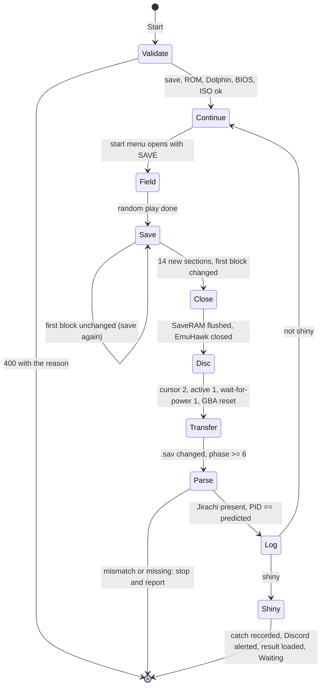

# Spec: Wishmaker Jirachi hunt

Status: Implemented (epic #163, 2026-10-26). FR-1 to FR-20 and NFR-1 to NFR-3 are built, with FR-17 and FR-18 as rewritten on 2026-10-25 (the summary view and the RAM read, W8, #188). `rs-jirachi-setup-refusals` and `rs-jirachi-soak` passed on `feature/wishmaker-jirachi`. `rs-jirachi-shiny` passed on 2026-10-26, so the shiny path is proven end to end. Run folders are under [QA](#qa); divergences are under [What diverged](#what-diverged).
Last updated: 2026-10-26
Owner: Phil
Related: [research: the spike](../research/wishmaker-jirachi.md) (the source for every address, timing and rule here), [decisions](../decisions/wishmaker-jirachi.md), [game profile spec](game-profile.md), [QA automation](qa-automation.md), [feature workflow](feature-workflow.md), plan [phase 7](../plans/2026-10-cleanup-and-hardening.md#phase-7-wishmaker-jirachi-hunt)

## Summary

A new self-managing special event, beside the RS shiny starter hunt, that hunts the Wishmaker Jirachi from the Pokémon Colosseum Bonus Disc. One cycle is: continue the Sapphire or Ruby save in BizHawk, play a random while, save in-game (twice if the first save landed in the second block), flush and close; start Dolphin on the Bonus Disc with that save on the integrated GBA, drive the disc's Jirachi menu from a virtual pad, reboot the GBA when the disc waits for it, and read the Jirachi the disc wrote into the save; log it as an encounter; on a shiny, keep the save, record the catch, alert Discord and stop. The spike proved every step unattended, gated on memory and files only, over a one-hour soak.

The Jirachi is a function of the save: the disc seeds it from the checksum of the save's first block, and the PID is the Gen 3 LCRNG run from that seed. The hunt therefore makes each cycle a real, different encounter by letting the game itself advance the save (play time and the fields that move on every in-game save), never by editing bytes. Every cycle checks the Jirachi it got against the one the save predicts; a mismatch stops the hunt and reports, because it means the pipeline read a different save than it wrote.

## Goals

- G1: the event runs from the dashboard like the starter hunt, with no operator action after Start, no screen reads, no keyboard focus, and no LLM.
- G2: every wait is a memory value or a file change with a stale-timeout that names what it waited for and what it saw.
- G3: a bad setup fails at Start with one plain sentence in the dashboard (wrong ROM, no save, no Pokédex, full party, Dolphin or BIOS missing).
- G4: the Dolphin side is installed and configured by a script from files in the repo, from the same settings the backend reads.
- G5: every cycle is a logged encounter whose PID the save predicts; the shiny path records the catch, alerts Discord and stops.

## Non-goals

- A Dolphin fork or any change to Dolphin. Mainline Dolphin 2609a, driven through its DSU client, its shared memory mapping and its GBA window.
- Crafting the seed (editing play time to hit a shiny seed). The bot only ever plays the game and saves. The QA shiny scenario does craft one save, in QA tooling, to prove the shiny path.
- Keeping emulators alive between cycles. Both restart every cycle; about 155 s per cycle is accepted (the spike measured 152 to 171). Cutting it is a later task if the hunt proves too slow.
- Ruby and Sapphire ROM revisions other than 1.2 (header revision 2), and any save that is not the operator's own.
- More than one Jirachi hunt at a time: one DSU port, one Dolphin, one GBA window. The emulator-count setting does not apply.
- Logging the Jirachi from the save file alone. The result is shown at its summary screen in BizHawk first, as a human would check it, and only then read from BizHawk's RAM and logged (FR-17, owner's rule of 2026-10-25). The save file still predicts the result (FR-17's check) and keeps it (FR-11b).

## Requirements

| ID | Requirement | Priority | Acceptance |
|---|---|---|---|
| FR-1 | `ApplicationSettings` gains `DolphinBaseDirectory` (the folder holding `Dolphin.exe`), `GbaBiosPath` (the GBA BIOS file) and `ColosseumBonusDiscPath` (the ISO). `appsettings.json` carries placeholders like the BizHawk keys; real paths live in user secrets. | Must | Settings test: the three keys bind; `Scripts/deploy-dolphin.ps1` reads them (FR-2). |
| FR-2 | A top-level `Dolphin/` folder holds the Dolphin config the bot needs as files (`Config/Dolphin.ini`, `Config/DSUClient.ini`, `Config/GCPadNew.ini`), and `Scripts/deploy-dolphin.ps1` installs them into a Dolphin user folder the bot owns, `{DolphinBaseDirectory}\User-ShinyBotHunter`, substituting the BIOS path. The bot always launches Dolphin with `-u` on that folder, so the operator's own Dolphin settings are never touched. | Must | Running the script on a clean folder produces the three files; `Dolphin.exe -u <folder> -e <iso>` then boots the disc with the integrated GBA on port 2 and the DSU pad on GCPad1 (QA: `rs-jirachi-soak`). |
| FR-3 | Registry entry `Wishmaker Jirachi Hunt`: parameters `GameName` (required), `PhaseName` (required); `OwnsEmulators: true`; requires a new capability `HasWishmakerJirachi`, true for RS only. | Must | `GameProfileTests` asserts the RS profile has it and HGSS does not; `GetTopLevelOptions` lists the entry. |
| FR-4 | The `GameName` choices for this event are only ROMs with flavor RS and `RevisionSupport == Tested` (header revision 2), and the backend refuses any other handle at Start with a 400 naming the ROM and its revision. The dashboard filters the dropdown from a filter the registry entry carries (`EventArgumentOptions.GameFilter`: flavor and tested-only), so the rule lives in one place. | Must | Unit test on the filter; dashboard test on the dropdown; QA: a rev 0 ROM in the folder is absent from the list. |
| FR-5 | At Start, before any emulator launches, the event reads `{BizHawk}\GBA\SaveRAM\{GameName}.SaveRAM` and refuses with a 400 when: the file is missing or shorter than 131072 bytes; the live block (higher section-0 counter) is incomplete (not all 14 sections valid); the Pokédex flag (`FLAG_SYS_POKEDEX_GET`, flag `0x801`, in `SaveBlock1.flags` at `0x1220`, so section 2 offset `0x3A0` bit 1) is clear; the party count (`SaveBlock1` offset `0x234`, section 1) is 6; `Dolphin.exe`, the BIOS or the ISO is missing. The message says which, in one sentence the dashboard shows as it shows other 400s. | Must | Unit tests over crafted saves for each refusal (section walk, flag, party count); QA: Start on the rev 2 ROM with no save shows the message. |
| FR-6 | `Gen3SaveFile` grows the section walk the hunt needs: every section's id, counter, stored and computed checksum; the live block; the first-block section-0 checksum (the Wishmaker seed); the play time; the Pokédex flag and party count; "every section of a block carries counter above N with a valid checksum" (save completion). Pure functions over a byte span, no I/O beyond the existing file reader. | Must | Unit tests on the spike's saves: seed `0A64` for the rev 0 base, `ECDD` for the crafted shiny save, completion false for the truncated save (8 of 14). |
| FR-7 | An RS `ContinueGame` macro (`Macro/Configs/RS/continue_game.yaml`): the deterministic twin of `ContinueGameWithRandom`, the same presses with fixed waits and no `W.R[0,2000]`. `Launch Bot + Continue` works for RS through it, as it does for HGSS. | Must | `MacroTests` lists it; QA: `Launch Bot + Continue` on the rev 2 ROM reaches the field. |
| FR-8 | Reaching the field is confirmed, not assumed: after the continue macro the event opens the start menu and reads it through `RsStartMenuService` (count 1 to 10, SAVE id present), closes it with B, and retries A plus the check up to a bounded count; it never presses B at the CONTINUE menu. | Must | QA: `rs-jirachi-soak` log shows "in the field" on every cycle. |
| FR-9 | The in-game save: close any text box (B twice), open the start menu and confirm it is live by a cursor probe (the menu bytes keep their last values after the menu closes, so one Down, or Up on the last entry, must move the cursor byte within 1 s; up to 12 Start presses, held presses with the spike's waits between them), step to SAVE by its id through `RsStartMenuService`, run the RS `SaveGame` macro, then POST `/flush` once a second and read the SaveRAM until every section of a block carries a counter above the previous maximum with a valid checksum (FR-6); dismiss "saved the game" with A. Then, if the first block's counter did not increase, do it again. Timeout 40 s per save, then stop and report. | Must | Unit test for the "save again" rule; QA: every soak cycle's save has 14 new sections and the first block's counter rises by one or two per cycle. |
| FR-10 | Random play: a uniform wait of `MinPlayMs` to `MaxPlayMs` (config, default 2000 to 20000) in the field before saving. | Must | Config validation test (min < max, both positive). |
| FR-11 | After the saves, `/flush`, then close EmuHawk the way the launcher does (`CloseMainWindow`, then kill after the timeout). The resulting SaveRAM, `{GameName}.SaveRAM`, is the hunt's save: the operator's own file, continued and saved over in place every cycle, never replaced by anything Dolphin wrote. A one-time copy, `{GameName}.SaveRAM.wishmaker.bak`, is taken before the first cycle (not `.SaveRAM.bak`, which BizHawk writes and restores itself). | Must | QA: the SaveRAM's play time and counters grow across the soak; the `.bak` is unchanged. |
| FR-11b | Two files carry the Wishmaker suffix, named after the Jirachi's OT: `{GameName}-WISHMKR.gba` in the ROM folder, a copy of the hunt's ROM made at Start if missing (as `CreateSaveEvent` copies ROMs), and `{GameName}-WISHMKR.SaveRAM` in the SaveRAM folder, which every cycle overwrites with the save Dolphin returned. The fork names SaveRAM after the ROM file, so EmuHawk on the suffixed ROM opens the result and never the hunt save. The result step (FR-17) launches EmuHawk on the suffixed ROM, so it shows and reads the suffixed SaveRAM. | Must | Unit test of the two paths; QA: after a soak cycle the suffixed SaveRAM holds Jirachi in slot 1 and the hunt save holds none. |
| FR-12 | `DolphinLauncher` (`Emulators/Dolphin/`): copies the hunt's SaveRAM to `{user folder}\GBA\Saves\{rom}-2.sav` (a copy; Dolphin names the port-2 GBA save after the ROM file with a `-2` suffix; the mGBA footer round-trips), starts `Dolphin.exe -u <folder> -e <iso> -C Dolphin.GBA.Rom2=<rom> -C Dolphin.GBA.SavesPath=<folder>\GBA\Saves` (`-C` takes the GBA keys on 2609a and does not persist them, so nothing rewrites `Dolphin.ini`), waits for the shared memory mapping `dolphin-emu.<pid>` to open and the game id `PC6E01` to read at `0x80000000`, and stops Dolphin by process. | Must | QA: `rs-jirachi-soak`. |
| FR-13 | `DolphinMemory` (`Emulators/Dolphin/`): `MemoryMappedFile.OpenExisting("dolphin-emu." + pid)` and a read accessor over MEM1 (24 MiB, big-endian, `0x80000000` at offset 0); `ReadByte(addr)`, `ReadBytes(addr, n)`. | Must | Unit test against a fake mapping; QA: the game id reads. |
| FR-14 | `DolphinPad` (`Emulators/Dolphin/`): a cemuhook (DSU) server on UDP 26760 that answers version and port-info requests, streams an 84-byte pad frame every 4 ms to every requester seen in the last 5 s, ignores ICMP resets, and exposes `Press(button, holdMs)`. Buttons used: `Cross` (A), `Pad E` (D-pad Right). | Must | Unit tests for the frame layout and CRC (header `DSUS`, protocol 1001, CRC32 over the packet with the field zeroed); QA: Dolphin subscribes within 2 s of launch. |
| FR-15 | The disc is driven as a state machine on four MEM1 bytes, with no screen read: `0x80D0ED38` menu cursor (0 movie, 1 Colosseum, 2 Jirachi); `0x800C662D` gift flow active; `0x800C6631` gift phase (logged only); `0x800C7D63` waiting for GBA power. Steps: Right every 1 s until cursor is 2 and active is 0 (max `DiscMenuTimeoutMs` / 1 s, 60); A every 2 s until active is 1 (max `DiscMenuTimeoutMs` / 2 s, 30); A every 1.5 s until wait-for-power is 1 (max `DiscPromptTimeoutMs` / 1.5 s, 40); reset the GBA (FR-16); wait until the GBA save file's mtime changes and phase is at least 6 (max 90 s); then 2 s and parse. Each loop's exhaustion stops the hunt and reports the bytes it saw. Addresses live in one commented table in `Emulators/Dolphin/BonusDisc.cs`, FR-9 style (symbol or origin, proving scenario). | Must | Unit test of the state machine over a scripted memory; QA: `rs-jirachi-soak` reaches "power prompt" on every cycle. |
| FR-16 | The GBA reset needs no focus and no coordinates: find Dolphin's `GBA2` window by title, post `WM_CONTEXTMENU` to it, find the Qt popup window that appears for Dolphin's process, and post `WM_KEYDOWN`/`WM_KEYUP` for Down four times, then only `WM_KEYDOWN` for Return, to the popup (menu order: Connected, Load ROM, Unload ROM, a disabled e-Reader entry that keyboard navigation skips, Reset). Return gets no key-up because Qt runs Reset on the key-down and closes the popup; a failed `PostMessage` throws. Success is observed, not assumed: the wait-for-power byte must clear and the save file must change within the FR-15 wait, else stop and report. | Must | QA: every soak cycle; the research doc records this as the posted-message variant, with UI Automation by item name as the fallback if the order ever changes. |
| FR-17 | The result, checked as a human would: copy the GBA save Dolphin rewrote to `{GameName}-WISHMKR.SaveRAM` (FR-11b); launch EmuHawk on `{GameName}-WISHMKR.gba`, continue the game (the RS `ContinueMacro` and the FR-8 field check), open the start menu, step to POKéMON by its action id (1; SAVE is 5) through `RsStartMenuService`, select the Jirachi's slot (the last party member) and SUMMARY, and hold the summary screen on view for a short display time so the operator sees the Jirachi and whether it is shiny. Only then read that party slot from BizHawk's RAM (`gPlayerParty`, through the existing `PokemonStateReader` and `Gen3PokemonParser`): Jirachi must be in the party; compute the predicted PID from the pre-disc save's first-block seed (two LCRNG steps: `s = s * 0x41C64E6D + 0x6073`, high halves form the PID) and compare; a mismatch stops the hunt with both values in the message. Log one encounter (`AddEncounterAsync`: Game RS, Milestone PhaseName, GameFileName GameName, the PID, IVs, nature and shiny flag read from RAM). Not shiny: close the menus with B, close EmuHawk the way the launcher does, and continue. The start menu is confirmed by its bytes as in FR-9; the party and summary screens have no mapped RS byte, so those presses use the spike-style held presses with waits, and the RAM read is the gate: a slot that does not decode as Jirachi after the presses stops the hunt and reports. Decided by the owner on 2026-10-25, replacing the file-only read. | Must | Unit test of the LCRNG rule on the spike's nine seed/PID pairs; QA: every soak row's PID equals the prediction logged beside it, and the recorded cycle video shows the summary screen before the log line. |
| FR-18 | On a shiny: the suffixed SaveRAM already holds the result and is not overwritten again (the hunt's own save stays as it was), `AddCaughtPokemonAsync` with `GameFileName` `{GameName}-WISHMKR`, `ShinyAlertService.NotifyTargetFoundAsync` (the gold embed in the shiny channel), leave the EmuHawk of FR-17 open at the Jirachi's summary screen so the operator sees it, push `Waiting`, and stop cycling. The dashboard shows the event stopped with the shiny, as the starter hunt parks one. | Must | QA: `rs-jirachi-shiny`. |
| FR-19 | Cancel from the dashboard stops at the next step boundary and kills both emulators; no cycle leaves a half-written hunt save (the SaveRAM is only replaced by a complete save per FR-9). | Must | QA: cancel during the Dolphin half; the SaveRAM is still the last complete save. |
| FR-20 | Config `Configs/Events/WishmakerJirachi.json` (loaded like `RsStarterHunt.json`): `ContinueMacro`, `SaveMacro`, `SaveMenuActionId`, `MinPlayMs`, `MaxPlayMs`, `LaunchReadyTimeoutMs`, `SaveTimeoutMs`, `DiscMenuTimeoutMs`, `DiscPromptTimeoutMs`, `TransferTimeoutMs`, `DsuPort`. Validated at load. | Must | Config validation tests. |
| NFR-1 | A cycle completes in under 300 s on the dev PC (soak mean 181 s before the FR-17 summary view, which adds about 40 s); a cycle over the limit is logged, not fatal. | Should | QA soak timings. |
| NFR-2 | A one-hour unattended soak completes every cycle with no stall, every PID matching its prediction and no repeated seed. | Must | QA: `rs-jirachi-soak`. |
| NFR-3 | No `SendInput`, no screenshot, no pixel read, no window focus call anywhere in the feature. | Must | Reviewer grep: `SendInput`, `GetPixel`, `SetForegroundWindow`, `CopyFromScreen` absent from the feature's files. |

## Design

### Where it lives

| Piece | Location | Notes |
|---|---|---|
| Event | `BotEvents/WishmakerJirachiEvent.cs`, `WishmakerJirachiConfig.cs` | `AbstractBotEvent`, self-managing like `StarterHuntEvent`; one emulator slot; `Configs/Events/WishmakerJirachi.json`. |
| Save logic | `Service/Gen3SaveFile.cs` (grown per FR-6) | Pure; the validation and the seed are here, tested on real saves. |
| Dolphin | `Emulators/Dolphin/DolphinLauncher.cs`, `DolphinMemory.cs`, `DolphinPad.cs`, `DolphinGbaWindow.cs` | Four classes, one job each. No interface: `DolphinLauncher` is a plain class the event owns, not an `ILauncher`, because `RepositionAsync` and `GameFileName` would be stubs. |
| Disc addresses | `Emulators/Dolphin/BonusDisc.cs` | The four bytes, each with origin and proving scenario, per the game profile's comment rule, plus `DriveGiftAsync`, the drive loop over them (FR-15). |
| Registry | `Games/EventRegistry.cs`, `Games/GameCapabilities.cs`, `Games/Rs/RsProfile.cs`, `Service/BotDtos.cs` | New entry and capability; `EventArgumentOptions.GameFilter` (in `BotDtos.cs`). |
| Dashboard | `types/api.ts`, `admin/actionSchema.ts`, `admin/TopLevelActionForm.tsx` | Filter the `GameName` options by the entry's `GameFilter`. No new component. |
| Macro | `Macro/Configs/RS/continue_game.yaml` | FR-7. |
| Settings | `ApplicationSettings.cs`, `appsettings.json` | FR-1. |
| Dolphin config | `Dolphin/Config/*.ini`, `Scripts/deploy-dolphin.ps1` | FR-2; the script follows `deploy-apihawk.ps1`'s conventions (header, `param()`, stop on error). |
| QA | `ShinyBotHunter.Qa/dashboard/rs-jirachi-setup-refusals.spec.ts`, `rs-jirachi-soak.spec.ts`, `rs-jirachi-shiny.spec.ts`, `jirachi-seed.ts`; the cheat's README in `ShinyBotHunter.Qa/Cheats/rs-sapphire-usa-rev2/` | See [QA](#qa). |

### The cycle

Every arrow out of a wait has a timeout from the config; an exhausted timeout ends the event with a message naming the state and the last values read. Cancellation is checked at every arrow.

### Dolphin configuration the script installs

`Dolphin.ini`: `[Core] SIDevice0 = 6` (standard pad), `SIDevice1 = 13` (integrated GBA, port 2); `[GBA] BIOS = <GbaBiosPath>`, `SavesInRomPath = False`, `Threads = True`; `[Input] BackgroundInput = True`; `[Interface] ConfirmStop = False`; `[Analytics] Enabled = False`, `PermissionAsked = True` (no usage statistics dialog). `DSUClient.ini`: `[Server] Enabled = True`, `Entries = DSU1:127.0.0.1:26760;` (this build's key is `Entries`). `GCPadNew.ini`: `[GCPad1] Device = DSUClient/0/DSU1`, A `Cross`, B `Circle`, Start `Options`, D-Pad `Pad N/S/E/W`, Main Stick `Left X-/X+/Y-/Y+`. The ROM and saves path are per launch (FR-12).

### What stays in the spike's write-up, not here

The pointer discovery method (snapshot diff), the checksum arithmetic, the seed band and the odds, the Dolphin and mGBA save-file facts, and the alternatives that were tried and rejected (hotkeys, keyboard focus, PrintWindow, pixels) are in the [research doc](../research/wishmaker-jirachi.md). This spec states what the bot does; that doc states why.

## QA

QA runs on the final feature branch, programmatically through the Electron UI with the existing Playwright driver, one emulator run at a time.

| Scenario | What it does | Asserts |
|---|---|---|
| `rs-jirachi-setup-refusals` | Starts the event from the UI on: a rev 0 ROM (absent from the dropdown); the rev 2 ROM with no SaveRAM; a save with a full party (QA-made); a save with no Pokédex (the original `Pokemon Sapphire8.SaveRAM`). | Each shows the FR-5 sentence in the dashboard and launches nothing. |
| `rs-jirachi-soak` | Loads `rs.qa-jirachi`, starts `Wishmaker Jirachi Hunt` on `PhaseName` "Jirachi" from the UI, waits one hour, cancels during the Dolphin half (FR-19). | At least 20 `encounters` rows with species Jirachi for the phase (psql, as the QA spec's `assert-latest-encounter` step), all PIDs distinct, every backend log line "predicted … got …" equal, no cycle over 300 s, the SaveRAM's first-block counter advanced by cycles × 2 or so, no emulator left running after cancel. |
| `rs-jirachi-shiny` | `jirachi-seed.ts` crafts a copy of `rs.qa-jirachi` whose live-block section-0 checksum is `ECDD` (play time and the berry-tree stamp; checksum recomputed) and writes the matching QA cheat that freezes those bytes in RAM; installs both, starts the event (REST or UI). | One cycle, for real: the `encounters` row is Jirachi PID `987ED636` shiny; a `CaughtPokemon` document for it in Mongo; the Discord shiny channel's latest message (Discord REST with the QA token) is the Jirachi alert; the event is in Waiting; `{GameName}-WISHMKR.SaveRAM` holds Jirachi in slot 2 and `{GameName}.SaveRAM` holds none; EmuHawk is open on `{GameName}-WISHMKR.gba` at the summary; no Dolphin. The cheat is removed afterwards. |

Saves (added to the QA save table): `rs.qa-jirachi` = Sapphire rev 2, trainer Phil (TID 39541), Pokédex, one party member, play time 0:33:25 in its live section 0 (the spike's final base); `rs.qa-jirachi-full` = the same with six party members (PKHeX); `rs.qa-jirachi-nodex` = `Pokemon Sapphire8.SaveRAM` as the operator made it.

Results (run folders on the dev PC under `ShinyBotHunter.Qa/dashboard/qa-runs/`, not committed):
- `rs-jirachi-setup-refusals` passed 2026-10-25 13:34 UTC (`20261025-133415-rs-jirachi-setup-refusals`): the dropdown listed only the rev 2 ROM, and the no-save, full-party and no-Pokédex saves each showed their FR-5 sentence.
- `rs-jirachi-soak` run 1, on tip 2938f4e, failed after 2 minutes in the second in-game save: the stale start-menu bytes passed the menu check (fixed by W5e, #184).
- `rs-jirachi-soak` run 2, on tip 569588f, passed 2026-10-25 14:03 to 15:07 UTC (`20261025-140333-rs-jirachi-soak`): 20 Jirachi rows with 20 distinct PIDs, every "predicted … got …" line equal; cycle gaps 172 to 188 s (mean 181 s); first-block counter 82 to 124 (two saves a cycle); the `.wishmaker.bak` unchanged; the cancel during the Dolphin half left no EmuHawk or Dolphin running, and the hunt save was byte-identical to its snapshot on the Jirachi entry, complete, with the last logged seed (FR-19).
- `rs-jirachi-soak` after W8, on tip 40c1a13, run at five cycles by the owner's choice, passed 2026-10-26 08:41 to 09:02 UTC (`20261026-084126-rs-jirachi-soak5-recorded`): 5 Jirachi rows with 5 distinct PIDs, every "predicted … got …" line equal, every cycle logged "summary on view"; cycle gaps 211 to 227 s, under NFR-1's 300 s; first-block counter 82 to 94; the cancel during the Dolphin half left nothing running and the hunt save intact. The first two cycles were screen-recorded ad hoc (`jirachi-two-cycles.mp4` in the run folder); the scenario itself records nothing.
- `rs-jirachi-shiny` (#189), on tip 5f22950, passed 2026-10-26 09:03 to 09:07 UTC (`20261026-090332-rs-jirachi-shiny`), over REST.
  - The crafted `qa-jirachi` (play time 43:59:19, frames 59) and the generated System Bus cheat held `gSaveBlock2` (`0x02024EA4`).
  - The first cycle logged `Seed ECDD predicts PID 987ED636`, then the Dolphin half, `summary on view` and `predicted 987ED636 got 987ED636 SHINY`, and parked in Waiting.
  - EmuHawk was on `-WISHMKR.gba` at the summary, with no Dolphin. The result save had Jirachi `987ED636` (OT 20043/0) in slot 2, and the hunt save had one party member and first-block seed `ECDD`.
  - One shiny `CaughtPokemon` (species 385, `GameFileName` `{GameName}-WISHMKR`) was written, the Discord alert "Shiny Jirachi encountered!" was sent after the Start, and there was one shiny `encounters` row.
  - Cancel left nothing running, the cheat was removed, and the pristine save was restored.
  - Two earlier attempts were harness faults, not product faults. Run 1 failed on a mongosh warning before launch. Run 2 reached the park but read Mongo before the queued insert landed.

## Suggested task split

Disjoint file lists; W1 to W4 can run in parallel, W5 after them, W6 and W7 last.

| Task | Scope | Files |
|---|---|---|
| W1 | FR-1, FR-2: settings, `Dolphin/Config`, `Scripts/deploy-dolphin.ps1` | `ApplicationSettings.cs`, `appsettings.json`, `Dolphin/**`, `Scripts/deploy-dolphin.ps1` |
| W2 | FR-6: `Gen3SaveFile` section walk, seed, flag, party count, completion, slot bytes; tests on the spike's saves | `Service/Gen3SaveFile.cs`, tests |
| W3 | FR-7, FR-8: RS `ContinueGame`; `Launch Bot + Continue` for RS. The macro predated the epic (b2d59d6), so W3 closed with no change; FR-8 moved to W5 and FR-7's QA is every soak cycle | `Macro/Configs/RS/continue_game.yaml`, `MacroTests` |
| W4 | FR-12 to FR-16: the four Dolphin classes and the address table, with unit tests over fakes | `Emulators/Dolphin/**`, tests |
| W5 | FR-3, FR-4, FR-5, FR-9 to FR-11, FR-17 to FR-20: the event, config, registry entry, capability, `GameFilter`, dashboard filter | `BotEvents/WishmakerJirachi*.cs`, `Configs/Events/WishmakerJirachi.json`, `Games/*`, `Games/Rs/RsProfile.cs`, `Service/BotService.cs`, `types/api.ts`, `admin/actionSchema.ts`, `admin/TopLevelActionForm.tsx`, tests |
| W6 | QA: the three scenarios, `jirachi-seed.ts`, the saves and their README rows. Split into W6a (#181: refusals, soak, saves) and W6b (#189: the shiny scenario) | `ShinyBotHunter.Qa/dashboard/rs-jirachi-*.spec.ts`, `jirachi-seed.ts`, `docs/specs/qa-automation.md` |
| W7 | Close-out: architecture section, this spec's status, the plan's implementation notes | `docs/**` |

QA runs once, on the feature branch, after W6 (owner's decision 2026-10-25); W4 and W5 may run the soak scenario early at the orchestrator's discretion, one emulator run at a time.

## What diverged

Where the build differs from this spec as first written (2026-10-25). The statements above are corrected in place; this list keeps the record.

- W3, FR-7, FR-8: the RS `ContinueGame` macro was already on `main` (b2d59d6), so W3 (#166) closed with no change; FR-8 moved to W5 (#177), and FR-7's QA is every soak cycle.
- FR-2: `Dolphin.ini` also carries `[Analytics] PermissionAsked = True`, which suppresses the usage statistics dialog (W1b, #175). The deploy script refuses to run while Dolphin runs, and builds the `Dolphin.exe` path without `Join-Path` (#172).
- FR-6: `SectionOffset` finds a section by its footer id and signature. Two spike saves, `rs-rev0-base.SaveRAM` and `rs-seed-ecdd.sav`, are unit fixtures in `ShinyBotHunter.Tests/Saves/`, read through `RepoPaths.Root` (#171; [decision](../decisions/wishmaker-jirachi.md#two-spike-saves-are-unit-test-fixtures-in-the-repo)).
- FR-8: the EmuHawk ready wait (an anchor read that answers) has no settle delay after it; the bounded A-plus-check retry (10 checks) covers a continue macro that runs early (#177).
- FR-9: "the first block's counter increased" compares the highest section counter in the block at `0x0000` before and after the save (#177). The start menu is confirmed live by a cursor probe, with the spike's held presses and waits, because the menu bytes keep their last values after the menu closes and a Start press the game ate passed the plain check; that bug stopped the first soak run in the second save (W5e, #184).
- FR-11: the one-time backup is `{GameName}.SaveRAM.wishmaker.bak`, because BizHawk writes and restores `{name}.SaveRAM.bak` itself (#177).
- FR-12: `-C Dolphin.GBA.Rom2` and `-C Dolphin.GBA.SavesPath` work on 2609a and are not persisted; the `Dolphin.ini` rewrite was not built. `DolphinLauncher` is not an `ILauncher`, and its dispose kills a second time when Dolphin has not exited 10 s after the first kill, as seen on the dev PC (#173).
- FR-14: the pad frame carries a u64 microsecond timestamp, and the port-info reply is the fixed bytes of one connected full-gyro pad (#173).
- FR-15: the address table and the drive loop are `Emulators/Dolphin/BonusDisc.cs` (`DriveGiftAsync`), not a file in the event's folder. The press caps come from the config budgets: Right 60 and prompt 40 as written, Play 30 (`DiscMenuTimeoutMs` / 2 s), not 10 (#173, #177).
- FR-16: Down gets `WM_KEYDOWN` and `WM_KEYUP` four times and Return only `WM_KEYDOWN`, because Qt runs Reset on the key-down and closes the popup (a key-up then failed with error 1400). A failed `PostMessage` throws (#173).
- FR-19: `Bot.DisposeAsync` logs a failed final flush and still disposes the launcher (W5d, #179). This applies to every event.
- QA: the soak counts rows with psql, `rs.qa-jirachi` has no `.bak`, and the scenarios find the saves folder through `git rev-parse --git-common-dir`, so they run from a worktree (#181).
- W8, FR-17, FR-18, NFR-1 (#188, #190): the result is no longer parsed from the file. Each cycle launches EmuHawk on `{GameName}-WISHMKR.gba`, reaches the field, opens POKéMON (action id 1) from the live start menu, presses Down to the last slot, opens SUMMARY, logs `summary on view` and holds it 3 s, then reads the party from RAM. The press shapes were found live on a result save (A, Down, A, A with waits of 2000, 500, 1000 and 2000 ms), and closing back to the field takes four B presses, not three. `Gen3SaveFile.ReadPartySlot` was deleted with the file parse. The cycle budget is 300 s; the five-cycle soak's gaps were 211 to 227 s.
- W6b, QA (#189, #193): `rs-jirachi-shiny` runs one real cycle over REST on a save `jirachi-seed.ts` crafts to seed `ECDD`, with a generated QA cheat that freezes the moving section-0 fields of `gSaveBlock2` so the bot's own saves keep the seed. It polls Mongo for the `CaughtPokemon` document for up to 60 s, because the backend queues the insert.

## Open questions

- Resolved by the owner (2026-10-26): `rs-jirachi-shiny` runs the real cycle on a crafted copy of `rs.qa-jirachi` and keeps the crafted seed through the bot's own in-game saves with a QA-only BizHawk cheat. Across the soak's 42 saves only six bytes of section 0 moved: play time minutes, seconds and frames (`0x10` to `0x12`) and the berry-tree RTC stamp (`0xA2` to `0xA4`); the cheat freezes those fields (plus hours `0x0E` and the stamp's day `0xA0`) in `gSaveBlock2` at their crafted values, so the game writes a section 0 whose checksum stays `ECDD` and the disc returns the shiny Jirachi `987ED636` for real. The cheat lives under `ShinyBotHunter.Qa/Cheats/` and is installed enabled for the run only; the bot is unchanged. The scenario may drive the backend's REST directly instead of the Electron UI. It asserts the stop on the shiny: the encounter row, the Mongo `CaughtPokemon` document, the Discord alert, the event in `Waiting`, EmuHawk parked at the summary and no Dolphin. Earlier options considered: pin play time at its maximum, or change the acceptance; both dropped.

- Resolved by assumption: the ISO location is a third settings key rather than a file in `ROMBaseDirectory`, because `RomInfoService` lists only GBA and DS ROMs and the disc is not a game to hunt. Change to a fixed name under the ROM folder if a third key is unwanted.
- Resolved by assumption: the GBA reset uses posted key messages (proven in the spike with another application in the foreground); UI Automation by item name is the fallback, recorded in the decisions file, and would need the WindowsDesktop framework reference or COM interop.
- Resolved by the owner (2026-10-25): the hunt save is the operator's own file in BizHawk's SaveRAM folder, continued and saved over in place with a one-time `.bak`; Dolphin only ever gets a copy; the result lives under the `-WISHMKR` suffix with its own ROM copy. The starter hunt's copy-per-wave machinery is not reused because there is one save and one emulator.

## Changelog

- 2026-10-26 (later): close-out after W8 and W6b (W9, #192): FR-6 without the party slot bytes, the QA saves' play time, What diverged and the QA results for the post-W8 soak and the shiny run.
- 2026-10-26: the shiny route resolved (QA cheat freeze of the six moving section-0 bytes; REST allowed); W6b.
- 2026-10-25 (later): owner's rule: the Jirachi is shown at its summary screen in BizHawk and read from RAM before it is logged (FR-17, FR-18, NFR-1 rewritten; non-goal replaced; task W8).

- 2026-10-25: first version, from the spike of 2026-10-24 to 25.
- 2026-10-25: implemented (epic #163); statements corrected to what was built, What diverged, QA results, and the shiny route as an open question.
